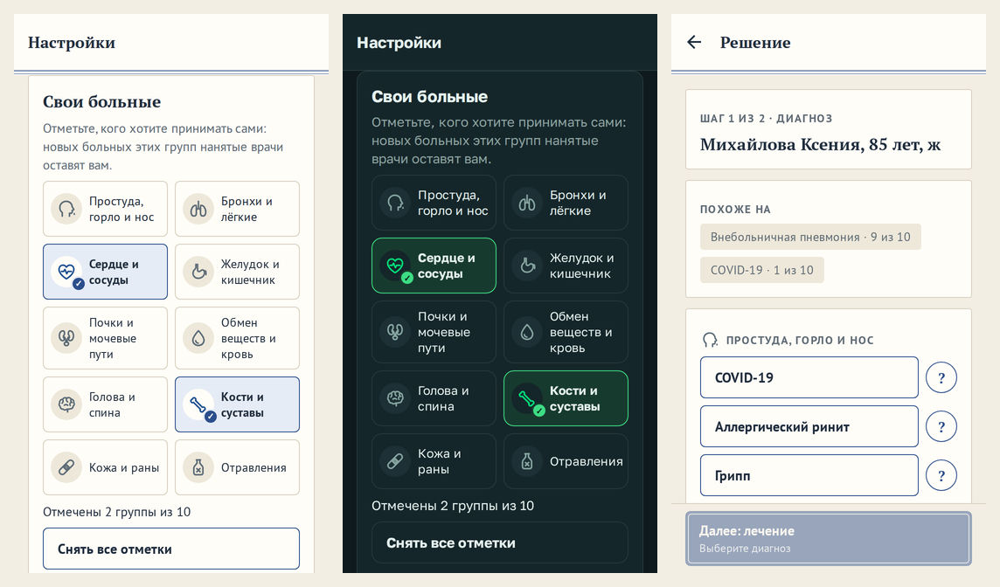
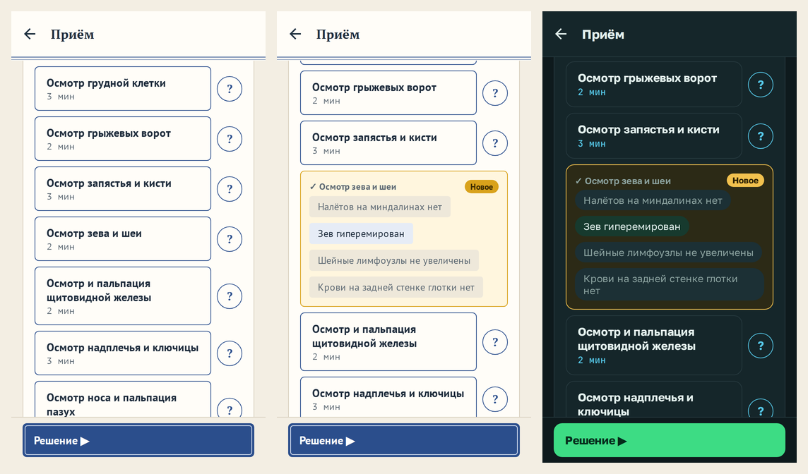

# Ответ на виду

**Версия:** 0.5.20 **Состояние:** сделано, ждёт проверки на телефоне

## Зачем

Отзыв владельца 16.10.2026, по проверке на телефоне:

- «При нажатии на кнопку Осмотр зева и шеи или любую другую всё ещё не центруется на экране „Новое“, приходится
  проматывать, чтобы посмотреть результат».
- «Нужно проработать дизайн и сделать красивым. Например, кнопки „Свои больные“ — Простуда, горло и нос — нужно подумать
  как над расположением кнопок, так и над иконками: это важная часть игры, и игроку должно быть понятно, удобно и
  красиво отмечать эту важную часть».

Новый вид всей карты пациента — отдельная работа, релиз 0.6.0: [`2026-10-patient-card.md`](2026-10-patient-card.md),
вопрос 43 ([#139](https://github.com/Nefeste/anamnez/issues/139)). Здесь — то, что от выбора вида не зависит: в новой
карте ответ так же встаёт посередине, а «Свои больные» остаются в «Настройках».

## Что увидит игрок

- **Ответ на виду.** Нажали обследование или вопрос — строка с ответом встаёт посередине экрана, с отметкой «Новое».
  После «Подождать» — так же, к первому новому в «Известно». Начали листать сами — карта больше не двигает экран.
- **«Свои больные»** — своей карточкой в «Настройках», после «Смены»: десять групп плитками в два ряда, у каждой —
  значок и название целиком. Отмеченная — рамкой цвета главной кнопки и галочкой на значке: цвет один различают не все.
  Под плитками — сколько отмечено, например «Отмечены 2 группы из 10», и «Снять все отметки».
- **Значки групп** — те же у групп в выборе диагноза: голова с каплей у носа — «Простуда, горло и нос», лёгкие, сердце с
  зубцом кардиограммы, желудок, почки, капля крови — «Обмен веществ и кровь», мозг — «Голова и спина», кость, пластырь —
  «Кожа и раны», склянка с крестом — «Отравления».

## Как сделано

- **Почему уезжало.** Ответ появлялся сразу в двух местах: на месте нажатой строки и наверху, в «Известно». «Известно»,
  «Похоже на» и ряд гипотез выше списка вырастали, и всё под ними уезжало вниз. Браузер держит место прокрутки сам
  (`overflow-anchor`), поэтому в веб-сборке строка оставалась на месте. Прокрутка Android места не держит, и на
  телефоне строка уходила из-под пальца.
- **Прокрутка снаружи.** `Screen` (`src/ui/components.tsx`) отдаёт `scrollRef` с одной командой — `center(y, height)`:
  место листа встаёт посередине видимой части, а выше видимой высоты — к верху. `onDrag` — игрок начал листать сам.
- **Карта пациента** (`src/ui/case/PatientCard.tsx`) запоминает по `onLayout`, где лежат карточки «Известно» и списка
  действий от начала прокрутки и где лежат строки внутри них. После действия она ждёт, пока раскладка уляжется: 40 мс
  после последнего изменения, в окне 0,9 с. После «Подождать» окно — 8 с, потому что часы доживают ожидание в
  следующих кадрах (0.5.13). Своё листание игрока окно сразу закрывает.
- **Значки** — рисунок кодом, без чужих наборов, как план больницы и портреты (ADR 0017, «картинки — плоско и кодом»).
  Контуры — строки SVG в сетке 24 × 24 (`src/ui/iconShapes.ts`); на телефоне их рисует Skia (`src/ui/Icon.tsx`), на
  вебе — картинка SVG из тех же строк. Холсту Skia в браузере нужен WebGL, а их у браузера немного; холст, который
  отдаёт WebGL после рисунка, на скрытом экране стека перерисовывался в нулевой размер с ошибкой в консоли — её поймал
  сценарий в браузере.
- **Плитки** — `SystemTiles` (`src/ui/SystemTiles.tsx`): флажок для чтения с экрана (`aria-checked`), порядок — как в
  выборе диагноза, а не как отмечали. Две плитки в ряд при любой ширине; название — в две строки, при крупном шрифте —
  в три.

## Проверки

- `icons.test.ts` (новый): у каждой группы выбора диагноза — свой значок, лишних нет; контуры — абсолютные команды SVG,
  координаты — в сетке 24 × 24.
- Сценарий в браузере:
  - **Ответ посередине.** Без удержания прокрутки браузером, как на Android: ответ на выслушивание лёгких — посередине
    экрана.
  - **Свои больные.** Отмечена одна группа — «Отмечена 1 группа из 10»; «Снять все отметки» снимает все.
- Движок, база и симуляторы не менялись: «Виртуальный врач», районная больница и экономика не гоняются («Релизы и
  проверки», `05-process.md`).
