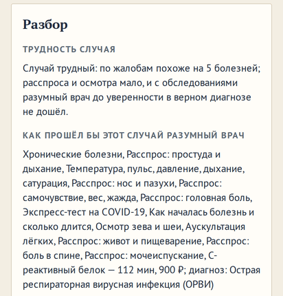
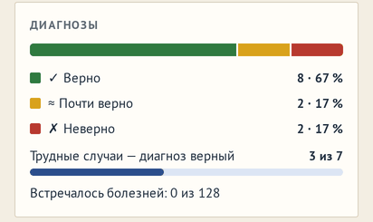

# Трудность случая: мера, «Случай дня» — загадка, разбор и профиль

**Версия:** 0.6.16 **Состояние:** сделано

## Зачем

Предложение владельца 24.10.2026: «Допустим из десяти случаев 6-8 должны диагностироваться легко, а 1-2 должны быть
реально сложными загадками, из множества вариантов.» Вопрос 56 ([#169](https://github.com/Nefeste/anamnez/issues/169))
предложил четыре варианта: сначала замерить, «Случай дня» — трудный по мере, поток с долей загадок, разбор называет
трудность. Ответ владельца: «согласен, делаем по рекомендации 1 2 и 4 сразу, 3 по результатам замеров». Это часть 92
дорожной карты.

Меры трудности не было: «Случай дня» задуман непростым, но был обычным пациентом (`09-game-design.md` §10), а сколько в
игре лёгких и трудных случаев, никто не мерил.

## Что увидит игрок

- **Разбор приёма** — первой строкой карточки «Разбор»: «Трудность случая» — «Случай трудный: по жалобам похоже на 6
  болезней; расспроса и осмотра мало — разумный врач решает его с обследованиями». У лёгкого — «Случай лёгкий: по
  жалобам похоже на 2 болезни; разумному врачу хватает расспроса и осмотра». Не довёл и разумный врач — «…, и с
  обследованиями разумный врач до уверенности в верном диагнозе не дошёл». Что он делал — строкой ниже, как раньше.
- **«Случай дня»** — каждый день загадка: по жалобам похоже на пять болезней и больше, правда — не первая в «Похоже
  на», расспроса и осмотра мало, а с обследованиями она решается. Одинаковый у всех с той же базой, как раньше.
- **Профиль** — в карточке «Диагнозы»: «Трудные случаи — диагноз верный: 3 из 7». Считаются ваши приёмы с 0.6.16.

## Мера

- **Ряд у двери** — болезни отделений больницы с вероятностью по одним жалобам не меньше 1 из 20 (`ROW_P`): те, что
  назвал бы «Похоже на» — он округляет их до «1 из 10» и больше. Вывод — тот же, с полом, возрастом, временем года и,
  в «Зимнем гриппе», с эпидемией.
- **Хватает ли расспроса и осмотра** — по разумному врачу разбора, тому же, что в разборе: все обследования, кандидаты
  — болезни отделений, тем же зерном. Всё, что он сделал до первого анализа, экспресс-теста, ЭКГ или снимка, — расспрос,
  осмотр и измерения у постели (давление и сатурация, пикфлоуметр, глюкометр, тест глотания), и после этого он уверен в
  правде на 90 % (`SURE`) — хватает. Весь его путь — из них — тогда по его решению: верное и уверенное — хватает.
- **Уровень**: лёгкий — в ряду не больше трёх (`EASY_ROW`) и хватает; трудный — пять и больше (`HARD_ROW`) и мало;
  средний — остальное.
- Мера считается по правде больного — поэтому она только в разборе закрытого случая и в выборе «Случая дня», не на
  экране приёма: правда интерфейсу недоступна.

## «Случай дня»

- **Загадка** — из зёрен дня (дата и номер базы; первое — прежнее зерно дня) — первое, у кого в ряду у двери пять
  болезней и больше, правда — не первая из них и разумный врач разбора этого приёма не решает его расспросом и осмотром
  (трудный по мере), а к концу пути, с обследованиями, ставит верный диагноз (решаемый). Не нашлось за 100 зёрен
  (`DAILY_TRIES`) — первое зерно; за 365 дней загадка находится в среднем на 8-м зерне, позже 81-го — ни разу.
- **Почему «не первая»**: трудный по одной мере — каждый третий ОРВИ, где загадка лишь в экспресс-тесте на грипп и
  COVID-19, а правда и так первая в «Похоже на». С этим условием — бронхит, гастрит, ГЭРБ, ангина, пневмония, анемия
  и другие (замер ниже).
- **Почему «решаемый»**: без этого условия у 24 из 90 дней разумный врач разбора со всеми обследованиями ошибался — 8
  раз принимал бронхит за ОРВИ, по 3 — гипертензию и мигрень за головную боль напряжения: загадка без отгадки. С ним
  верен у всех 90, болезней столько же — 24, подбор — вдвое дольше (замер ниже). «Верен и уверен на 90 %» — слишком
  строго: 10 дней из 90 без загадки за 60 зёрен.
- **Игроку правило «не первая» не называем** — ни во вступлении «Случая дня», ни в новостях, ни в магазине: иначе первую
  строку «Похоже на» можно отбросить не думая. Там — «по жалобам похоже на много болезней, и расспроса и осмотра мало».
  Во вступлении — и что с обследованиями загадка решается: это обещание, а не подсказка.
- **Подбор заранее** — по шагу, 12 мс каждые 25 мс, пока на экране меню (сегодняшний случай) или список дней (и
  прошлые дни по порядку): без JIT подбор — до двух с половиной секунд (замер ниже), и касание дня его не ждёт.
- **Касание дня, которого не успели**, тоже не ждёт (NFR-PRF-1 — ни одного подвисания дольше 100 мс): строка дня говорит
  «Подбираю случай…», подбор идёт по 12 мс каждый кадр, приём открывается сам. Ушли со списка — подбор встал.
- **У кого расспроса и осмотра хватило, подбор не ведёт разумного врача дальше первого анализа** (`talkOf`): к этому шагу
  мера уже известна. У трудного — до конца пути: верен ли диагноз. Зерно то же, что по всему пути (тест).
- **Начатый приём** помнит версию подбора (`pick`): начатый до 0.6.16 — с прежним пациентом — начинается заново.

## Замер

`npm run difficulty-sim -- --n 400 --days 90`: по 400 пациентов в больнице каждой главы, времена года поровну, в
больницах каждый четвёртый — привезённый скорой.

| Больница | лёгких | средних | трудных | ряд у двери | разумный врач уверен в верном |
|---|---|---|---|---|---|
| амбулатория (глава 1) | 38 % | 49 % | 14 % | 3,2 | 75 % |
| районная (глава 2) | 43 % | 48 % | 9 % | 2,8 | 83 % |
| с сосудистым отделением (глава 3) | 45 % | 46 % | 9 % | 2,7 | 85 % |
| городская (глава 4) | 44 % | 46 % | 10 % | 2,9 | 86 % |

- **Времена года**: трудных меньше всего зимой (4–8 %), больше всего весной (13–19 %); лёгких — 33–48 % в любое.
- **Привезённые скорой** — те же доли, что пришедшие сами (лёгких 41–45 %, трудных 8–9 %), но разумный врач уверен в
  верном чаще: 91–96 % против 80–83 %.
- **Трудные** — чаще всего ОРВИ (8–13 в каждой больнице), бронхит, гастрит, ангина, головная боль напряжения, ГЭРБ,
  пневмония. Правда — первая в «Похоже на» — у 21 из 55 трудных в амбулатории и у 7–9 из 35–41 в больницах; разумный
  врач уверен в верном — у 31–43 % трудных: они и для него трудные.
- **«Случай дня»**, 90 дней с 01.10.2026: 24 болезни — бронхит 16, головная боль напряжения 9, ангина 7, ГЭРБ 7,
  COVID-19 6, гастрит 6, впервые выявленные гипертензия и диабет по 5, боль в спине, функциональная диспепсия и ОРВИ
  по 4, остальные — реже. Без условия «правда не первая» ОРВИ выпадала бы почти каждый третий день (29 из 90 в пробном
  замере).
- **Подбор без JIT** (`node --jitless`, как Hermes на телефоне), 90 дней: медиана — 0,6 с, у каждого десятого дня —
  больше 1,4 с, в худшем — 2,5 с; самый долгий шаг — 24 мс. Поэтому — заранее и по шагу.
- **Итог для варианта 3**: трудных и так около одного из десяти — столько, сколько просил владелец («1–2 … реально
  сложными»); лёгких — четыре из десяти, а не 6–8: остальное — средние, у которых в ряду четыре болезни или расспроса
  и осмотра мало при двух-трёх. Делать ли поток с долей загадок и что делать с долей лёгких — вопрос 62
  ([#182](https://github.com/Nefeste/anamnez/issues/182)); ответ владельца 24.10.2026 — «вариант 1»: как есть, поток
  — по частотам жизни, загадка — каждый день в «Случае дня».

## Данные

- **Закрытый приём**: `hardness?: { level, row, talk, solved }` — у ваших приёмов, в сохранении смены и в архиве
  профиля; у прежних — нет.
- **Профиль**: `stats.hard: { met, correct }` — трудных встретилось и с верным диагнозом; у прежних профилей — нули.
- **Начатый приём дня**: `pick` — версия подбора (`DAILY_PICK`). База — прежняя (81).

## Движок

- `src/engine/med/difficulty.ts`: `ROW_P`, `EASY_ROW`, `HARD_ROW`, `SURE`, `TALK`, `doorRow`, `levelOf`, `hardnessOf`.
- `buildReview` — трудность в `ReviewData`; готовое (разумный врач, уверенность, эпидемия, трудность) — одним объектом
  `ReviewReady`.
- Смена: трудность — в записи разбора приёма (`hardnessFor`), считается заранее, в паузах (`prepareReview`, ещё одна
  уверенность), и при закрытии вашего приёма пишется в него.
- `talkOf` — хватило ли расспроса и осмотра, по пути разумного врача к любому шагу; `DoctorRun.sofar` — что он сделал
  к этому шагу.
- `src/state/daily.ts`: `dailyCaseSeed`, `dailyPicked`, `prepareDaily`, `prepareDailyEvery`, `pickDaily`.

## Неудачные случаи

- **Разумный врач решил не тем путём** — до первого анализа он спросил не всё, что мог: мера говорит «мало», хотя
  расспросом можно было. Мера — про его путь, тот же, что в разборе, а не про лучший из возможных.
- **Приём нанятого врача** — трудность не считается: в профиль идут ваши приёмы.

## Проверки

- `difficulty.test.ts`: уровни и пороги; ряд у двери — «Похоже на» по жалобам, «хватает» — по пути разумного врача до
  первого анализа, весь путь из расспроса — по его решению; у закрытого вашего приёма — та же трудность, что в разборе;
  строка разбора; профиль — сколько трудных и верных, старый профиль — без них; «Случай дня» — загадка, решаемая
  разумным врачом, и трудный в разборе; подбор — то же зерно, что по всему пути врача; по частям — тот же; заранее —
  дни по порядку; касание неподобранного дня — подбор каждый кадр, затем приём; начатый до 0.6.16 — заново.
- Сценарий в браузере: разбор «Случая дня» — «Случай трудный: по жалобам похоже на …».
- Отдельный прогон на веб-сборке: разбор «Случая дня» — «Случай трудный», в «Похоже на» по одним жалобам — столько же
  болезней, сколько в строке разбора; в профиле — «Трудные случаи — диагноз верный: 3 из 7».

## Чего здесь нет

- Поток с долей загадок (вариант 3 вопроса 56): по замеру — как есть, ответ владельца на вопрос 62
  ([#182](https://github.com/Nefeste/anamnez/issues/182)).

## Что изменилось по ходу работы

- **«Хватает ли расспроса» — по пути разумного врача разбора, а не отдельным врачом без анализов.** Второй прогон —
  ещё 25 мс на пациента сверх разбора, а доли те же (лёгких 46 и 39 %, трудных 14 и 14 % в амбулатории); путь врача
  разбора — 2 мс и та же мера, что в разборе.
- **Касание неподобранного дня — без ожидания.** Сначала день, которого не успели заранее, досчитывался при касании:
  без JIT — полсекунды, на каждом десятом дне больше секунды, в худшем две с половиной — подвисание, какого NFR-PRF-1 не
  допускает. Теперь касание не ждёт, а список подбирает и прошлые дни.
- **Загадка — решаемая.** Сначала «Случай дня» был просто трудным по мере, и сегодняшний, 24.10.2026, не решал и
  разумный врач; замер показал — так у каждого четвёртого дня. Теперь подбор требует и верного диагноза в конце его пути.
