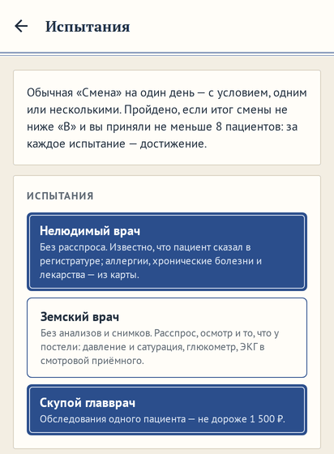
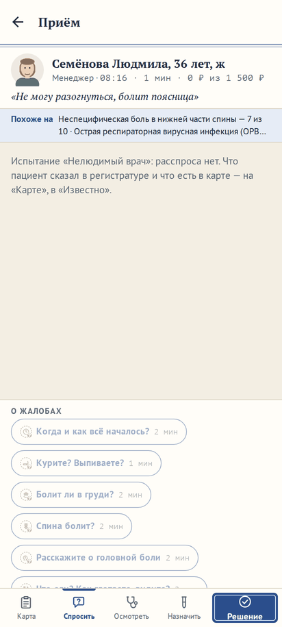
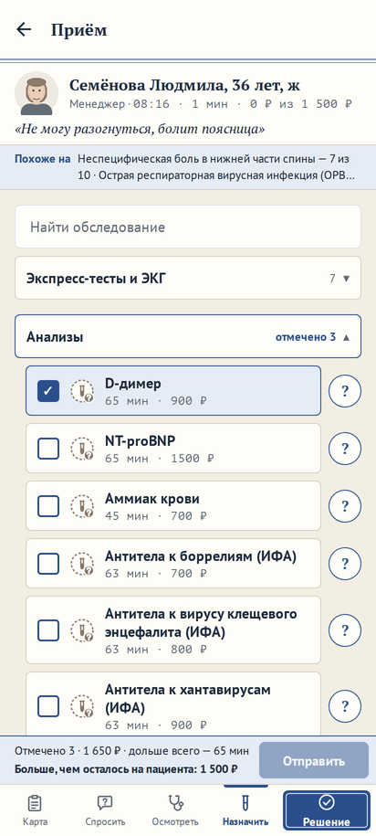
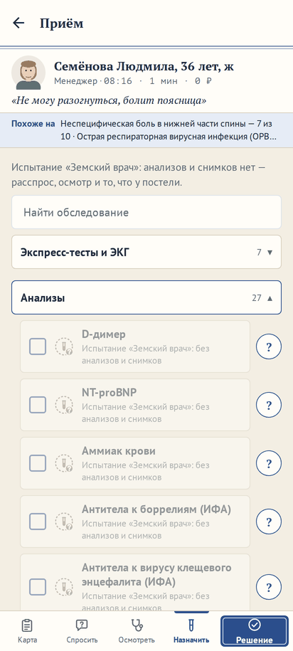

# Испытания: «Нелюдимый врач», «Земский врач», «Скупой главврач»

**Версия:** 0.6.14 **Состояние:** сделано

## Зачем

Мысль владельца 24.10.2026 — взять идеи из сериалов о врачах и применить к игре: «Например, врач не общительный,
диагностирует только осмотром и анализами, не разговаривает с пациентами (недоступен опрос). Или другие настройки.»
Вопрос 50 ([#163](https://github.com/Nefeste/anamnez/issues/163)) предложил восемь испытаний на готовом движке; ответ
владельца: «вариант 1: 1 2 и 4 делаем, 3 и 7 после 1.0, а 5 и 6 записываем на более поздние версии в roadmap». Это
часть 91 дорожной карты; вторая её половина — три сценария на неделю (вопрос 55,
[#168](https://github.com/Nefeste/anamnez/issues/168)) — следующим релизом, 0.6.15. Названий, персонажей и цитат из
сериалов в игре нет — только механики.

Каждое испытание учит своему: «Нелюдимый врач» — осмотру и анализам, «Земский врач» — расспросу и осмотру, «Скупой
главврач» — выбирать самое нужное.

## Что увидит игрок

- **«Быстрая игра» → «Испытания»** — новый пункт между «Сменой» и песочницей. На экране — три испытания, можно одно или
  несколько: название, что нельзя, лучший итог; ниже — больница и сложность, как у «Смены»; «Начать смену». Смена — та
  же «Смена» на один день, с условием.
- **«Нелюдимый врач»** — без расспроса. Вкладка «Спросить» — с пояснением, вопросы серые: «Испытание «Нелюдимый врач»:
  без расспроса». Известно, что пациент сказал в регистратуре, — жалобы; аллергии, хронические болезни и лекарства — из
  карты, в «Известно» — «Из карты: …». Карта пациента открывается на «Осмотреть», а не на «Спросить».
- **«Земский врач»** — без анализов и снимков: расспрос, осмотр и то, что у постели, — давление и сатурация, глюкометр,
  пикфлоуметр; ЭКГ — у постели в смотровой приёмного. В бланке «Назначить» — пояснение, строки серые: «Испытание
  «Земский врач»: без анализов и снимков».
- **«Скупой главврач»** — обследования одного пациента не дороже 1 500 ₽. В шапке — «400 ₽ из 1 500 ₽»; дороже
  оставшегося — серым: «Испытание «Скупой главврач»: на пациента осталось 1 100 ₽»; отмечено в бланке больше, чем
  осталось, — «Отправить» нельзя, в полосе — «Больше, чем осталось на пациента: 1 100 ₽».
- **Итог дня** — итог «Смены», как раньше, и строка испытания: «Испытание пройдено: итог не ниже «B», 12 пациентов»
  или «Испытание не пройдено: нужен итог не ниже «B» и не меньше 8 своих пациентов». Пройдено — достижение за каждое
  испытание смены. Лучший результат — свой у каждого набора испытаний в каждой больнице.
- **Профиль** — карточка «Испытания»: у каждого лучший итог и где.

## Правила

- **Чьи пациенты.** Условия — у ваших пациентов. Нанятые врачи городской больницы работают как обычно.
- **Без расспроса** — все обследования вида «расспрос» (`kind: ask`). Аллергии, хронические болезни и лекарства, которые
  принимает, — из карты: ответы на «Аллергии», «Хронические болезни» и «Какие лекарства принимает», когда вы позвали
  пациента; без них антибиотик пришлось бы назначать вслепую (вопрос 50). Остальные противопоказания — беременность и
  то, что спрашивают перед тромболизисом, — так не узнать: беременность — тестом, тромболизис без вопросов — замечание
  безопасности, как у всех.
- **Без анализов и снимков** — нельзя анализы, экспресс-тесты, снимки, эндоскопию и ЭКГ в кабинете; можно расспрос,
  осмотр и то, что у постели (`kind: bedside`), и ЭКГ у постели — лежащему в смотровой приёмного с монитором (часть 37).
- **1 500 ₽** — на обследования одного пациента, вместе с назначенным раньше: дороже оставшегося — нельзя.
- **Пройдено** — итог «Смены» не ниже «B» и не меньше 8 своих пациентов: одного-двух пациентов мало, чтобы судить о
  смене. Несколько испытаний сразу — пройдены все.
- **Разбор.** Разумный врач разбора — с теми же запретами: без расспроса — не спрашивает, без анализов и снимков — не
  назначает их; бережливость сравнивается с ним. Деньги «Скупого главврача» разумному врачу не ограничены: игрок с
  лимитом не тратит больше него, и бережливость от лимита не страдает.

## Замер: проходимо ли

Разумный врач в амбулатории, 300 пациентов, все сезоны: без ограничений верных диагнозов 89 %, в среднем 1 064 ₽ на
пациента, дороже 1 500 ₽ — у 23 %. Без расспроса — 82 % верных, 1 869 ₽: вместо вопросов — анализы и снимки. Без
анализов и снимков — 85 %: расспрос и осмотр решают большую часть. Оба сразу — 69 %. Порог точности «B» — 70 %:
каждое испытание по отдельности проходимо, вместе — трудно.

## Данные

- **Смена**: `meta.challenges?: Challenge[]` — `'mute' | 'rural' | 'thrifty'`, задаются при начале, до плана дня. Старые
  сохранения — без испытаний.
- **Результат из карты**: у результата — `card: true`; в «Известно» — «Из карты: …», в беседе его нет.
- **Вид приёма**: `challenges`, `budget` (`{ left, of }` — у «Скупого главврача»); запрещённое — в `unavailable` с
  причиной.
- **Достижения**: вид `challenge` (`challenge: mute`), группа «Испытания»; закрытый день сообщает пройденные испытания.
- **Лучший результат**: ключ — больница, «только вы» и набор испытаний.

## Движок

- `src/engine/shift/challenges.ts`: `challengeBlock` — что запрещает испытание у пациента; `CARD_EXAMS`; `BUDGET`.
- `examSetup`: у ваших пациентов запрещённое не назначается — и одним касанием, и бланком.
- `call`: «Нелюдимый врач» — ответы из карты, своей ветвью зерна.
- Разбор: разумный врач — с запретами испытаний смены.

## Неудачные случаи

- **Тромболизис без вопросов** — замечание безопасности: спросить нельзя, и это часть испытания.
- **Беременность** — только тест: экспресс-тест можно без расспроса и нельзя без анализов; вместе — не узнать.
- **Пациент нанятого врача, взятый себе**, — запреты с этой минуты; потраченное до — в счёте 1 500 ₽.

## Проверки

- `challenges.test.ts`: запреты у ваших пациентов и не у нанятых врачей; ответы из карты — при «Нелюдимом враче» и
  только при нём, без «спросили об аллергии»; ЭКГ у постели — можно; 1 500 ₽ — сверх нельзя, бланком тоже; разбор — с
  запретами; пройдено — по итогу и числу пациентов, достижения; лучший результат — по набору испытаний.
- Сценарий в браузере: «Быстрая игра» → «Испытания», «Нелюдимый врач» — карта на «Осмотреть», вопросы серые, «Из
  карты»; «Скупой главврач» — «из 1 500 ₽» в шапке.

## Чего здесь нет

- Испытания 3 и 7 («Пациенты не договаривают», «Ночная смена») — после 1.0; 5 и 6 («Редкие болезни», «Одна попытка») —
  в поздних версиях (ответ владельца).
- «Испытание дня» в «Случае дня».
- Сценарии на неделю — 0.6.15.

## Что изменилось по ходу работы

- **«Из карты» — не расспрос.** Ответы из карты лежат в результатах с пометкой `card`, а в `done` их нет: на «Спросить»
  вопросы об аллергиях, хронических болезнях и лекарствах остаются серыми, как все, а в беседе этих ответов нет — только
  в «Известно».
- **Сроки по рекомендации** — без того, что запрещает испытание: срок, которого не выполнить, не ставится, как и без
  кабинета (ЭКГ в первые 10 минут у «Земского врача» — только у постели). Деньги «Скупого главврача» сроки не снимают:
  расходом игрок управляет сам.
- **Разбор в профиле** — с теми же запретами: у записи приёма — испытания смены, архив строит разбор по ним.
- **«Выберите вопрос внизу — пациент расскажет»** — не при «Нелюдимом враче»: на кадре веб-сборки пустая лента беседы
  звала к вопросам, которых не задать; теперь под пояснением ничего нет.
