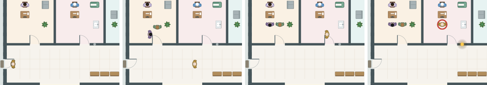

# Очередь и порядок в амбулатории

**Версия:** 0.6.9 **Состояние:** сделано

## Зачем

Замечания владельца 24.10.2026: «Больные продолжают не соблюдать очередь, когда заходит одновременно 3-4 в клинику, они
сразу заходят и в регистратуру, и к медсестре, а должны по очереди. Слишком рано появляются тревожные признаки и
красный код (синий код по идее) триажа сразу после регистратуры, а надо после измерений у медсестры. Кнопка вызвать
доступна пока человек только в регистратуру зашел, он там даже если начал не заканчивает текущую операцию и сразу
бежит к врачу, причем с известной сатурацией и температурой, нужно выстроить очередь и порядок. Также и в другие
кабинеты. Если одновременно назначить общий анализ крови и тест на стрептококк, пациент уже не идёт сдавать кровь,
сразу на скамейку как после теста, при этом в лаборатории анализатор становится занят (но не видно кому он тест делает)
нет логистики где забрали кровь, кто отнес в лабораторию, как доставили результат врачу или пациенту отдали когда
готово. Это нужно доделывать».

Что было в 0.6.8 — проверено на движке и в веб-сборке:

- регистратура и медсестра не знали очереди: у каждого пришедшего регистратура — 2 минуты от прихода, медсестра —
  следующие 3, сколько бы ни пришло разом; карта ставила всех в одну клетку;
- срочность — по жалобе у двери (0.5.12): цвет и «! нужно скоро» — сразу, до медсестры;
- в очереди врача — с прихода: «Пригласить» звало того, кто ещё у регистратора; витальных у него нет;
- в процедурной очереди не было: кровь у двоих брали разом;
- ОАК и мазок разом: если первым шёл ОАК, пациент сдавал кровь, пока врач ждал его в кабинете ради мазка, —
  игрок в это время в карте пациента; отпустили — сразу на скамью, лаборатория горит без подписи, чья проба.

В геймдизайне путь был такой и раньше (`09-game-design.md`, «Путь по больнице»): вход → регистратура → сортировка у
медсестры → ожидание → кабинет врача.

## Что увидит игрок

- **Регистратура — по одному.** Регистратор оформляет 2 минуты. Пришли трое разом — второй и третий стоят в очереди
  у стойки за первым; из нескольких регистратур (своя больница) — к той, что освободится раньше.
- **Медсестра доврачебного кабинета — по одному**, 3 минуты: давление, пульс, температура, сатурация. Кто ждёт её —
  на скамье у её двери.
- **Срочность — после медсестры.** До неё у пациента нет цвета и тревожных признаков, в очереди врача его нет; в
  списке очереди он внизу, серым, без номера: «ждёт регистратуру», «в регистратуре», «ждёт медсестру», «у медсестры».
  Медсестра нашла срочное — сигнал, как раньше.
- **Пригласить — из очереди врача**: тех, кто прошёл регистратуру и медсестру. Касание оформляющегося на карте — кто
  он и что с ним, без «Пригласить».
- **Без очереди** — с тревожной жалобой (давящая боль за грудиной, внезапная слабость в руке) или с такой, при которой
  срок по клиническим рекомендациям идёт с порога: подозрение на инсульт, в том числе прошедшая слабость, — осмотр
  невролога не позднее 10 минут от поступления (`814_1`, раздел 2.2), — и рвота кровью. Регистратор ведёт такого к
  медсестре сразу, карту заводит потом; медсестра берёт его после того, кого меряет, и после тех, кто пришёл без очереди
  раньше; кто ждал её по очереди, — за ним. Увидев его, она сразу
  зовёт врача: он в очереди врача с цветом по жалобе — инсульт объявляют с порога, по признакам, — а давление, пульс,
  температуру и сатурацию она досчитывает к концу своих 3 минут; позвали раньше — меряет врач, как в 0.5.12. Иначе
  срок не успеть: регистратура, медсестра и осмотр — уже больше 10 минут. Цвет ставит медсестра, а не регистратор.
  Вопрос 59 ([#172](https://github.com/Nefeste/anamnez/issues/172)): владелец выбрал вариант 1 — с проверкой, что
  так и на карте.
- **На карте цвет — у медсестры.** Пришедший сам входит без цвета, цвет на фигурке — когда она у стола медсестры: без
  очереди — как подошла, по очереди — когда медсестра закончила. Фигурки идут медленнее смены, на ×4 смена может уже
  поставить цвет, а человек ещё в пути: цвет он примет у медсестры, не в дверях и не по дороге.

- Без доврачебного кабинета (своя больница) — после регистратуры сразу в зал: срочность не определена, витальные
  меряет врач, как раньше; без очереди тут некому — и со слабостью в руке регистратура, как у всех. Нанятые врачи берут
  новых тоже после медсестры.
- **Процедурная — по одному**: медсестра процедурного кабинета берёт кровь у одного, остальные ждут на скамье ближе к
  её двери. У рентгена, ЭКГ и других аппаратов очередь была и раньше; теперь ждут на скамье ближе к своей двери.
- **Несколько назначений разом** — сначала то, что делают в кабинете (мазок, глюкометр, вопросы), потом пациент идёт по
  направлениям: в процедурную, на снимки. Отпустили ждать — на карте видно, как он идёт сдавать кровь.
- **Проба — в лабораторию.** Взяли кровь — медсестра процедурной несёт пробирки к двери лаборатории, на карте видно;
  отдала — вернулась, и только тогда процедурная берёт следующего. Анализаторы работают с минуты, как проба дошла.
- **Касание процедурной** — у кого берут кровь и сколько ждут забора; **касание лаборатории** — чьи пробы несут и чьи
  анализы в работе, к которому часу будут: «Общий анализ крови — Иванов Пётр: будет к 09:40», до четырёх строк, дальше
  «и ещё N».
- **Привезённый скорой** ждёт результатов на своей койке в смотровой, а не на скамье; на снимок и в процедурную его
  везут — на карте он там на время процедуры.
- Результат — в карте у врача, как раньше (медицинская информационная система). Показывать ли на карте, как его
  несут или отдают пациенту, — вопрос 51 ([#164](https://github.com/Nefeste/anamnez/issues/164)).

## Данные

- Новый статус пациента `intake` — оформляется: от прихода до конца сортировки (или регистрации, если медсестры нет).
- `ShiftPatient.intake` — регистратура и медсестра (`Desk`: помещение, начало и конец); карта по ним ставит его в
  очередь у стойки, на скамью у двери медсестры и к её столу.
- `s.rooms` — «свободно с»: как у аппаратов — у регистратуры, доврачебного кабинета и процедурной.
- `pending[].draw` — где берут кровь; `pending[].lab` — когда проба дошла до лаборатории.
- `HANDOFF` — минута: медсестра отдаёт пробирки в лаборатории; процедурная занята забором, дорогой туда, минутой и
  дорогой обратно.
- Сохранения прежней версии читаются: пациент без `intake` уже прошёл сортировку — медсестра меряет его, если его не
  позвали, как в 0.5.12; ожидающие без `draw` и `lab` — анализ, как прежде, с конца забора.

## Как сделано

- Приход (`arrive`): место у регистратуры — за последним, у медсестры — за последним, с дорогой между ними по клеткам;
  событие `nurse` — в конце сортировки: витальные, срочность, в очередь врача; терпение — от прихода, как раньше, но
  ждать в очереди не меньше минуты после сортировки. Красный по витальным — сигнал `arrived` с цветом.
- Срочность у двери движок записывает, но до сортировки она не видна (`triaged: false`): по ней не ставят в очередь
  врача, нанятые врачи её не видят, карта рисует пациента без цвета. По ней и по срокам базы — только «без очереди»
  (`rushOf`), и только с доврачебным кабинетом: красная жалоба или жалоба срока без помещения, идущего от прихода
  (`from: arrival`). Такому регистратура — нулевая, медсестра — после того, кого меряет, и пришедших без очереди раньше
  (`nextAtNurse`; без очереди он в очереди врача с её первой минуты, но у неё — до конца её 3 минут); ждавшие её по
  очереди сдвигаются по порядку, их событие `nurse` — тоже. В очередь врача он встаёт, когда она начала (событие `nurse` — в начало), витальные — вторым событием
  в её конец (`vitalsInQueue`, как у сохранений до 0.6.9): позвали раньше — их нет. На карте до конца её работы он у её
  двери и у её стола, и пригласить его уже можно.
- Смена кончилась, а кто-то ещё оформляется, — как ждущие в зале: не приняты.
- Кровь (`orderExam`): начало — когда пациент дошёл и процедурная свободна; анализ — с минуты, когда проба дошла, со
  временем лаборатории; так же считает «Через сколько придёт» у разумного врача (`readyIn`). Взяли на месте, в
  смотровой, — несёт медсестра смотровой, процедурная не занята.
- `examineAll` (бланк направления): сначала — что делают при враче (`atDoctor`), потом — по направлениям, в порядке
  бланка.
- Карта (`clinicMap.ts`): очередь у стойки — клетками от стола к двери и по коридору; скамьи — ближе к нужной двери и
  за пациентом, пока он ждёт; медсестра процедурной с пробирками — у двери лаборатории, пока проба не дошла и она её не
  отдала (`carry`); значок лаборатории горит с минуты, как проба дошла.
- Цвет на карте (`walkers.ts`): новый вид фигурка принимает на остановке у медсестры (`triage`), а без неё на пути — когда
  дошла; стоит у медсестры — сразу, и в зал идёт уже с ним. Пришедшего сам, у кого цвет уже есть, а на карте его ещё нет,
  карта вводит с улицы без цвета (`Placement.door`); скорая сообщает срочность заранее — её везут с цветом.

## Проверки

- `intake.test.ts`: трое разом — регистратура 0–2, 2–4 и 4–6 минут, медсестра — по одному следом; до конца сортировки —
  не в очереди врача, позвать нельзя, цвета и витальных нет; терпение — от прихода; срочный — сигнал после медсестры;
  без очереди — со слабостью в руке мимо регистратуры к медсестре, ждавшие её — за ним, в очереди врача он первый с её
  первой минуты, витальные — к её концу; двое без очереди — второй за первым, и когда первый уже в очереди врача, а у
  медсестры ещё стоит; прошедшая слабость — тоже без очереди, и осмотр невролога успевает в 10 минут от прихода;
  витальные — те же, когда бы ни мерили; без доврачебного кабинета — после регистратуры в зал, и со слабостью в руке
  тоже; сохранение 0.6.8.
- `lab-flow.test.ts`: двоим ОАК — второму начнут, когда медсестра вернулась из лаборатории, анализ — с минуты, как
  проба дошла; карта — первый в процедурной, второй на скамье, медсестра у двери лаборатории, лаборатория горит, когда
  проба дошла; сначала ОАК — мазок только когда пациент вернётся; привезённый скорой — на снимке в рентген-кабинете,
  результатов ждёт на койке.
- `session.test.ts`: бланк с ОАК и мазком — как мазок, затем ОАК; оформляющиеся — строками со стадией.
- `sandbox.test.ts`: касание процедурной — «Берут кровь», «Ждут забора»; лаборатории — «несут из процедурной»,
  «будет к».
- `clinic.test.ts`, `ultrasound.test.ts`, `rsc.test.ts`: путь пришедшего и очереди к аппаратам — с оформлением; без
  очереди — у стола медсестры его уже можно пригласить, померила — в зале.
- `clinic.test.ts`, цвет на карте (вопрос 59): входит без цвета — цвет у стола медсестры; ждал её на скамье — не на
  скамье; она закончила, пока он стоит у неё, — сразу, а пока идёт к ней — у неё, не на стуле; сидит — сразу. Смена на
  ×1 и ×4 тиками приложения (250 мс): у каждого пришедшего сам цвет впервые виден у стола медсестры; с прежней картой,
  где вид менялся сразу, проверка падает.
- `nste.test.ts`, `map.test.ts`: тропонин и свет лаборатории — с дорогой пробирок.
- `lazy-review.test.ts`: разбор нанятых врачей по требованию — тот же, что сразу; отпечатки записаны заново: прежним
  движком новый путь не сыграть (`tools/test/make-review-fixture.ts`).
- Симулятор сосудистой главы (`npm run district-sim -- --chapter vascular`): сроки — 93,5 % из 309 при пороге 90 %,
  осмотр при подозрении на инсульт — 79 из 87; без «без очереди» было 83 % и 49 из 87, с врачом после всей сортировки —
  84 % и 58 из 87.
- Симуляторы на итоговом коде, 8 зёрен × 30 дней: районная больница с карьерой — все критерии, приняты 88,5 %, ушли
  11,5 %, сроки — 97,7 % из 88; городская — все критерии, сроки — 90,1 % из 614 при пороге 90 % (на 0.6.8 — 91,6 % из
  616: осмотр при подозрении на инсульт — 131 из 153 против 142 из 160, без очереди он ждёт медсестру до 3 минут; на 0.6.8
  не окупались боксы — 267 450 ₽ против 271 175 ₽, теперь окупаются); своя амбулатория — все критерии.
- Быстродействие (`--stall --runs 1 --days 3`): худшая команда смены — 241 мс при пороге 250 (на 0.6.8 — 116):
  «Ждать результатов» в городской больнице ждёт дольше — проба стоит в очереди процедурной; движок на минуту смены не
  медленнее (5–8 мс против 12). По частям, как в игре (`--stall --parts`), — худший кусок 45 мс, 99 % — до 33 мс.
- Сценарий в браузере: пришедший — строкой внизу очереди со стадией, в очереди врача его нет; прошёл медсестру — в
  очереди.
- Веб-сборка, кадры карты на ×1 и ×4 (трое разом, третий — со слабостью в руке): он идёт мимо очереди у стойки к
  медсестре без цвета, красный обод — у её стола, смена встаёт на автопаузу «срочный пациент»; у её стола его можно
  пригласить.

## Чего здесь нет

- Короткой «экспресс-сортировки»: медсестра меряет всё за те же 3 минуты, без очереди она лишь раньше зовёт врача.
- Курьер или санитар: пробы носит медсестра процедурной.
- Пробирок партиями: медсестра процедурной несёт в лабораторию каждую пробу отдельно и только потом берёт следующего. В
  районной больнице очередь к ней почти не ждёт: в главах 2 и 3 из 55 заборов за три дня ждали 7, не дольше 76 секунд. В
  городской больнице процедурная одна, а заборов — около 50 в день: из 155 ждали 92, половина — дольше 79 секунд, каждый
  десятый — дольше 17 минут, дольше всех — 56 минут (замер на этом коде, главы 2–4 по три дня). Дальше — партиями: пока к ней
  очередь, она берёт кровь подряд, а пробы несёт разом (дорожная карта, часть 89).
- Результат на бумаге или бланк у пациента — вопрос 51 ([#164](https://github.com/Nefeste/anamnez/issues/164));
  «синий код» — вопрос 52 ([#165](https://github.com/Nefeste/anamnez/issues/165)).
- Очередь у повторного забора (тропонин через час) — его берут в срок по алгоритму, без очереди процедурной.
