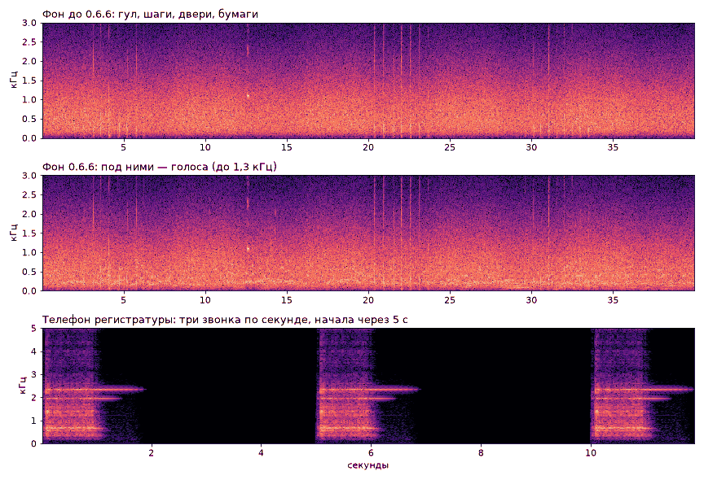
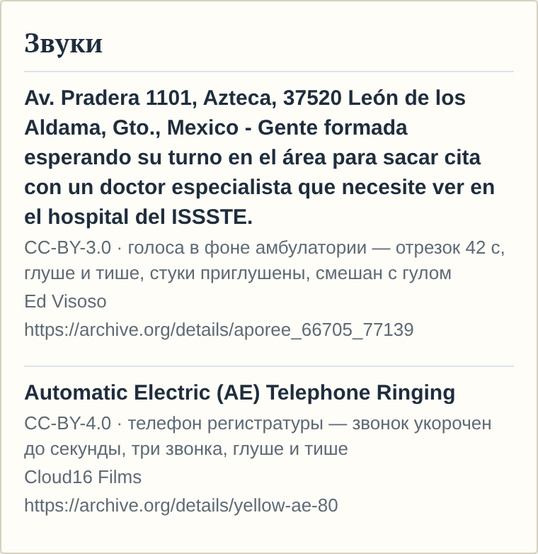

# Голоса и телефон в фоне амбулатории

**Версия:** 0.6.6 **Состояние:** сделано, ждёт проверки на телефоне

## Зачем

Фон амбулатории с 0.0.41 — гул вентиляции, шаги по коридору, дверь вдали, бумаги у регистратуры, скрип стула. Людей в
нём не слышно: далёких голосов и телефона регистратуры под CC0 не нашлось, а правило звуков (ADR 0013) было — только
CC0 или свои. Вопрос 18 ([#110](https://github.com/Nefeste/anamnez/issues/110)): обойтись без них, записать свои или
разрешить CC BY с автором в «Лицензиях». Ответ владельца 17.10.2026 — «вариант 3»; правило звуков теперь — ADR
[0019](../adr/0019-sounds-cc-by.md).

## Что услышит игрок

- **Голоса** — на экране смены, всю петлю фона: гул разговоров в очереди за стеной, слов не разобрать. Чуть тише гула
  вентиляции; гул и голоса вместе — так же громко, как прежде один гул, и шаги с дверями слышны над ними, как раньше.
- **Телефон регистратуры** — изредка, пока играет фон: первый раз через одну-две минуты, дальше раз в 2–5 минут.
  Звонит по-нашему — секунда звона, четыре секунды паузы; после третьего звонка трубку сняли. Вдали: глуше, на пиках
  тише шагов и дверей.
- Фон выключен в настройках, звук на нуле, игра свёрнута или открыта карта пациента — нет ни голосов, ни телефона:
  телефон звонит, только пока играет фон. В вебе-стенде фона нет, как и прежде.
- **«Об игре» → «Лицензии»** — новый раздел «Звуки»: у каждой записи название, автор, что она в игре и что в ней
  изменено, ссылка на страницу записи; касание — текст лицензии. В строке «Звук и музыка» в «Об игре» — авторы обеих
  записей.

## Данные

| Запись | Автор | Лицензия | Что из неё в игре |
|--------|-------|----------|-------------------|
| Очередь записи к врачу-специалисту в больнице ISSSTE, Леон, Мексика, 660 с — [archive.org](https://archive.org/details/aporee_66705_77139) | Ed Visoso | CC BY 3.0 | отрезок 452–494 с: ровный гул разговоров без воды из уборной, громких ударов и сигналов телефонов |
| «Automatic Electric (AE) Telephone Ringing», 12 с — [archive.org](https://archive.org/details/yellow-ae-80) | Cloud16 Films | CC BY 4.0 | начало и конец первого звонка — удар бойка, звон и спад колокола |

- `assets/audio/ambient.wav` — та же петля 40 с, голоса — в ней; `assets/audio/phone.wav` — новый, 12 с.
- Реестр — `assets/audio/LICENSES.md`: строки файлов, записи под CC BY с MD5 исходников, как пересобрать.
- Экран «Лицензии» — `tools/licenses/native.yaml`, раздел `sounds`; тексты CC BY 3.0 и 4.0 — дословно с
  creativecommons.org (`tools/licenses/texts/`). В записи списка — поле `source`: ссылка на страницу записи.
- Сохранения и настройки не меняются: голоса и телефон — часть фона, его выключатель — прежний.

## Как сделано

- **Голоса** — `makeVoices` в `tools/audio/clinic.ts`. Запись выбрана по спектрограммам: из найденных под CC BY и CC0
  это одна, где очередь в больнице. Записи с меткой Public Domain Mark (зал ожидания вокзала в Саратове, поликлиники в
  Познани) не взяты: метка — не отказ автора от прав (ADR 0019). Отрезок — ровный гул: на 452–494 с нет воды из
  уборной, громких ударов и тонов уведомлений. За стеной: ниже 200 Гц и выше 1,3 кГц — глуше (фильтры второго порядка,
  выше — дважды); щелчки и стуки — вровень с гулом (`tame`: кадр 20 мс громче медианы соседних трёх секунд больше чем
  на 3 дБ становится тише до неё). Начало петли — смесь продолжения её конца и своего звука, 2 с: стык не слышен.
- **Уровень** — голоса — 0,8 среднеквадратичной гула (−2 дБ); гул тише прежнего, чтобы вместе они были как прежний
  один гул (0,55 / √(1 + 0,8²)). Шаги, двери, бумаги и скрип — те же моменты из генератора с прежним зерном.
- **Телефон** — `makePhone` там же: начало первого звонка записи (0,45–1,25 с) и его конец со спадом колокола
  (2,80–3,95 с), стык — 40 мс; три звонка с началами через 5 с; выше 3 кГц и ниже 300 Гц — глуше; пик 0,35 — у фона
  0,5. На записи звонки американские, по 2–3 с; наш ритм — 1 с звона, 4 с паузы.
- **Когда звонит** — `src/audio/sounds.ts`: таймер, пока фон слышен (`applyAmbient`); первый звонок — через 45–120 с,
  дальше — через 120–300 с, случайно. Фон замолчал — таймер снят, звонок оборван.
- Перевод MP3 в WAV — `tools/audio/mp32wav.mjs` (декодер — во временной папке, как у `ogg2wav.mjs`). Пересборка из тех
  же исходников даёт те же файлы: прежний `clinic.ts` из заново скачанного набора Kenney собрал прежние `arrived.wav` и
  `ambient.wav` байт в байт; `arrived.wav` не изменился и теперь.

## Проверки

- `audio.test.ts`: `phone.wav` — в списке файлов и в `sounds.ts`; три звонка по секунде с началами 0, 5, 10 с, между
  ними тишина, колокол около 2,3 кГц, выше 9 кГц тише на 30 дБ и больше, на пиках тише фона; фон — петля 40 с без
  щелчка, пики шагов и дверей выше среднего в 8 раз и с голосами.
- `licenses.test.ts`: CC BY 3.0 и 4.0 — в списке разрешённых; записи на экране — те же, что в реестре звуков, с
  автором, источником, тем, что изменено, и текстом своей версии CC BY.
- Сценарий в браузере: «Лицензии» — четыре раздела; в «Звуках» — Ed Visoso и Cloud16 Films со ссылками, у телефона —
  текст CC BY 4.0.
- Слышно ли голоса и не мешает ли телефон — проверка на телефоне: громкость, частота звонков.

## Чего здесь нет

- Ночью в больнице голоса те же: фон один на все часы и все больницы.
- Колокольчика регистратуры при приходе пациента — нет: приход — дверь, как прежде.
- Свои записи голосов и телефона (вариант 2 вопроса 18) — не делались.
