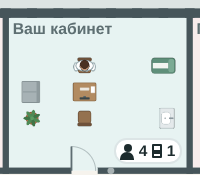
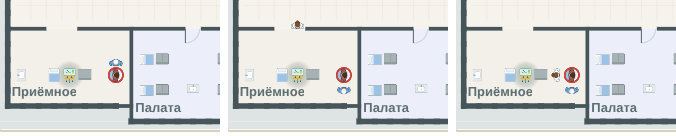

# «Код синий», результат у кабинета, пробирки партиями

**Версия:** 0.6.10 **Состояние:** в работе

## Зачем

Часть 89 дорожной карты — ответы владельца 24.10.2026 и то, что показали проверки 0.6.9:

- вопрос 52 ([#165](https://github.com/Nefeste/anamnez/issues/165)), вариант 1: «„Код синий“ — вызов к остановке
  сердца… Когда у лежащего под монитором фибрилляция желудочков (тревога монитора с 0.5.7), на экране — „Код синий:
  остановка сердца, смотровая 2“, сигнал и бег бригады на карте. Сортировка остаётся тремя цветами»;
- вопрос 51 ([#164](https://github.com/Nefeste/anamnez/issues/164)), вариант 1: результат — электронно, «на карте у
  лаборатории гаснет свет, у кабинета врача — значок „пришёл результат“, пациент идёт в очередь. Новой ходьбы нет»;
- проверки 0.6.9 ([`2026-10-clinic-flow.md`](2026-10-clinic-flow.md), «Чего здесь нет»): медсестра процедурной несёт
  в лабораторию каждую пробу отдельно — в городской больнице с одной процедурной каждый десятый ждал забора дольше
  17 минут, дольше всех — 56; несколько анализов одному — несколько заборов подряд по 5 минут, как и в 0.6.8.

## Что увидит игрок

- **Один забор на анализы, назначенные вместе.** ОАК и кальций — одна вена: 5 минут, обе пробирки — в лабораторию
  разом. Назначили ещё анализ, пока у него берут кровь или он ждёт забора, — пробирку добавят к тому же забору.
- **Пробы — партиями.** Пока к процедурной очередь, медсестра берёт кровь подряд, а пробы несёт разом, когда
  очереди нет. Очереди нет — несёт сразу, как в 0.6.9. Касание лаборатории: «пробирка в процедурной», «несут из
  процедурной», «будет к 09:40».
- **Результат у кабинета.** Вернулся с результатами — у двери кабинета его врача на значке очереди лист с числом:
  сколько ждут с готовыми результатами. Свет лаборатории гаснет, как раньше.

  

- **«Код синий».** Фибрилляция желудочков у лежащего в смотровой приёмного — «Код синий: остановка сердца, смотровая
  приёмного», сигнал монитора, как раньше; медсестра смотровой и анестезиолог-реаниматолог палаты интенсивной терапии
  или реанимации бегут к койке и 10 минут у неё: разряд, ритм, наблюдение. Разряд под монитором, ритм восстановлен — как
  с 0.5.7. Сортировка — по-прежнему три цвета.

  

## Как сделано

- Забор (`orderExam`): у пациента в этой процедурной забор, который ещё не кончился (`sameDraw`), — новая пробирка
  к нему: те же начало, конец и время, когда понесут, анализ — со своим временем лаборатории. Иначе — медсестра ещё
  не понесла пробы последних, когда он дошёл (`openDraws`): берёт у него следом за ними и понесёт все разом
  (`carryLater`), — понесла: ждёт её, как в 0.6.9 (`s.rooms`).
- `pending[].sent` — когда медсестра понесла пробы; нет — сразу после забора, как в сохранениях 0.6.9. Понесла позже —
  на столько же позже проба в лаборатории (`lab`) и результат (`readyAt`): новое событие `result`; нанятый врач,
  который ждёт результата у себя в кабинете, — его следующий шаг (`colleague`) тоже позже. Старое событие `result`
  ничего не делает: результатов к нему нет.
- «Через сколько придёт» у разумного врача (`readyIn`) считает так же: к его забору, за последними, когда вернётся.
- Карта: медсестра с пробирками — у двери лаборатории с минуты, как понесла (`sent`); касание лаборатории — «пробирка
  в процедурной» до `sent`; касание процедурной — «Ждут забора»: люди, а не пробирки.
- Значок «пришёл результат» (`roomSigns`): у кабинета врача — сколько из ждущих его уже были у него (`step > 0`), то
  есть вернулись с результатами; на карте — лист со строками и число рядом с очередью; позвали — число меньше.
- «Код синий» (`clinicMap.ts`, `codeTeam`): у привезённого скорой с `arrest` (движок с части 39б) `CODE` секунд — 10
  минут смены — медсестра его смотровой и анестезиолог-реаниматолог палаты интенсивной терапии или реанимации стоят
  у койки (`doing: code`), на свободных клетках рядом; бегут — быстрее обычного, как в кабинет по вызову
  (`walkers.ts`). Медсестра смотровой приёмного — новая фигурка (`erNurse`): до 0.6.10 её на карте не было. Строка в
  журнале и «за это время» — «Код синий: остановка сердца — …, смотровая приёмного. Разряд под монитором, ритм
  восстановлен»; сигнал — тревога монитора, как с 0.5.7.

## Проверки

(по ходу работы)

## Чего здесь нет

- Курьера и пневмопочты: пробы носит медсестра процедурной.
- Исхода «код синий» без восстановления ритма: разряд под монитором восстанавливает ритм, как с части 39б.
