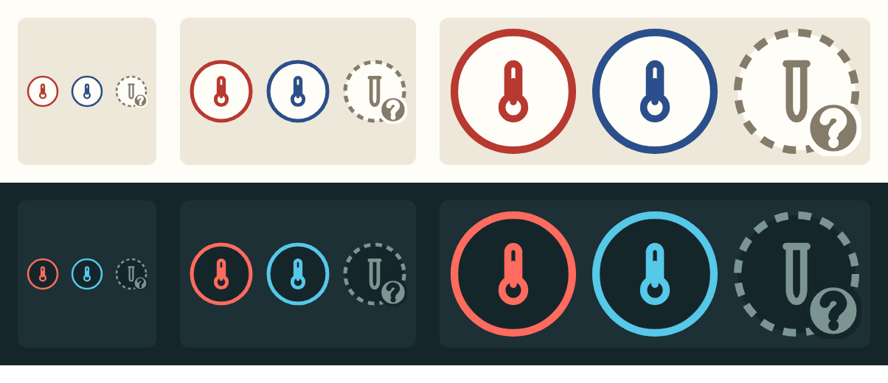
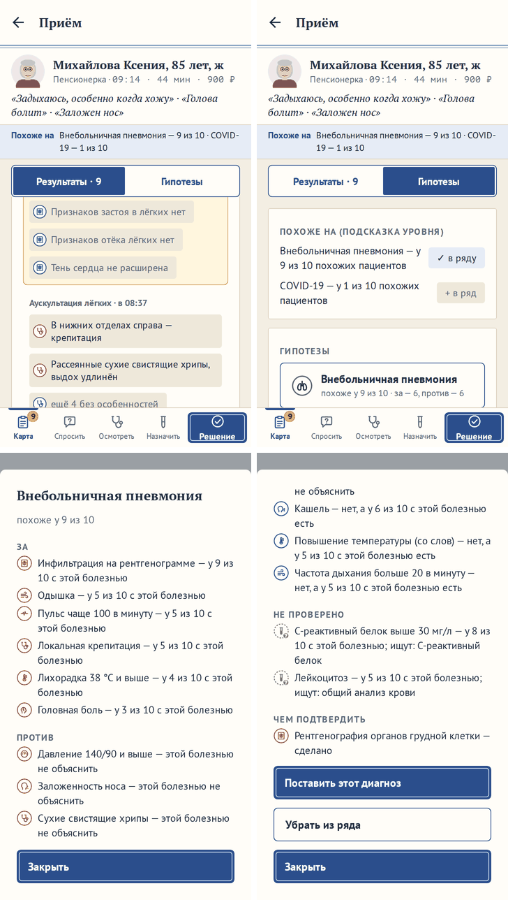
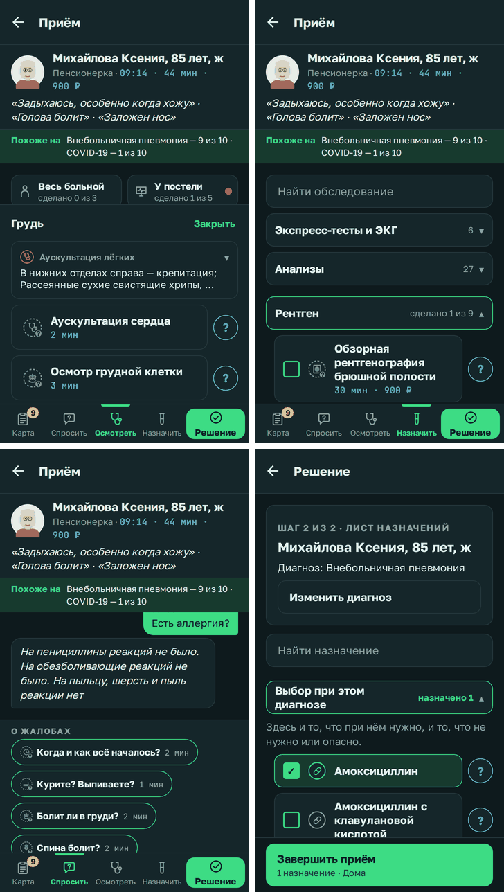

# Значки строк карты пациента

**Версия:** 0.6.8 **Состояние:** сделано, ждёт проверки на телефоне

## Зачем

Просьба владельца 22.10.2026: «Мне кажется, что под каждый симптом, диагноз и обследование и назначение нужна иконка,
чтобы оживить игру и цвет иконки будет иметь значение что оно присутствует или отсутствует у пациента или еще
неизвестно.» До 0.6.8 значков было 17 — системы органов у «Своих больных» и вкладки карты (0.5.20, 0.6.0); строки
карты — текстом. Найденное в «Известно» отличала только плашка: найденное — голубая, «без особенностей» — бежевая;
«ещё неизвестно» не было нигде, кроме строк «Не проверено» в карточке гипотезы.

Вопрос 49 ([#161](https://github.com/Nefeste/anamnez/issues/161)) — макет на настоящем приёме в обеих темах, три
варианта: А — значок в кружке, как метка в карте больного («есть» — залитый кружок, «нет» — перечёркнутый,
«неизвестно» — пунктир с «?»); Б — значок без кружка, сам в цвете; В — цветом вся плашка строки. Ответ владельца:
«Все варианты хороши, Вариант А неплох / При этом, как будто заливать иконки не очень красиво, на белом фоне иконка
выглядит значительно лучше. / При этом пунктиром лучше обводить иконку, чем плашку / Перечеркивать тоже не
обязательно, как будто бы цвета, пунктира и знака вопроса достаточно.» Сделан вариант А без заливки и перечёркивания.

## Что увидит игрок

- **Значок** — рисунок строки в кружке; внутри кружка — фон карточки: белый в «Медкарте», тёмный в «Мониторе». Цвет
  кружка и рисунка — что о строке известно:
  - **есть у пациента** — красными чернилами, в «Мониторе» — коралловым, как тревога монитора;
  - **нет** — синими чернилами, в «Мониторе» — голубым, как кривая сатурации;
  - **ещё неизвестно** — серым, кружок пунктиром, внизу справа — «?».
- **«Карта» → «Результаты»**, «Известно»: у каждой строки результата — значок находки; найденное — «есть», «без
  особенностей» — «нет»; у плашки «ещё N без особенностей» — значок обследования, «нет». Плашки строк — одного цвета:
  прежняя голубая плашка найденного спорила бы с синим «нет». Текст «нет» — серее, как прежде.
- **«Гипотезы»**: у болезни ряда — система органов, как у «Своих больных», без цвета: есть ли болезнь, ясно только на
  разборе, и значок ответа не подсказывает. В карточке гипотезы — значки доводов: «За» — «есть»; «Против» — «есть» у
  найденного, которого болезнь не объясняет, «нет» — у типичного, которого нет; «Не проверено» — «неизвестно»; «Чем
  подтвердить» — значок обследования: не сделано или не пришло — «неизвестно», пришло и что-то нашло — «есть», ничего —
  «нет».

- **«Осмотреть» и «Назначить»**: у не сделанного — значок обследования, «неизвестно»; у сделанного — по тому, что
  пришло: нашло — «есть», ничего — «нет»; у строк ответа — значки находок, как в «Известно». Прежняя «✓» перед
  сделанным ушла — её место занял значок.
- **«Спросить»**: у вопроса — значок темы, «неизвестно»: ответа ещё нет. Ответ пациента — словами, без значков.
- **«Решение», лист назначений**: у лечения — значок вида: таблетка, капельница, укол, ингалятор, спрей в нос, кислород,
  операция, повязка, режим; назначено — цветом выбора (синим в «Медкарте», зелёным в «Мониторе»), не назначено —
  серым.

- Значок — не кнопка: касание строки, «?» и галочка — как прежде; касания не меньше 48 dp. Читалка экрана значок
  пропускает — строка говорит то же словами.

## Данные

- Новых записей базы и полей сохранения нет; сохранения не меняются.
- **Рисунки** — `src/ui/itemIconShapes.ts`: 64 своих, линией в сетке 24 × 24, как значки вкладок (ADR
  [0017](../adr/0017-own-look.md)); ещё 14 — из `src/ui/iconShapes.ts`: 10 систем органов, «Спросить», фонендоскоп
  «Осмотреть», «Весь больной» и «У постели». Набор Health Icons (CC0) смотрел — другая сетка и толщина линии, рядом
  со значками игры он смотрелся бы чужим.
- **Какой значок у строки** — `src/ui/itemIcons.ts`, на 1 025 строк базы:
  - жалобы, находки осмотра и анамнез (415) — таблицей `FINDINGS`, каждая строка явно: по месту и природе — кашель,
    боль в груди, сыпь, отёк, клещ, курение;
  - витальные (12) — по величине: температура, пульс, давление, дыхание, сатурация; анализы, снимки и ЭКГ (147) —
    значком обследования, которое их находит (`revealedBy`);
  - обследования (127): расспрос, осмотр и у постели — таблицей `EXAMS` (71); снимки — по кабинету: рентген, КТ, МРТ,
    УЗИ, эндоскопия, ЭКГ; анализ мочи — баночка, экспресс-тест — полоска, остальные анализы — пробирка;
  - лечение (196): процедуры, кислород, повязки, режим и особые лекарства — таблицей `TREATMENTS` (60); операции —
    скальпель; лекарства — по пути введения: внутрь — таблетка, в вену — капельница, в мышцу и под кожу — шприц,
    ингаляционно — ингалятор, в нос — спрей;
  - болезни (128) — по системе органов; астма, ХОБЛ, диабет 2 типа и гипертензия, у которых системы в записи нет, — по
    органу.
- **Цвета** — `src/ui/palette.ts`, три на тему:

| Состояние | «Медкарта» | Контраст: карточка · плашка · фон | «Монитор» | Контраст: карточка · плашка · фон |
|-----------|------------|------------------------------------|-----------|------------------------------------|
| есть (`present`) | `#B8392F` | 5,6 · 4,7 · 5,0 | `#FF6B5E` | 5,6 · 4,9 · 6,3 |
| нет (`absent`) | `#2B4E8C` | 8,0 · 6,7 · 7,1 | `#56C8E8` | 8,1 · 7,1 · 9,1 |
| неизвестно (`unknown`) | `#857B69` | 4,1 · 3,4 · 3,6 | `#7C9592` | 4,9 · 4,3 · 5,5 |

- **Вид приёма** (`src/state/caseView.ts`): доводы карточки гипотезы — строкой с признаком и тем, что о нём известно
  (`Evidence`); «Чем подтвердить» — с обследованием и тем, что оно показало. «Есть» и «нет» — только у того, что врач
  уже узнал: правда интерфейсу по-прежнему недоступна.

## Как сделано

- **Рисунок значка** — `src/ui/rowIconArt.ts`, в сетке 24: кружок радиусом 10,9 линией 1,4, пунктир «неизвестно» —
  2,4 и 1,9; рисунок — на 0,6 сетки, линией 2,2: на 20 точках линия значков вкладок теряется; «?» — кружок радиусом 4,9
  внизу справа в цвет кружка, знак — из значка «Спросить», цветом карточки.
- **Картинкой, а не холстом.** `RowIcon` (`src/ui/RowIcon.tsx`) — картинка: в веб-сборке — SVG, на телефоне — PNG,
  нарисованная Skia в растровой поверхности в точках экрана, как атлас плана больницы (`sprites.ts`). Холст Skia на
  Android — своя поверхность GPU на каждый значок, а строк в бланке и листе назначений десятки. Картинка собирается
  один раз на значок, состояние, тему и размер; контуры Skia — общие с `Icon.tsx` (`skPath.ts`).
- Размер — по месту: у вопроса 18, в плашке результата и у сделанного обследования 20, в карточке гипотезы 22, в строке
  бланка 26, у не сделанного обследования 28, у болезни ряда 30.
- **Что показать** — `src/ui/case/marks.ts`: строка результата — найденное или «без особенностей»; обследование — не
  сделано, нашло или ничего. Плашка (`Chip`), строка бланка (`CheckRow`) и кнопка (`Button`, `picture`) берут значок
  параметром.
- **Различимость.** Валидатор палитр: «есть» и «нет» различимы при нарушениях цветового зрения — ΔE OKLab 16,2 в
  «Медкарте» (протанопия) и 18,3 в «Мониторе» (дейтеранопия) при пороге 8. Серый к красному ближе — 7,6 и 7,2: его
  отличают пунктир и «?», а не цвет. Красный с зелёным для части игроков сливается, поэтому «нет» — не зелёным.
  Полоса светлоты валидатора — для заливок графиков; значки «Монитора» — линии на тёмной карточке и светлее её ради
  контраста.

## Проверки

- `itemIcons.test.ts`: рисунки — абсолютными командами SVG в сетке; таблицы — только из строк базы, без повторов;
  жалобы, находки осмотра и анамнез — в таблице явно; у каждой строки базы — нарисованный значок; каждый рисунок — у
  какой-нибудь строки; примеры: инфильтрат на снимке — рентген, кровь на КТ — КТ, СРБ — пробирка, лейкоциты в моче —
  баночка, амоксициллин — таблетка, адреналин в мышцу — шприц, аппендэктомия — скальпель, пневмония — лёгкие.
- `theme.test.ts`: три цвета значков — контраст не меньше 3 : 1 с карточкой, плашкой и фоном в обеих темах.
- `differential.test.ts`: доводы — с признаком и состоянием; «Чем подтвердить» — с обследованием, «неизвестно», пока
  не сделано.
- Сценарий в браузере: в «Известно» — значки «есть» и «нет», «неизвестно» — ни одного; в бланке у не сделанного —
  «неизвестно»; в карточке гипотезы за — «есть», «Не проверено» — только «неизвестно», у сделанного снимка — не
  «неизвестно»; в листе назначений у амоксициллина — цвет выбора, у остального — серый.
- `rowIcon.test.ts`: PNG для телефона рисует та же Skia через CanvasKit (`tools/imaging/headless.ts`) — в обеих темах
  кружок цветом состояния, у «неизвестно» — пунктиром и с «?», внутри — фон карточки, рисунок и заливка — цветом
  состояния, вне кружка — прозрачно; каждый контур значков разбирается Skia; SVG для веба — с теми же размерами.
- На телефоне — посмотреть, чёткие ли значки и не тормозит ли длинный бланк: в веб-сборке значок — SVG.

## Чего здесь нет

- Значков в ответах пациента, на итоге приёма и разборе, в энциклопедии, в полосе «Похоже на», у мест лечения
  («Дома», «В стационар») и у болезней первого шага «Решения» — там строки как прежде.
- Смешанного варианта (А в «Известно» и «Гипотезах», Б в бланке и листе назначений) — выбран А везде.
- Значок не подсказывает ответ: у болезни — без цвета, «есть» и «нет» — только у узнанного.
