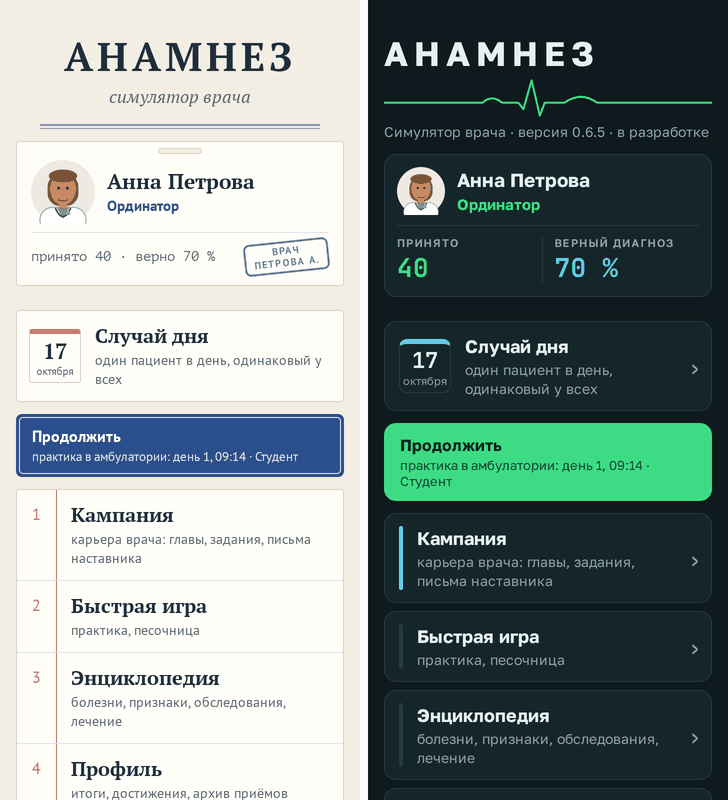
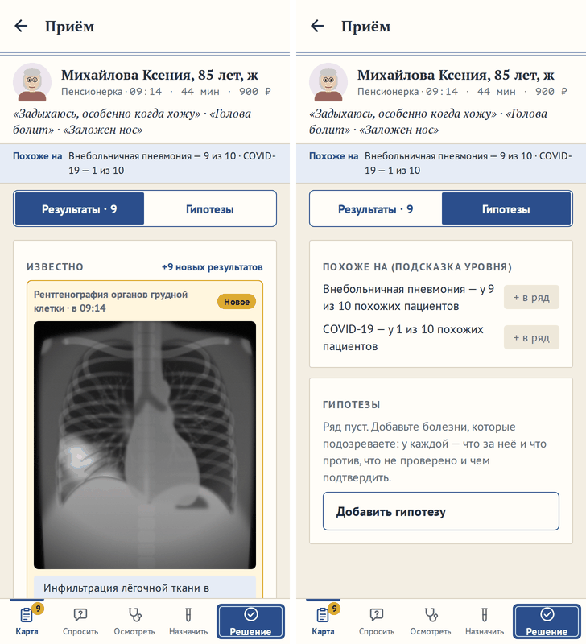

# Бейдж врача в меню и доска гипотез

**Версия:** 0.6.5 **Состояние:** сделано, ждёт проверки на телефоне

## Зачем

Две просьбы владельца 17.10.2026, обе решены вопросами в Issues.

- **Главное меню.** «Требуется оформление главной страницы меню, где пункты 1 кампания 5 настройки а вверху просто
  название игры, не хватает дизайна страницы». Макет трёх вариантов в обеих темах — бейдж врача, план больницы,
  «Сегодня» — вопрос 47 ([#150](https://github.com/Nefeste/anamnez/issues/150)). Ответ: «Вариант А Бейдж врача, и найти
  удачное место куда можно вынести Случай дня, чтобы не искать его в подменю».
- **«Карта» пациента.** «Может быть в Карта отделить доску дифференциальной диагностики с гипотезами от журнала
  результатов?» С 0.6.0 «Карта» — одна прокрутка: сверху журнал «Известно», ниже «Похоже на», «Ваш ряд» и правила;
  чем больше результатов, тем дальше вниз уезжает доска. Вопрос 46 ([#148](https://github.com/Nefeste/anamnez/issues/148)),
  ответ — вариант 1: переключатель вверху «Карты».

## Что увидит игрок

**Главное меню.**

- Сверху — название, как прежде: в «Медкарте» — над двойной чертой, в «Мониторе» — с кривой ЭКГ.
- Под ним — **бейдж вашего врача:** портрет в белом халате со стетоскопом, имя, звание, сколько принято и доля верных
  диагнозов. В «Медкарте» — карточка с прорезью для зажима и личной печатью врача «ВРАЧ ПЕТРОВА А.»; в «Мониторе» — панель
  с цифрами цветов монитора: принято — зелёным, как ЭКГ, верный диагноз — голубым, как сатурация. Приёмов ещё нет —
  «пока ни одного приёма» и прочерк. Касание бейджа — профиль.
- Ниже, под большим пальцем, — **«Случай дня»:** листок календаря с сегодняшним числом и что с ним — «один пациент в
  день, одинаковый у всех», «сегодня начат — продолжить с того же места» или «сегодня сыгран: B». Из «Быстрой игры» он
  ушёл: искать его в подменю не нужно.
- Дальше — «Продолжить» (без сохранений — «Кампания») и пункты, как прежде. У «Профиля» вместо имени — что внутри:
  «итоги, достижения, архив приёмов»: имя и числа — на бейдже.
- На высоком экране между бейджем и «Случаем дня» — пустое место: пункты — внизу. На маленьком экране меню листается.
- Версия в «Медкарте» — внизу меню, в «Мониторе» — под кривой ЭКГ, как прежде.

**«Карта» пациента.**

- Вверху «Карты» — переключатель **«Результаты» | «Гипотезы»**. Он над листом и не уезжает с прокруткой.
- «Результаты» — журнал «Известно», как прежде: новое сверху и выделено, где ничего не нашли — одной строкой; сделанные
  сроки, вернувшийся с результатами, кто платит. Открывается первым. Есть новые — на переключателе «Результаты · 9», и, как
  прежде, число на вкладке «Карта».
- «Гипотезы» — «Похоже на» с кнопками «в ряд», «Ваш ряд» с карточками гипотез и правила решения.
- У каждой части своя прокрутка: вернулись — там же. Часть запоминается у пациента, как вкладка.
- «Подождать» на «Гипотезах» переводит на «Результаты»: результаты придут туда, и новый встанет посередине.
- Приём закончен или его ведёт нанятый врач — переключателя нет, только журнал.
- Нижняя полоса и шапка не меняются: четыре вкладки и «Решение»; «Похоже на» одной строкой — под шапкой, с любой
  вкладки.

## Данные

- Сохранения не меняются. Часть «Карты» помнится только в памяти, как вкладка и открытое место на фигуре.
- `dailyMenuHint` (`src/state/daily.ts`) знает начатые приёмы: сегодняшний начат — «сегодня начат».
- Строки — `src/i18n/sections/menu.ts` (бейдж), `daily.ts` (листок календаря), `spikes.ts` (части «Карты»).

## Как сделано

- **Бейдж** — `Badge` в `src/ui/menu.tsx`: портрет — тот же `Portrait` с формой врача (`uniform="doctor"`), что у
  нанятых врачей; печать и прорезь — украшения, для чтения с экрана бейдж — одна кнопка: «Профиль: Анна Петрова,
  ординатор; принято 40 · верно 70 %».
- **«Случай дня»** — `DailyCard` там же: листок — рамка с полосой сверху, красной в «Медкарте», голубой в «Мониторе»;
  для чтения с экрана — «Случай дня, 17 октября: …».
- **Пункты внизу** — `Screen grow`: лист растягивается на экран, `MenuSpacer` отодвигает «Случай дня» и пункты вниз.
- **Части «Карты»** — в `PatientCard.tsx`: `Tabs` с ключами `results` и `board`; у каждой части свой `Pane` и своё место
  прокрутки (`card:results`, `card:board`).

## Проверки

- `daily.test.ts`: подпись в меню — что это, «сегодня начат», вчерашний начат — сегодняшний нет, «сегодня сыгран».
- Сценарий в браузере: при первом запуске бейдж — «Профиль: Анна Петрова, интерн; пока ни одного приёма», «Случай дня» —
  в меню; случай дня — из меню, «Назад» — в меню «сегодня начат», после приёма — «сегодня сыгран»; «Карта» —
  «Результаты» первыми, на «Гипотезах» — ряд, журнала нет; «Похоже на» — в ряд и правило коронарографии — на
  «Гипотезах»; на 360 × 640 с текстом 1,3 — «Гипотезы» и меню без вылезающего за край.

## Чего здесь нет

- План больницы (вариант Б) и «Сегодня» (вариант В) — владелец выбрал бейдж.
- Шкалы «до следующего звания» на бейдже нет: звание — без «осталось», как в профиле.
