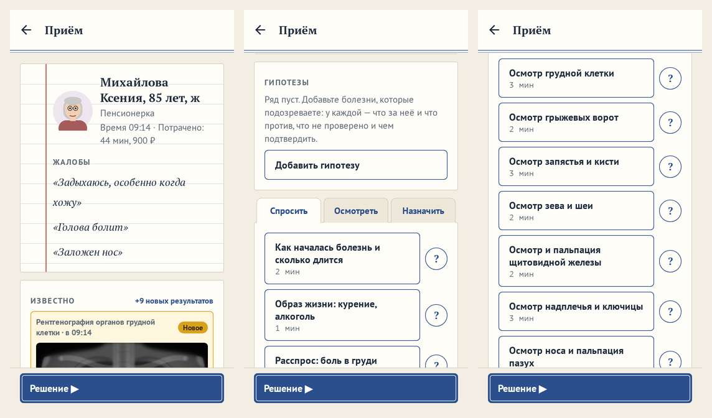
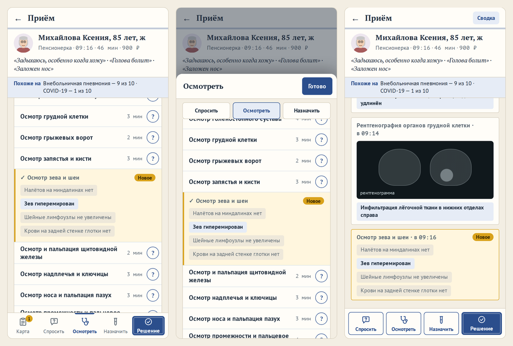
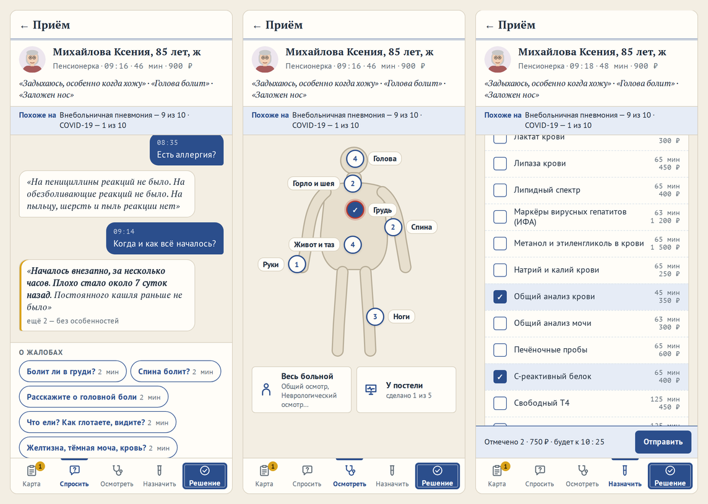
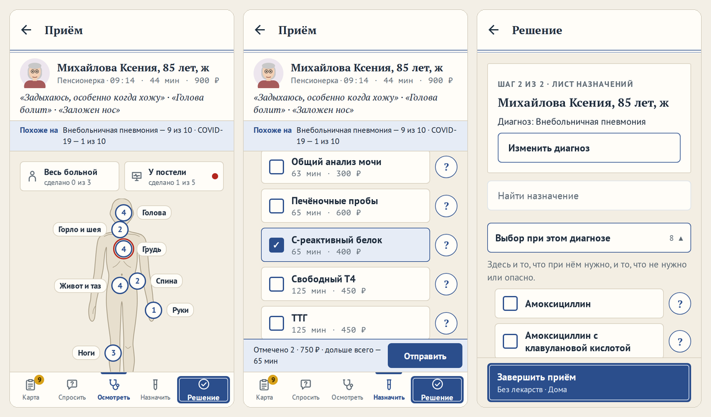

# Новая карта пациента

**Версия:** 0.6.0 **Состояние:** сделано — вариант 1, вкладки внизу, «Спросить» — беседой (владелец, 16.10.2026,
вопрос 43, [#139](https://github.com/Nefeste/anamnez/issues/139)); «Осмотреть» — фигурой человека, «Назначить» —
бланком направления, лечение — листом назначений (вопросы 44 и 45,
[#140](https://github.com/Nefeste/anamnez/issues/140), [#141](https://github.com/Nefeste/anamnez/issues/141))

## Зачем

Отзыв владельца 16.10.2026: «Можно критически переосмыслить концепцию одного длинного экрана с бесконечной прокруткой
и несколькими вкладками Спросить Осмотреть Назначить (которые тоже надо искать и прокручивать). Также информация о
пациенте всегда в самом верху, но чтобы увидеть, нужно скроллить. Всё время скроллить, на экране не закреплено
абсолютно ничего, кроме надписи Приём в самом верху и Решение в самом низу».

Как сейчас (больная с пневмонией из снимков магазина, телефон 360 × 640):

- Шапка с портретом, временем и жалобами занимает две трети первого экрана.
- Ниже — «Известно» со снимком, «Похоже на» и ряд гипотез; вкладки «Спросить / Осмотреть / Назначить» — на третьем-
  четвёртом экране.
- В «Спросить» у этой больной 21 действие, в «Осмотреть» — 29, в «Назначить» — 54; каждое — карточка в два ряда со
  справкой «?».
- Ответ появляется в двух местах — на месте строки и в «Известно»; на Android он уезжал вниз (исправлено в 0.5.20,
  [`2026-10-answer-in-view.md`](2026-10-answer-in-view.md)).

## Прототип

Три варианта — кликабельным прототипом на том же настоящем случае: все вопросы, осмотры и назначения этой больной, их
минуты и цена и что каждое из них покажет, взятые из движка. Вид — две темы игры: светлая «Медкарта» и тёмный
«Монитор». Решение и справка в прототипе не открываются: эти экраны остаются прежними. Ссылка на прототип — в вопросе 43.

## Что общее

- **Шапка пациента закреплена:** портрет, имя, возраст, работа, время, потраченные минуты и рубли. Жалобы — под ней в
  две строки, касание раскрывает.
- **Строка действия** — вдвое ниже нынешней карточки: название слева, минуты и цена — справа, «?» — кружком.
- **Группы.** Осмотр делится на «Осмотр» и «У постели» (виды `physical` и `bedside`). Назначения — на «Экспресс-тесты и
  ЭКГ», «Анализы» и «Снимки, УЗИ, КТ, МРТ и эндоскопия» (`rapid` и `functional`, `lab`, `imaging`), с поиском.
- **Ответ** на действие — на месте строки, с отметкой «Новое», посередине экрана.

## Варианты

### 1. Вкладки внизу

- Сверху закреплены шапка пациента и строка «Похоже на».
- Внизу, под большим пальцем: «Карта · Спросить · Осмотреть · Назначить» и «Решение». У каждой вкладки своя прокрутка:
  вернулись — там же, где были.
- «Карта» — что известно, «Похоже на» и гипотезы; на значке вкладки — число новых.
- Ждём анализ — полоса «Ждём: общий анализ крови — к 10:03 · Подождать» над вкладками.

**Хорошо:** привычно, как в любом телефонном приложении; листать меньше всего; ничего не открывается поверх.
**Плохо:** общая картина — на отдельной вкладке.

### 2. Лист и ящик

- На экране — сама карта, как лист истории болезни: что известно, новое сверху, «Похоже на», гипотезы.
- Действия — в ящике, который выезжает снизу: нажали «Осмотреть» — список; ответ — на месте строки, посередине ящика.
- Закрыли ящик — новое наверху карты.

**Хорошо:** карта всегда перед глазами.
**Плохо:** лишнее касание — открыть ящик; открытый ящик закрывает карту.

### 3. Беседа

- Приём — лента по ходу: вопрос — ответ пациента, осмотр — что нашли, анализ — «будет к 10:03», потом результат.
- Новое всегда внизу, у пальца: лента сама едет к нему.
- Действия — тем же ящиком снизу; «Сводка» в шапке — что известно, по обследованиям.

**Хорошо:** живо и понятно с первого приёма, ближе всего к расспросу.
**Плохо:** у тяжёлого больного лента длинная; общая картина — в сводке.

## Рекомендация

**Вариант 1.**

1. Это привычное устройство телефонных приложений: игрок не учится заново.
2. Листать меньше всего, и ничего не открывается поверх карты; «Похоже на» видно всё время.
3. Нынешние части карты переходят в него почти целиком. Снимки, разбор, «Практикант» и сценарии в браузере правятся, а
   не пишутся заново.

Беседа хороша для расспроса. Журнал приёма из неё можно добавить позже — на вкладку «Карта».

## Решение

Владелец, 16.10.2026, в чате сессии: «Вариант 1, делай вкладки внизу. Беседу тоже думаю нужно добавить, чтобы было похоже
на диалог, где врач выбирает что спросить и далее пациент рассказывает (опрос). Думаю это тянет как минимум на версию 0.6,
а не 0.5.х. Осмотр тоже надо подумать на что заменить вместо вкладки с прокруткой. Назначить — это может быть выписка
рецепта, где доктор выбирает что куда вписать?»

Прототип, версия 3 — вариант 1 с ответами на эти вопросы:

- **«Спросить» — беседа.** Вопросы внизу — двумя рядами, «О жалобах» и «О жизни», живой речью: «Когда и как всё
  началось?», «Есть аллергия?». Пациент отвечает репликой: найденное — первым и жирным, из «нет» — до трёх, остальное —
  «ещё N без особенностей». Беседа идёт сверху вниз, новое — у пальца.
- **«Осмотреть» — фигура человека** — вопрос 44: точки на теле — голова, горло и шея, грудь, живот и таз, спина, руки,
  ноги; касание — осмотры места в ящике. Ниже — «Весь больной» и «У постели». Помещается на один экран.
- **«Назначить» — бланк направления** — вопрос 45: свёрнутые разделы, галочки, «Отправить» разом; лечение в «Решении» —
  листом назначений.

## Как сделано

### Часть 1. Шапка, вкладки внизу, «Карта»

- **Карта** (`src/ui/case/PatientCard.tsx`) — экран без общей прокрутки: сверху закреплены шапка пациента (портрет,
  кто он, кем работает, время и потраченное, идущие сроки по рекомендации, жалобы в две строки — касание раскрывает) и
  полоса «Похоже на»; сделанный срок уходит из шапки на «Карту» — у инсульта их три, и шапка иначе занимала полэкрана;
  под ними — «За это время», когда что-то случилось. Ниже — лист вкладки, у каждой свой (`Pane`,
  `src/ui/components.tsx`): вернулись на вкладку — там же, где были.
- **Вкладки** (`src/ui/case/CardTabs.tsx`) — внизу: «Карта · Спросить · Осмотреть · Назначить» со значками, рисованными
  кодом (`CARD_ICONS`, `src/ui/iconShapes.ts`), и «Решение» — пятой, шире, цвета главной кнопки. На «Карте» — число
  нового. Новый пациент открывается со «Спросить», тот, с кем уже что-то делали (`VisitView.acted`), — с «Карты»; приём
  закончен или его ведёт нанятый врач — только «Карта» и своя кнопка внизу.
- **«Карта»** — «Известно», «Похоже на» с «в ряд», гипотезы, правила решения, сделанные сроки, возвращение и
  плательщик.
- **Ждём** — полосой над вкладками, с любой из них: «На обследовании: КТ — вернётся в 10:20», «Ждём: общий анализ
  крови — к 10:03», «Подождать», «Отпустить». Ждать нечего, а ждёт срочный — там же «Попросить подождать».
- **Ответ — посередине листа**, как в 0.5.20: у каждой вкладки свои места строк. Снимок, лента или срез — и в строке
  назначения, где их заказали, а не только на «Карте».
- **Вкладка помнится**, даже когда экран карты собран заново (из «Подробнее» в веб-сборке назад); отпустили пациента
  ждать — вернётся на «Карту» с новым.

### Часть 2. «Спросить» — беседой

- **Вопросы** (`src/ui/case/Talk.tsx`) — внизу вкладки, над вкладками, не выше трети экрана: «О жалобах» и «О жизни»
  (расспрос, все признаки которого — из анамнеза, `lifeHistory`). Плашка — вопрос врача живой речью и минуты; заданный
  уходит в ленту. Долгое касание — «Что это?», как «?» у осмотров; для чтения с экрана — действием.
- **Вопросы живой речью** — тексты интерфейса (`T.spikes.talk.questions`), а не база: это не медицинские сведения, а
  что проверяет вопрос — по-прежнему в базе. У каждого расспроса базы — свой вопрос (`talk.test.ts`).
- **Лента** — по порядку вопросов: вопрос справа, цветом главной кнопки, со временем; реплика пациента слева, курсивом,
  как жалобы. Новая реплика — целиком, как новое в «Известно»: важное «нет» («приступы такие же, не чаще») не прячется.
  В прежних найденное — первым и жирным, из «нет» — до трёх, остальное — «ещё N — без особенностей», касание раскрывает
  (`replyOf`, `src/ui/case/reply.ts`); касание фразы — справка о признаке. Открыли вкладку — лента в конце.
- **Голос реплик.** Реплика собрана из строк признаков, а они написаны для «Известно»: «Кашля нет», «Не курю», но и
  «Наркотики не употребляет». Пересказ от лица пациента целиком — отдельной частью, с изменением базы.

### Часть 3. «Осмотреть» — фигурой, «Назначить» — бланком, лечение — листом

Владелец, 16.10.2026: «да, фигура человека, только чуть реалистичнее и профессиональнее, а не как детский рисунок
человечка» (вопрос 44); «вариант 1» (вопрос 45).

- **Фигура** (`src/ui/case/BodyFigure.tsx`, контуры — `src/ui/bodyShape.ts`) — взрослый спереди, как схема в учебнике:
  пропорции, ключицы, рёберные дуги, колени, пупок; без лица и признаков пола. Цвет — из темы. На телефоне рисует
  Skia, на вебе — картинка SVG из тех же контуров.
- **Места** (`src/ui/case/Examine.tsx`) — точки на теле: голова, горло и шея, грудь, спина, живот и таз, руки, ноги;
  над фигурой — «Весь больной» (общий и неврологический осмотр, шкалы, кожа) и «У постели» (давление, пульс,
  сатурация, глюкометр). На точке — сколько осмотров осталось, всё сделано — галочка, нашли что-то — красный ободок.
  Касание открывает осмотры места панелью внизу вкладки, не выше половины экрана; ответ — на месте строки. Фигура с
  ногами — на экране без прокрутки; открытое место помнится, как вкладка. «Практикант» — места без осмотров по жалобе
  бледнее.
- **Где на теле делают осмотр** — раскладка интерфейса (`src/ui/case/places.ts`), а не база: база не меняется. Тест —
  у каждого осмотра руками и у постели есть место, приборы — на полке «У постели» (`places.test.ts`).
- **Бланк направления** (`src/ui/case/Referral.tsx`) — разделы: экспресс-тесты и ЭКГ, анализы, рентген, УЗИ, КТ и МРТ,
  эндоскопия, пункции; свёрнуты, есть поиск по названию. У раздела — сколько отмечено и сделано. Отмечают галочками;
  над вкладками — «Отмечено 2 · 750 ₽ · дольше всего — 65 мин» и «Отправить»: назначено разом, по порядку отметки
  (`examineAll`, `src/state/session.ts`), — то же, что по одному (`session.test.ts`). Отправленное — штампом «Будет в
  10:01», пришедшее — ответом на месте строки и на «Карте»; раздел с новым ответом раскрыт. Не сделать здесь — серым,
  с причиной. «Практикант» — первым разделом «По жалобе», раскрытым.
- **Раздел — по виду и кабинету базы** (`src/ui/case/sections.ts`): пункции — своим разделом, их делает врач. Тест — у
  каждого снимка кабинет из раздела, пустых разделов нет (`sections.test.ts`).
- **Лист назначений** (`src/ui/case/DecisionScreen.tsx`) — тот же вид: поиск по названию; сверху — «Выбор при этом
  диагнозе», раскрыт; остальное — группами препаратов, свёрнуто, у группы — сколько назначено; галочки, противопоказание
  и почему здесь не назначить — под названием. Место лечения — внизу листа, одно из нескольких. Строки бланка и листа —
  общие (`src/ui/case/FormRow.tsx`).

## Что дальше

Релиз 0.6.0 — частями, одним PR: части 1–3 и сценарии в браузере, снимки магазина и сайта. Карта одна у смены, «Случая
дня», «Разобрать случай» и прототипа П4 (`PatientCard`). Приём нанятого врача («Забрать себе») — тем же видом, без
действий.

После 0.6.0:

- **Пересказ от лица пациента** — реплики беседы живой речью целиком, с изменением базы (часть 2, «Голос реплик»).
- **Одно направление — одно время.** Сейчас «Отправить» стоит столько же минут врача, сколько отметки по одной: в
  жизни пишут одно направление. Это изменение движка и баланса — с симуляторами, отдельной частью.
- **Смена плана на обходе** — тем же листом назначений.
- **«Карта» из двух частей** — сделано в 0.6.5 по вопросу 46: переключатель «Результаты» и «Гипотезы», у каждой части
  своя прокрутка ([`2026-10-menu-board.md`](2026-10-menu-board.md)).
