# Премиальный вид: загрузка, свет на плане, звуки приборов, итог смены

**Версия:** 1.1.0 **Состояние:** сделано в коде, ждёт проверки на
телефоне (свет плана, звуки приборов, экран загрузки проверены только веб-стендом и Bun)

## Зачем

Игра вышла в магазин, и владелец хочет, чтобы она выглядела как готовый продукт, а не как
демонстрация: узнаваемый первый экран, загрузка с ходом, свет и тени на плане больницы,
звуки приборов и процедур, чистые меню и ясный итог смены. Проверка — снимки всех экранов в
обеих темах из веб-сборки, два полных прохода «снять — разобрать — поправить».

## Что нашла проверка до работы (проход 0)

По убыванию важности:

1. **Загрузка без лица.** В веб-сборке до оговорки — белая страница около секунды; в игре
   меню и смена ждут чтения сохранений пустым экраном, итог приёма считается с одной строкой
   «Закрываем приём…». Названия игры нигде нет.
2. **Итоги дня — столбик строк.** Главные числа (принято, верных диагнозов, оценки) не
   выделены; достижение дня — обычной строкой; конец главы — строкой в карточке главы.
3. **План больницы плоский.** Пол, стены и предметы — ровные заливки без тени и света:
   чертёж, а не помещение. Лампы и аппараты светятся, но мебель и люди «висят» на полу.
4. **Первый запуск без имени игры.** Оговорка — одна карточка сверху пустого экрана,
   название игры появляется только в меню после двух экранов.
5. **Звук без приборов.** Есть фон амбулатории, сигналы и тревога, но осмотр, ЭКГ, снимок и
   анализы беззвучны.
6. **Мелочи.** Предупреждения Skia в консоли (`SkPath.moveTo` устарел — кривая ЭКГ, знак
   студии); в веб-сборке подпись вкладки «Практикант» обрезается (на телефоне шрифт
   подстраивается); переходов между экранами в веб-сборке нет.

Ошибок в консоли нет; ничего не вылезает за край на 412 × 915 и 360 × 640.

## Что увидит игрок

- **Загрузка.** В веб-сборке — страница с названием игры и полосой хода: ход — по загрузке
  CanvasKit (несколько мегабайт) и кода. В игре — экран «Анамнез» с кривой ЭКГ, по которой
  бежит отметка, там, где прежде был пустой экран или одна строка: меню до прочтения
  сохранений, смена до чтения партии, итог приёма, пока считается разбор. Строка с
  названием и ходом — в цветах темы.
- **Первый запуск.** Над оговоркой — обложка игры (название и подзаголовок), как в меню;
  карточка «Это игра» и имя врача — под ней.
- **План больницы.** Мягкая тень у каждого предмета и человека (сдвиг к юго-востоку, как от
  верхнего света); у стен — полоска затенения на полу; в середине каждого помещения —
  слабый блик потолочной лампы; по линолеуму коридора — отблеск. Всё — в записанном
  рисунке пола и в слоях атласа: по одному лишнему обращению к GPU на слой.
- **Звуки приборов и процедур** — синтезированы кодом, как сигналы: манжета тонометра при
  осмотре у постели, писк монитора при ЭКГ, экспозиция рентгена при снимке, стук пробирок
  при отправке анализов. Играют по действию врача в карте пациента, не громче сигналов.
- **Итог смены.** Сверху — одна карточка дня: «День N закрыт», четыре плитки — принято,
  верный диагноз, уверенность идеального врача, ушли не дождавшись, — под ними только то,
  чего в плитках нет; у достижений дня — медаль на ленте. Конец главы — карточка «Глава
  пройдена» над картой главы. На итоге приёма вердикт — штампом цвета итога.
- **Переходы.** На телефоне экраны выезжают справа; вкладки карты пациента — как были.

Кадры — веб-сборка 1.1.0, 412 × 915:

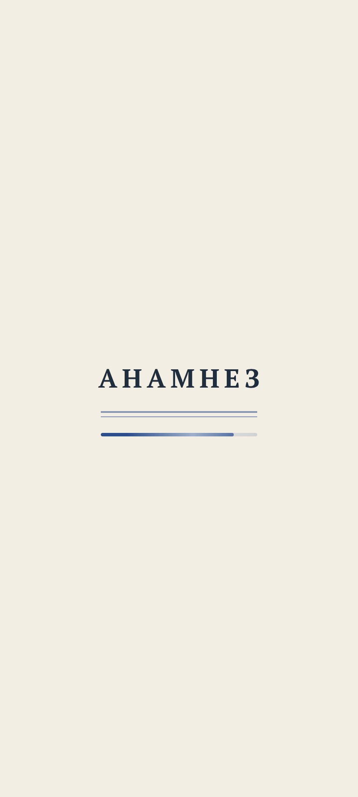
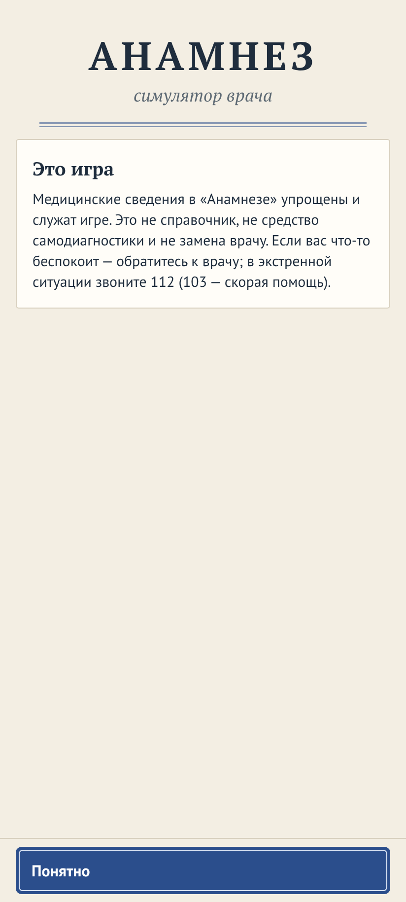
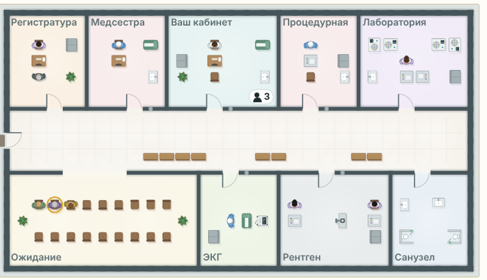
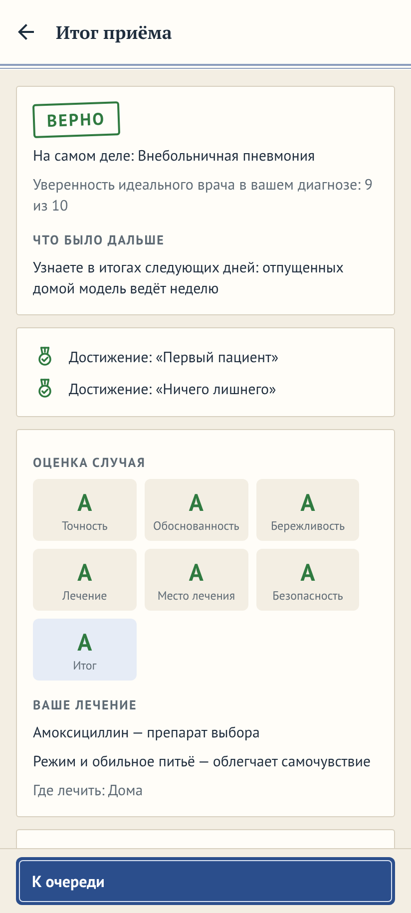
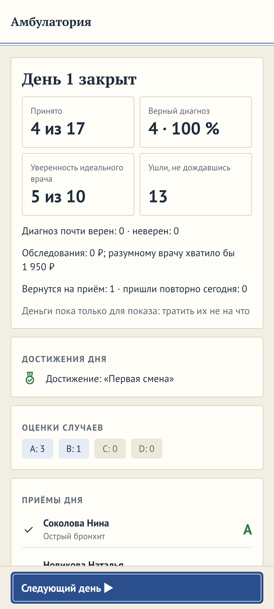
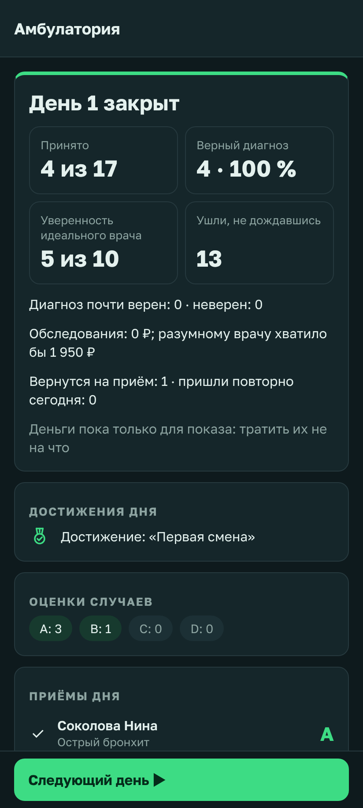
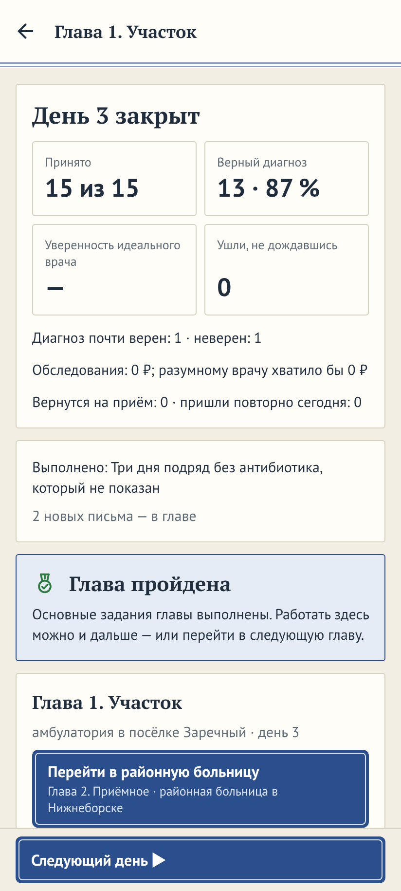

## Данные

- Состояние, сохранения, база и движок — без изменений.
- `assets/audio/`: новые WAV — `cuff.wav`, `monitor.wav`, `xray.wav`, `tubes.wav`;
  строки в `LICENSES.md` («синтезирован `tools/audio/gen.ts`»).
- `src/audio/sounds.ts`: имена новых звуков; `src/ui/case/sounds.ts` — какой звук у
  какого обследования (по разделу бланка и виду обследования).
- `src/ui/Loading.tsx`: экран загрузки; `src/app/+html.tsx`: страница веб-сборки с ходом.
- `src/render/map/floor.ts`: тени у стен, блики; `ClinicMap`, `BuildMap`, `HospitalMap`:
  слой теней атласа.
- Строки — `src/i18n/sections/common.ts` (загрузка), `shift.ts` (итог дня).

## Движок

Не меняется. Золотой отпечаток тот же.

## Неудачные случаи

- **Звук выключен или на нуле** — звуки приборов молчат, как сигналы.
- **Нет WebGL в вебе** — страница загрузки показывает ход до появления игры; дальше — как
  прежде.
- **Крупный текст и 360 × 640** — плитки итога дня переносятся на две строки, ничего не
  вылезает за край; проверяется снимками.
- **Тёмная тема** — план остаётся светлым; тени и блики на нём те же.

## Критерии приёмки

1. Снимки всех экранов в обеих темах (412 × 915) без ошибок в консоли; на 360 × 640 ничего
   не выходит за край.
2. План больницы: тень у предметов и людей, затенение у стен, блики; кадры карты не
   дорожают заметно — слоёв атласа на карте смены не больше, чем было, плюс два.
3. Загрузка: в веб-сборке до оговорки видно название и полосу хода; в игре — экран
   загрузки вместо пустого.
4. Итог смены начинается с карточки дня с тремя плитками; у конца главы — своя карточка.
5. Четыре новых звука — WAV моно 16 бит 22 050 Гц, без перегрузки, тише «срочного», со
   строкой в реестре; `audio.test.ts` их знает.
6. `npm run lint`, `npm run typecheck`, тесты и веб-сценарий проходят.

## Чего здесь нет

- Заставки при запуске на телефоне — брендбук студии её запрещает (ADR 0017); системный
  экран запуска — в `app.json`, он не меняется.
- Новых записей CC BY, картинок и шрифтов из сети.
- Смены раскладки меню (spec 2026-10-menu): пустое место между бейджем и пунктами — по
  решению владельца, пункты под большим пальцем.
- Анимации людей на плане сверх того, что есть.

## Что изменилось по ходу работы

- **Страница загрузки веб-сборки — `public/index.html`, а не `+html.tsx`:** у сборки
  `web.output: single` корневой файл берётся из `public/`, а `+html.tsx` — только у статической.
  Ход — не байтами, а ступенями, которые видны коду: код выполняется, CanvasKit готов, экран
  собран. Название — из `<title>`: сборка подставляет имя игры только туда.
- **Строки в HTML нет:** название берётся из `<title>`, подзаголовка на странице нет —
  тексты для игрока остаются в `src/i18n`.
- **Тест рисунка плана** держит пол у стены своим цветом с допуском 4 — поэтому затенение не
  дальше 0,16 клетки от полосы стены, а блик лампы не шире пола помещения; в коридоре лампы
  по средней линии коридора шириной от трёх клеток, радиус 1,4 клетки.
- **Headless-тест Skia** подменяет модуль только типами и `Skia`: в записи пола точки —
  простые `{ x, y }`, без `vec` из слоя React.
- **Проход 1 показал:** блики едва видны, коридор плоский — усилены до 0,22, добавлены лампы
  коридора; третья плитка карточки дня растягивалась на всю ширину — плиток четыре, две в
  ряд («Ушли, не дождавшись» — четвёртая); достижения на итоге приёма остались строками —
  общий `AchievementLine` с медалью; план «Своей больницы» между сменами — без рамки, как у
  карты смены, — в рамке.
- **Звуки приборов** — по виду обследования базы (`kind`) и разделу бланка, а не по списку
  идентификаторов: новое обследование получает звук само; тест сверяет: молчат только
  расспрос и осмотр руками.
- **Проход 3 (разбор снимков прохода 2):** карточка дня и прежние «Итоги дня N» повторяли
  числа — теперь одна карточка: плитки и под ними только то, чего в плитках нет (кто сколько
  принял с нанятыми врачами, не успели принять, почти верные и неверные диагнозы, обследования
  против разумного врача, повторные). Веб-сценарий читает «Принято» с плитки (`summary-seen`)
  и строку «Вами — N, врачами — M» (`summary-seen-by`) — те же факты. Отметка достижения
  (кольцо с точкой) читалась как переключатель формы — теперь медаль на ленте с галочкой
  (`AWARD_ICON` в `iconShapes.ts`, значок кодом), зелёная, как была галочка полученного в
  списке достижений профиля; там полученные — тоже этой медалью; «Глава пройдена» — она же.

## Что проверено

- Снимки всех экранов веб-сборки — четыре прохода (0–3), обе темы, 412 × 915 и 360 × 640:
  79 снимков на проход; ошибок в консоли нет, за край ничего не выходит. Остались только
  предупреждения: программный WebGL безголового Chromium и устаревшие вызовы `SkPath` в
  рисунке рентгена (`src/render/xray`) — не тронуты, это генератор снимков.
- `npm run lint`, `npm run typecheck` (приложение и `tools`), `bun test tools/test` —
  2017 из 2017; веб-сценарий `npm run e2e` — все проверки (число — в отчёте о работе).
- Не проверено на телефоне: кадры карты с двумя слоями теней, громкость звуков приборов из
  динамика, переход `slide_from_right`, экран загрузки при «уменьшить движение».

## Журнал проверок

Полные отчёты субагента (модель Fable, ветка `wip/premium`) — дословно; между ними — мой разбор его снимков, после
которого был третий проход; в конце — что сделано после него в том же PR (Nefeste/anamnez#198). Пути `pass0/` …
`pass3/` в отчётах — папки снимков в сессии: каждый проход — 79 экранов в обеих темах на 412 × 915 и 40 на 360 × 640,
консоль по экранам — `console.json`. В репозиторий положены ключевые кадры до и после — ниже. Правило владельца
31.10.2026: результаты работы агентов записываются в репозиторий.

### Кадры до и после

До работы (проход 0) → после (1.1.0):

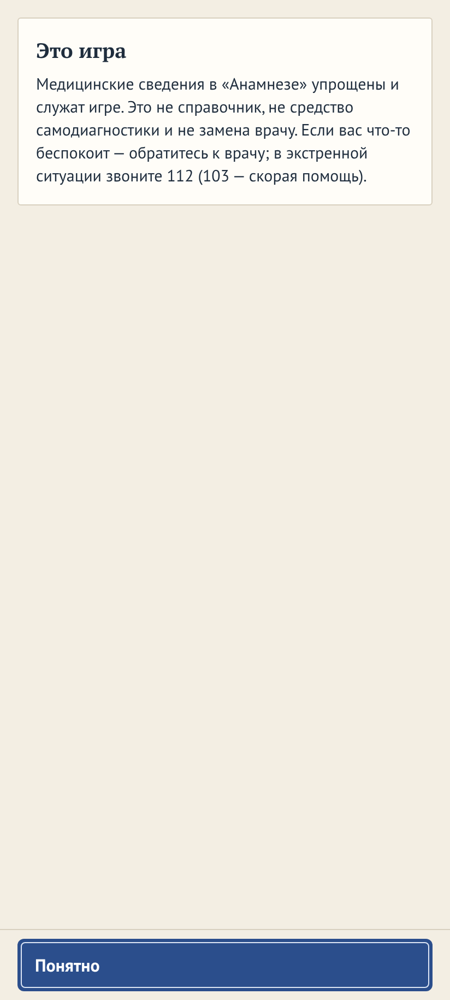

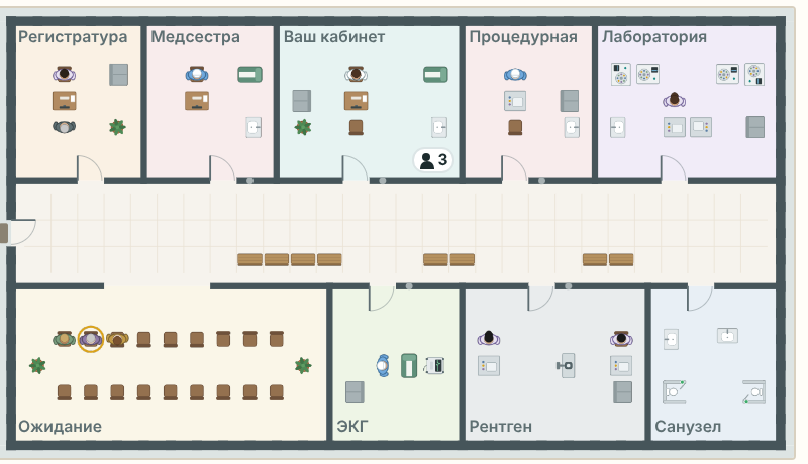

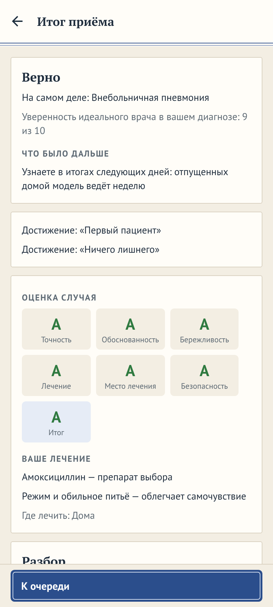

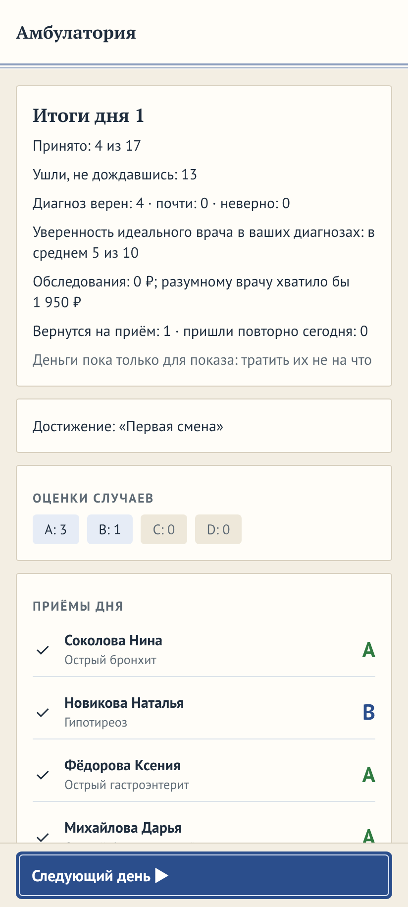

### Отчёт 1 — проходы 0, 1 и 2

### Итог: премиальный проход по «Анамнезу» (ветка `wip/premium`, 6 коммитов, всё проверено)

Работал только в `/home/user/anamnez-premium`. Версия не поднята, ничего не пушил, PR/теги не создавал. Движок, база,
сохранения, `app.json`, `.github/` не тронуты. Новых зависимостей, картинок, шрифтов и CC BY записей нет — всё
нарисовано/синтезировано кодом.

#### Проход 0 — критические находки (по убыванию важности)
1. **Загрузка без лица.** Веб-сборка: белая страница ~1 с до оговорки. В игре меню ждёт сохранения пустым экраном
   (`<Screen bare>{null}</Screen>`), смена — карточкой «Открываем амбулаторию…», итог приёма — строкой «Закрываем
   приём…». Имени игры нигде нет.
2. **Итоги дня — столбик из 8 строк текста**: главные числа не выделены, достижение дня — обычная строка, конец главы
   — строка внутри карточки главы.
3. **План больницы плоский**: ровные заливки без теней и света; мебель и люди «висят» на полу.
4. **Первый запуск без имени игры**: оговорка — одна карточка сверху пустого экрана.
5. **Звук без приборов**: есть фон, сигналы, тревога; осмотр/ЭКГ/снимок/анализы беззвучны.
6. **Мелочи**: предупреждения Skia в консоли (`SkPath.moveTo` устарел — кривая ЭКГ, знак студии); в вебе подпись
   вкладки «Практикант» обрезается (на Android шрифт подстраивается); переходов экранов в вебе нет.

Ошибок консоли — 0; переполнений на 412×915 и 360×640 — 0 (обе темы).

#### Проход 1 (коммиты)
- `9ebea96` — спецификация `docs/specs/2026-10-premium-polish.md` (+ строка в `docs/specs/README.md`) и **свет на
  плане**: в записи пола (`src/render/map/floor.ts`) затенение у стен градиентом (0,16 клетки от полосы — тест
  `mapdraw` держит пол у стены своим цветом с допуском 4) и блики потолочных ламп в середине помещений; на картах
  смены/стройки/прототипа — слой теней тем же атласом цветом тени (`colors` + `colorBlendMode="srcIn"`), сдвиг к
  юго-востоку: +1 обращение к GPU на предметы и +1 на людей.
- `3f68e9b` — **звуки приборов и процедур**: `tools/audio/gen.ts` синтезирует `cuff.wav` (манжета: 5 качков груши +
  спуск), `monitor.wav` (3 тона пульсоксиметра), `xray.wav` (гул трубки + щелчок реле), `tubes.wav` (два стеклянных
  тона); строки в `assets/audio/LICENSES.md`; `src/ui/case/sounds.ts` выбирает звук по `kind` обследования и разделу
  бланка (расспрос и осмотр руками молчат); играет `PatientCard` при `act`/`actAll`, громкость 0,5 (тише сигналов).
  `audio.test.ts` знает новые файлы и сверяет карту звуков по всей базе.
- `64576d8` — **экран загрузки** `src/ui/Loading.tsx` (название + кривая ЭКГ с бегущим отрезком, Reanimated; при
  `useReducedMotion` — статично) вместо пустых экранов меню, смены и итога приёма; **страница загрузки веб-сборки**
  `public/index.html` (у `web.output: single` Expo берёт `public/index.html`, не `+html.tsx`): название из `<title>`,
  полоса хода по ступеням (код выполняется → CanvasKit готов → экран собран; `index.web.ts`, `src/ui/splash.web.ts`;
  на телефоне заглушка `splash.ts`); обложка игры над оговоркой первого запуска; `animation: 'slide_from_right'` в
  стеке; `EcgLine` и `Studio` переведены на `PathBuilder` (ушли предупреждения).
- `668ccba` — **итог смены/главы/приёма**: карточка «День N закрыт» с плитками (`StatTile`), достижения с медалью,
  карточка «Глава пройдена» над главой (`src/ui/campaign.tsx`), штамп вердикта «ВЕРНО/ПОЧТИ/НЕВЕРНО» цветом итога на
  итоге приёма (`Urgency big`).

Критический разбор прохода 1: на странице загрузки осталась `%WEB_TITLE%` (Expo подставляет имя только в `<title>`);
блики едва видны, коридор плоский; третья плитка карточки дня растягивалась на всю ширину; достижения на итоге приёма
остались строками; план «Своей больницы» между сменами без рамки (в «Мониторе» — светлое пятно без негатоскопной
рамки).

#### Проход 2 (коммиты)
- `30abee1` — имя на странице загрузки из `document.title`; свет 0,22 и **лампы коридора** вдоль средней линии
  коридора (ширина ≥ 3 клеток, радиус 1,4); **четыре плитки** 2×2 («Ушли, не дождавшись» — четвёртая); общий
  `AchievementLine` (итог приёма и дня); план между сменами — в рамке, как карта смены; «Что изменилось по ходу
  работы» в спецификации.
- `503d8e5` — документы: `docs/02-architecture.md` §6 (слой света и теней), §7 (экран загрузки), §10 (звуки
  приборов); спецификация — состояние и «Что проверено».

##### Снимки «до/после» (полные наборы — в сессии субагента; ключевые — ниже, в «Кадрах до и после»)
- Загрузка веба: `pass0/00-loading-light.png` (белая) → `pass2/00-loading-light.png`, `pass2/00-loading-dark.png`
- Оговорка: `pass0/01-disclaimer-light.png` → `pass2/01-disclaimer-light.png`
- Карта смены: `pass0/05-shift-queue-light.png` → `pass2/05-shift-queue-light.png` (и `-dark`); увеличенные вырезы
  плана: `pass0-map-zoom.png` → `pass1-map-zoom.png` → `pass2-map-zoom.png`
- Итог приёма: `pass0/08-outcome-light.png` → `pass2/08-outcome-light.png` (и `-dark`)
- Итоги дня: `pass0/09-summary-light.png` → `pass2/09-summary-light.png` (и `-dark`); маленький экран
  `pass2-small/09-summary-light.png`
- Глава пройдена: `pass2-chapter/11-chapter-done-card-light.png`, `-dark.png`
- Своя больница между сменами: `pass0/10-sandbox-evening-dark.png` → `pass2/10-sandbox-evening-dark.png`
- Все 79 экранов за проход: `pass0/`, `pass1/`, `pass2/` (+ `pass1-small/`, `pass2-small/` на 360×640).

#### Чего сознательно не делал — вопросы владельцу
1. **Системный экран запуска Android** (`app.json`) не трогал (запрет на `app.json`; брендбук запрещает
   заставку-логотип). Экран загрузки в игре виден только там, где есть ожидание. Варианты: оставить; или в отдельной
   задаче подогнать цвета системного экрана запуска под темы. Рекомендация: оставить.
2. **Пустое место в меню** между бейджем и пунктами — решение владельца (spec 2026-10-menu: пункты под большим
   пальцем). Варианты: оставить; заполнить бледной кривой ЭКГ/«водяным знаком». Рекомендация: оставить.
3. **Предупреждения `SkPath` в генераторе рентгена** (`src/render/xray/*`) остались (только на экране карты
   пациента; ошибок нет). Это медицинская картинка с золотыми тестами — отдельная задача «перевести на PathBuilder».
   Рекомендация: отдельным PR.
4. **Тишина в кабинете** (фон играет только на экране смены) — по документам так задумано («за закрытой дверью
   тихо»). Вариант: очень тихий фон и на приёме. Рекомендация: не менять.
5. **Звуки приборов проверены только анализом волны в Bun** (длина, пик, 5 качков, тоны), не на слух из динамика.
   Прошу послушать на телефоне; громкость — одна константа `volume.device` в `src/audio/sounds.ts`.
6. **Конца карьеры как отдельного экрана нет** — в движке нет такого события; «Глава пройдена» есть и у последней
   главы (`completeLast`). Делать «итог карьеры» — вопрос дизайна.
7. **Быстродействие на телефоне не мерил**: +2 слоя атласа на кадр и десятки градиентных прямоугольников в записи пола
   — ожидаемо дёшево, но проверить стоит на `/spikes/map` (счётчик кадров) в режиме разработчика.
8. **Ход загрузки в вебе — ступенями, не байтами**: загрузчик CanvasKit не отдаёт прогресс, а `wasmBinary` эта сборка
   не принимает; честные три ступени вместо «липового» процента. Веб — стенд, на телефоне этой страницы нет.
9. Обрезка «Практика…» в вебе не правил — на Android `adjustsFontSizeToFit` работает.

#### Проверки (точные результаты)
- `npm run lint` — 0 предупреждений (EXIT 0). `tsc --noEmit` (приложение) и `tsc -p tools` — EXIT 0.
- `bun test tools/test` (полный набор) — **2017 из 2017**, 159 файлов, 0 падений (860 с); в нём
  theme/i18n/licenses/audio/mapdraw; отдельно `audio.test.ts` 8/8, `mapdraw.test.ts` 16/16.
- `npm run e2e` на финальной сборке — **438 из 438**, «нет ошибок в консоли», «Всё прошло».
- Мои съёмки, проход 2: 79 экранов × 2 темы + 40 на 360×640 + карточка главы — **0 ошибок консоли, 0 переполнений**;
  остались только предупреждения: программный WebGL безголового Chromium и `SkPath` в рентгене (п. 3).
- Не проверено: телефон (кадры, звук из динамика, переход `slide_from_right`, «уменьшить движение»).

---

### Мой разбор после прохода 2 (отправлен субагенту на третий проход)

Снимки `pass2/` я смотрел сам. Загрузка, обложка над оговоркой, штамп вердикта и свет на плане — хорошо. Два огреха
субагент пропустил:

1. **Итоги дня дублировали числа**: под новой карточкой «День 1 закрыт» с плитками стояла старая «Итоги дня 1» с теми
   же «Принято: 4 из 17», «Ушли, не дождавшись: 13», уверенностью и диагнозами.
2. **Отметка достижения выглядела как радиокнопка** (кольцо с точкой) в обеих темах — на итоге приёма и дня.

---

### Отчёт 2 — проход 3

### Проход 3 — готово (ветка `wip/premium`, worktree `/home/user/anamnez-premium`)

#### Коммит
- `fb4fe6b` — «Проход 3: итоги дня одной карточкой без повторов чисел; медаль на ленте вместо кольца у достижений»
  (с теми же трейлерами). Дерево чистое; всего на ветке 7 коммитов над `main` (9ebea96 … fb4fe6b).

#### Что исправлено
1. **Итоги дня — одна карточка.** `DayCard` в `src/app/shift/index.tsx`: «День N закрыт», четыре плитки (принято,
   верный диагноз, уверенность идеального врача, ушли не дождавшись) и под ними только то, чего в плитках нет: с
   нанятыми врачами — «Вами — N, врачами — M»; не успели принять; «Диагноз почти верен: … · неверен: …»; обследования
   против разумного врача; вернутся/повторно; примечание о деньгах. Второй заголовок «Итоги дня N» и повторные строки
   убраны; неиспользуемые строки `title/seen/seenAll/left/verdicts/confidence` из `src/i18n/sections/shift.ts`
   удалены, добавлены `seenBy`, `verdictRest`. Проверено на вариантах: практика, песочница (касса), нанятый врач
   (строка «Вами — 3, врачами — 30»), глава кампании (карточки «Выполнено», «Глава пройдена», глава) — дублей нет;
   карточки «Стационар/Скорая/Где ждали/Сроки/Операционная» — отдельные факты, не трогал.
   - Веб-сценарий: три проверки переписаны на те же факты в новой раскладке (`summary-seen` теперь плитка
     «Принято\nN из M»; с нанятым врачом — плитка + `summary-seen-by` по регулярке «^Вами — \d+, врачами —
     [1-9]\d*$»); ни одна проверка не ослаблена. `summary-cash`, `summary-colleagues`, «summary-seen отсутствует до
     закрытия дня» — как были.
2. **Отметка достижения — медаль на ленте.** Существующего значка награды в `iconShapes.ts` не было (только группы
   болезней, вкладки карты, полки), в профиле полученное отмечалось зелёной галочкой «✓». Добавил `AWARD_ICON` (диск с
   галочкой и лента двумя полосами, контур в сетке 24×24, кодом) и использую его зелёным: `AchievementLine` (итог
   приёма и дня), «Глава пройдена» (`src/ui/campaign.tsx`), и в списке достижений профиля вместо «✓» (неполученные —
   прежний «○»). `icons.test.ts` проверяет контур медали.

#### Снимки (до → после)
- Итоги дня: `pass2/09-summary-light.png` → `pass3/09-summary-light.png`; `pass2/09-summary-dark.png` →
  `pass3/09-summary-dark.png`; 360×640: `pass3-small/09-summary-light.png`, `-dark.png`
- С нанятым врачом (новая фикстура): `pass3/10-hired-summary-light.png`, `-dark.png`; песочница с кассой:
  `pass3/10-sandbox-summary-light.png`, `-dark.png`
- Итоги дня главы кампании + «Глава пройдена»: `pass3/11-chapter-done-light.png` (верх),
  `pass3/11-chapter-done-card-light.png` (карточка), `-dark.png`; 360×640: `pass3-small/11-chapter-done-card-light.png`,
  `-dark.png`
- Итог приёма (медаль): `pass2/08-outcome-light.png` → `pass3/08-outcome-light.png`; `pass2/08-outcome-dark.png` →
  `pass3/08-outcome-dark.png`; 360×640: `pass3-small/08-outcome-light.png`, `-dark.png`
- Консоль по экранам: `pass3/console.json` — ошибок 0; переполнений 0 (обе раскладки).

#### Проверки (точно)
- `npm run lint` — EXIT 0 (0 предупреждений); `tsc --noEmit` (приложение) — EXIT 0; `tsc --noEmit -p tools` — EXIT 0.
- Тесты по затронутому: `theme`, `i18n`, `icons`, `licenses`, `audio`, `mapdraw` — **54 из 54**, 0 падений (тестов UI
  итогов/исхода в `tools/test` нет — они покрыты веб-сценарием).
- `npm run e2e` на финальной сборке: первый прогон **437 из 438** — упала одна проверка «песочница: касание
  регистратуры»: на полоске помещения не было строки «Сегодня: прошли …», которая появляется только когда кто-то уже
  прошёл регистратуру (`summary.waits`, `src/state/session.ts:2175`), а смена в сценарии засеяна временем запуска; код
  карты, полосок и ожиданий в проходе 3 не менялся. Повторный прогон — **438 из 438**, «нет ошибок в консоли», «Всё
  прошло» (та же проверка прошла). Проверку не менял.
- Не проверено на телефоне (как и прежде): кадры карты, звук из динамика, переходы, «уменьшить движение».

---

### Что я сделал после субагента (в том же PR Nefeste/anamnez#198)

- Разобрал падение проверки регистратуры: больного с тревожной жалобой регистратор ведёт к медсестре без очереди, и
  в «Сегодня» регистратуры он не идёт; если такой приходил первым, строки ещё не было. Теперь сценарий в этом случае
  пускает часы, пока регистратура не оформит кого-то по очереди, и требует ту же строку (коммит `70c8ff7`).
- Версия 1.1.0, `versionCode` 141; «Что нового» в игре, README и карточке; снимки магазина пересняты там, где
  поменялась игра; README сокращён до 20,6 КБ (разделы 0.6.1–0.6.8 — в журнал); STATUS, дорожная карта, журнал;
  кадры в спецификации.
- Проверки на итоговом коде: линтер и типы — без замечаний; полный прогон тестов — 2017 из 2017; сценарий в браузере
  — 438 из 438, ошибок в консоли нет; CI PR — зелёный.
