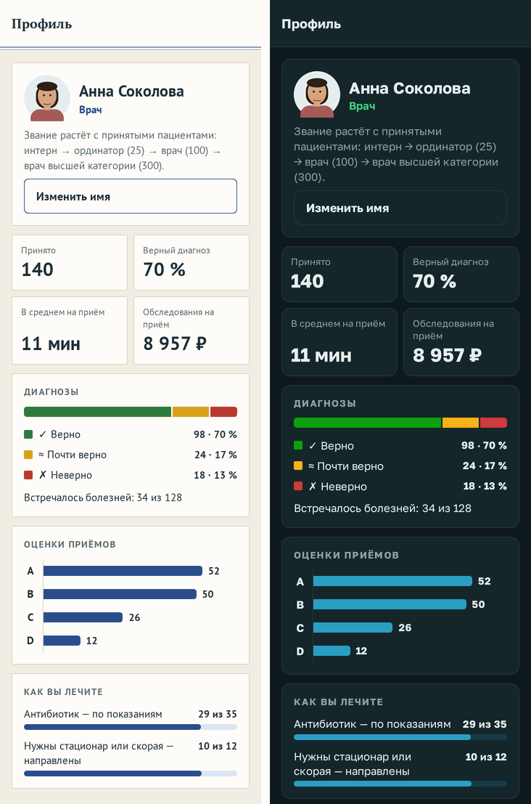

# Профиль: порядок и графики

**Версия:** 0.6.2 **Состояние:** сделано, ждёт проверки на телефоне

## Зачем

Пункт 80 дорожной карты — просьба владельца 16.10.2026: «в профиле нужно также прибраться и сделать в лучших
практиках data visualization». До 0.6.2 итоги практики шли восемью строками текста одного вида: «Принято: 140»,
«Диагноз верен: 98 (70 %) · почти: 24 · неверно: 18», «Оценки приёмов: A — 52 · B — 50 · C — 26 · D — 12», деньги,
минуты, антибиотики, опасное, встречавшиеся болезни; специальности — строками «Терапия — уровень 2»; архив — все 50
приёмов подряд. Главное не отличалось от второстепенного, а доли и ряды приходилось складывать в уме.

## Что увидит игрок

- Шапка — портрет, имя и звание, под ними — лестница званий строкой, как прежде. Шкалы «до следующего звания» нет:
  профиль не показывает «осталось» (обещания студии, [`2026-09-profile.md`](2026-09-profile.md)).
- Главное — четырьмя плитками: «Принято», «Верный диагноз» — доля, «В среднем на приём» — минуты, «Обследования на
  приём» — рубли. Плитки минут нет, пока ни у одного приёма нет минут врача (профиль до 0.0.30).
- «Диагнозы» — одна полоса из трёх частей: верно, почти верно, неверно. Под ней легенда: цветной квадрат, значок
  (✓, ≈, ✗), подпись, число и доля — «98 · 70 %». Цвет — не единственный носитель смысла. Под легендой — строкой,
  как прежде, «Встречалось болезней: 34 из 128».
- «Оценки приёмов» — четыре горизонтальные полосы A–D от общего основания, одним цветом, число — у конца полосы.
- «Как вы лечите» — шкалы «N из M»: антибиотик — по показаниям, нужны стационар или скорая — направлены. Пока
  таких приёмов не было, шкалы нет; нет обеих — нет и карточки.
- «Специальности» — у каждой шкала от порога нынешнего уровня до следующего, «уровень 2» и «до следующего — 3 верных
  диагноза»; у высшего уровня шкала полная.
- «Достижения» — «Получено: 9 из 24» строкой у кнопки «Все достижения», как прежде: у достижений нет «осталось»
  ([`2026-09-campaign.md`](2026-09-campaign.md)).
- «Архив приёмов» — первые 10, остальные — по кнопке «Показать все — 14», обратно — «Свернуть».
- Приёмов ещё нет — вместо итогов «Пока ни одного приёма: итоги появятся после первого», пустых графиков нет.

## Как сделано

- **Форма — по задаче числа:** одна цифра — плитка; доля от предела — шкала; часть целого — одна полоса из частей;
  ряд величин одного вида — горизонтальные полосы от общего основания. Кругов и колец нет, двух шкал на одном графике
  нет.
- **Без «осталось»:** шкала до следующего — только у специальностей, где «до следующего — N верных диагнозов» было и
  раньше ([`2026-10-skills.md`](2026-10-skills.md)). Звание, достижения и встречавшиеся болезни — строкой: шкала до
  полной звала бы добирать, а профиль не зовёт и не торопит.
- **Цвета — роли темы** (`src/ui/palette.ts`): `chart` и `chartTrack` — ряд и шкалы, один цвет на всех графиках:
  синий в «Медкарте», голубой в «Мониторе», как кривая сатурации; дорожка шкалы — светлый шаг того же цвета. `good`,
  `warn`, `bad` — только итог диагноза. Цвета проверены валидатором палитр: полоса светлоты, насыщенность,
  различимость при нарушениях цветового зрения (ΔE OKLab не меньше 8) и без них (не меньше 15), контраст не меньше
  3 к 1 к карточке — светлая тема на #FFFDF8, тёмная на #15262A. Что валидатор нашёл: зелёный и жёлтый «Монитора» под
  протанопией почти сливались (ΔE 5,6) — у итога диагноза свои шаги; зелёный ряд рядом с «верно» сливался (ΔE 7) —
  ряд «Монитора» голубой. Жёлтый «почти верно» на светлой бумаге слабее 3 к 1 — рядом всегда значок и подпись.
- **Метки:** полосы тонкие — 14, шкала — 8; конец закруглён на 4, у основания — прямой; между частями полосы —
  промежуток цвета карточки в 2; основание полос оценок — сплошная тонкая линия. Подписи и числа — цветом текста, не
  цветом данных. В плитке подпись — приглушённо, цифра — крупно, тем же шрифтом без засечек; цифры плиток одного ряда
  — на одной линии, даже когда подпись соседа в две строки.
- **Каждое число — без касаний:** всплывающих подсказок нет, у каждого графика подписи с числами. Читалке экрана —
  `accessibilityLabel` со всеми числами графика, у шкал — роль `progressbar` и значения.
- **Рисуются `View`**, без холста — одинаково на телефоне и в вебе: `StatTile`, `Meter`, `StackBar`, `BarList` в
  `src/ui/charts.tsx`.
- **Числа** — `practiceView`, `rankProgress`, `pctOf` и `specialtyRows` с порогами уровней в
  `src/state/profileView.ts`; строки `practiceLines` убраны. Сохранение профиля не менялось.

## Проверки

- `profile.test.ts`: приёмов нет — итогов нет; итоги числами — доля верных, оценки, рубли на приём, встречавшиеся
  болезни; профиль до 0.0.30 — без плитки минут и шкал антибиотиков и опасного.
- `skills.test.ts`: строки специальностей — уровень, подсказка, очки, порог нынешнего уровня и следующего, у высшего —
  без следующего.
- `theme.test.ts`: `chart`, `good` и `bad` — не меньше 3 к 1 к карточке в обеих темах.
- Сценарий в браузере: после первого приёма — плитки «Принято: 1» и минут, у полосы диагнозов одна часть — 100 %,
  специальности — «уровень 1».
