# Путь к публикации: критический проход и части

**Версия:** 1.1.x → публикуемая **Состояние:** проход сделан 31.10.2026; части 97–103 задуманы, 99–102 ждут
ответов владельца

## Зачем

Владелец 31.10.2026 решил публиковать в RuStore не 1.0, а более позднюю версию — «когда она будет выглядеть так, что
она готова к публикации - играбельная, завершенная, с достойным дизайном» (дорожная карта, «Путь к публикации»; там же
три мерки, расписанные так, чтобы их можно было проверить). Чтобы понять, чего не хватает, игру прошёл критик глазами
нового игрока. Здесь — что он нашёл, мой разбор его выводов и части, которые закрывают найденное.

## Как проверяли

- Субагент на другой модели, без моих гипотез: только мерки из дорожной карты. Читал код и документы, ничего не менял.
- Веб-сборка 1.1.0, собранная заново; Playwright, окна 412 × 915 и 360 × 640, светлая («Медкарта») и тёмная
  («Монитор») темы; пять обходов, 171 снимок; ошибки страницы и консоли собирались на каждом экране — их ноль.
- Первый запуск → кампания с начала: первая смена, три приёма, итоги дня, день 2; все пункты меню; режим разработчика.
  Конец кампании — на сохранении после главы 4, собранном движком.
- Я пересмотрел снимки ключевых находок и проверил выводы по коду; поправки — в «Журнале проверок», «Мой разбор».
- Не проверено: звук из динамика (в веб-сборке выключен кодом), плавность на телефоне, главы 2–4 вживую.

## Итог по меркам

| Мерка | Субагент | После разбора |
|---|---|---|
| играбельная | не готово, близко | почти: тупиков, падений и ошибок нет; первый день главы 1 давит на новичка (часть 100), ответ на общий вопрос — стена отрицаний (часть 97) |
| завершённая | не готово | не готово: у кампании нет финала, у карьеры — итога (часть 99); заглушек нет, всё в меню работает |
| с достойным дизайном | готово с оговорками | готово с оговорками: на 360 точках обрезаны вкладки сложности, анкета врача без обложки, провал в меню (части 98 и 102) |

Прежде всего публикацию держит финал кампании (часть 99): без него игра сама говорит, что не доделана, — «Следующей
главы пока нет».

## Части

Номера продолжают дорожную карту. Части без развилок идут первыми, остальные — по ответам владельца. Каждая часть —
релиз (третье число версии растёт), с тестами и снимками; публикуемая версия — та, которую владелец сочтёт готовой.

| Часть | Что | Находки отчёта | Развилка | Размер |
|---|---|---|---|---|
| 97 | Приём понятнее: в ответе на расспрос найденное — сверху, отрицания — свёрнуто; «Общий осмотр» — первым в «Весь больной», шкалы — по показаниям; норма без «больной стороны»; слова игрока вместо слов спецификаций | Н3, Н6, Н9, Н10, Ш2, Ш8 | — | M |
| 98 | Вид: вкладки сложности на узком экране — в две строки; обложка над анкетой врача; заголовок главы — один раз; камера стройки — по ширине плана; цена размера помещения — сразу; фон амбулатории — с затуханием, без обрыва; проверить наезд пузыря ответа в расспросе | Н4, Н7, Ш1, Ш4, Ш6, Ш7 | — | M |
| 99 | Финал кампании и итог карьеры; карточка «Карьеры» в профиле; «пока» уходит из «Глава пройдена» | Н1, Н5 | вопрос 66, [#201](https://github.com/Nefeste/anamnez/issues/201) | M |
| 100 | Первый день главы 1: сначала замер — модель «новичка» (вдвое больше действий на приём) на учебном дне; потом поток и подсказки — по ответу | Н2 | вопрос 67, [#202](https://github.com/Nefeste/anamnez/issues/202) | M |
| 101 | Лист назначений «Выбор при этом диагнозе» — группами по классу лечения | Ш3 | вопрос 68, [#203](https://github.com/Nefeste/anamnez/issues/203) | S |
| 102 | Меню на высоком экране — пустота между бейджем и пунктами | Н8 | вопрос 69, [#204](https://github.com/Nefeste/anamnez/issues/204) | S |
| 103 | Повторный критический проход по тем же меркам; снимки и тексты магазина — по публикуемой версии | — | — | M |

Вопросы 70 (системный экран запуска Android, [#205](https://github.com/Nefeste/anamnez/issues/205)) и 71
(тишина в кабинете на приёме, [#206](https://github.com/Nefeste/anamnez/issues/206)) — из спецификации
премиального вида, в Issues их не было; публикацию они не держат.

Две темы остаются двумя видами (ADR [0017](../adr/0017-own-look.md)): «все экраны в одном виде» — внутри темы. Снимки
магазина и обложка — в одной теме (Ш5).

## Часть 99: финал кампании

Ответ владельца на вопрос 66 ([#201](https://github.com/Nefeste/anamnez/issues/201)) — вариант 1, эпилог.

**Что увидит игрок.** Вечером дня, когда выполнены основные задания главы 4, кроме письма главного врача приходит
письмо наставницы — итог пути от участка в Заречном до городской больницы. Над главой вместо «Глава пройдена» —
карточка «Карьера пройдена»: медаль, строка пути, четыре плитки — дней в карьере, принято вами, верный диагноз,
главы «4 из 4» — и кнопки «Работать дальше» (карточка сворачивается в строку) и «В меню». Слова «Следующей главы пока
нет» больше нет: «Все главы пройдены. Больница остаётся вашей — работать здесь можно и дальше». В достижениях — новая
медаль «Карьера пройдена». В профиле — карточка «Карьеры»: у каждой из трёх — глава, день, основные задания и
пройдена ли.

**Данные.** Письмо `farewell` наставницы (`char.mentor`) в `content/campaign/chapters/city.yaml`, `when: end` — свои
слова, без доз и названий. Достижение `ach.career` (`content/achievements/career.yaml`, категория `campaign`) с новым
видом `career` — выполнены все главы кампании.

**Движок.** `achieved` для `career`: каждая глава базы — среди выполненных (`CareerFacts.chapters`). Числа карьеры —
из истории дней сохранения: дней — сколько закрыто, принято и верных — суммой по дням; нанятые врачи не в счёт.

**Неудачные случаи.** Глава 4 выполнена в сохранении до 1.1.3 — письмо наставницы не придёт задним числом (письма
приходят вечером выполнения), а карточка «Карьера пройдена» и медаль — придут: медаль — после следующего закрытого
дня. Карьеры нет ни одной — в профиле карточки «Карьеры» нет.

**Критерии.** После главы 4 — «Карьера пройдена» с числами и без «пока»; письмо наставницы в главе; медаль в
достижениях; карточка «Карьеры» в профиле; тесты движка и вида, сценарий в браузере.

## Критерии приёмки

- Повторный проход (часть 103) по трём меркам — ни одной находки «держит публикацию».
- Ноль ошибок страницы и консоли; ноль переполнений на 360 и 412 точках в обеих темах.
- После главы 4 у игрока — финал по ответу на вопрос 66; в профиле видны все карьеры.
- Модель «новичка» на первом дне главы 1 — не хуже порога, записанного по ответу на вопрос 67.
- В текстах игрока нет слов «модель», «подсказка уровня», «идеальный врач».
- Снимки и тексты магазина — по публикуемой версии.
- Звук, плавность и вид на телефоне — слово владельца: готова.

## Чего здесь нет

- Глав 5 и далее, новых отделений и всего из «Что сознательно после 1.0» — для мерок они не нужны; вернутся по
  отзывам игроков.
- Сверки базы врачом: выпуск с базой в черновиках — ADR [0020](../adr/0020-release-with-draft-base.md).
- Смены вида тем (Ш5) — ADR 0017.

## Что изменилось по ходу работы

- **Часть 97 — 1.1.1** (31.10.2026). В ответе на расспрос найденное — своим абзацем и жирным, «нет» — под ним,
  приглушённо (`src/ui/case/Talk.tsx`). Сворачивать «нет» в новом ответе, как предлагал отчёт, нельзя: сценарий в
  браузере поймал, что у стенокардии напряжения нужное «нет» — «Приступы такие же» — уходило под «ещё 7», а им
  стабильная стенокардия и отличается; прежние ответы свёрнуты, как были. Ответ из одних «нет» на общий вопрос
  остался длинным, только приглушённым; сворачивать ли его — вопрос 72,
  [#208](https://github.com/Nefeste/anamnez/issues/208). Ответ владельца 31.10.2026 — вариант 1: как в 1.1.1,
  целиком. В панели места осмотры идут в порядке
  `EXAM_PLACES`: в «Весь больной» общий осмотр — первым, шкала CIWA-Ar — последней (`inPlaceOrder`, тест в
  `places.test.ts`). Без «(подсказка уровня)» — «Похоже на», «Опасные причины», «Правила решения»; в итоге приёма —
  «за отпущенными домой игра следит неделю». Норма тяжёлого пареза лица — «Движения есть в обеих половинах лица»: она
  верна для степеней I–IV по Хаусу-Брэкманну, а при IV глаз закрывается не полностью, поэтому без «глаз закрывается».
  База 84.
- **«Уверенность идеального врача» оставлена.** Это понятие медицинской модели (`10-medical-model.md`: уверенность
  считается «так, как считал бы идеальный врач»), а не слово из спецификаций; критерий приёмки про «идеальный врач»
  снят.
- **Ш2 не трогал.** Прочерк в плитке «Уверенность» был только на сохранении, собранном движком: при приёмах уверенность
  считается, а при нуле приёмов прочерк стоит и в «Верный диагноз».
- **Часть 98 — 1.1.2** (31.10.2026). Вкладки сложности — по две в ряд (`Tabs` с `twoRows`, `src/ui/difficulty.tsx`):
  так подписи целы на 360 точках в обеих темах, одинаково на любом экране. Над анкетой врача при первом запуске —
  обложка игры (`DoctorForm` с `head`). Фон амбулатории со сменой экрана затихает и нарастает за секунду, как музыка
  (`src/audio/sounds.ts`); свернули игру — сразу, как было.
- **Из части 98 оставлено, с причинами.** Ш1 (заголовок главы и в шапке, и в карточке): карточка главы — документ со
  своим заголовком, шапка — навигация, и сценарий в браузере сверяет главу по карточке. Ш4 (пузырь «наезжает» на
  вопросы): не наезд — беседа и панель вопросов — две прокрутки встык, панель на снимке была прокручена; граница
  между ними бледная — посмотреть на телефоне. Ш6 (серое поле на стройке): это участок под стройку, план по ширине
  уже вписан. Ш7 («от … ₽» в списке помещений): цена зависит от размера, его выбирают следующим шагом.
- **Часть 99 — 1.1.3** (31.10.2026), как в разделе «Часть 99». Карточка «Карьера пройдена» в вечер завершения стоит
  наверху итогов дня, до карточки дня (`Summary` в `src/app/shift/index.tsx`), а в главе — строкой: первая сборка
  показывала её под итогами, ниже первого экрана, и для финала это мало. В следующие дни — строкой сразу (`fresh` —
  глава выполнена сегодня). Числа — из истории дней сохранения; письмо `farewell` — вторым письмом `end`; медаль
  `ach.career` — вид `career`. Сценарий в браузере финал не проходит (четыре главы — долго): вид — тестом
  `chapter4.test.ts`, медаль — `achievements.test.ts`, кадры — с сохранения, собранного движком.
- **Часть 100 — 1.1.4** (31.10.2026), ответ на вопрос 67, вариант 1. У главы 1 — `tutorialCalm`: в учебный день поток
  вдвое меньше (доля потока — 50 %), а пришедшие сами и записанные, кроме трёх заданных, — из попыток генератора тот,
  у кого все жалобы «в порядке очереди» (`calmPatient` в `planDay`). Со второго дня — как было; тест
  `calm-tutorial.test.ts` сверяет это с той же базой без `tutorialCalm`. Подсказка наставницы `tip.labels` — новый
  момент `urgent`: в карте пациента, когда в очереди ждёт кто-то срочнее. Замер новичка после правки
  (`bun tools/sim/first-day.ts`, 40 зёрен):

  | Врач | День 1: пришли | ушли | худший день | День 2: ушли |
  |---|---|---|---|---|
  | разумный | 7,7 | 0 % | 0 | 2 % |
  | новичок | 7,7 | 2 % | 3 | 19 % |
  | новичок, отпускает | 7,7 | 2 % | 4 | 17 % |

  В учебный день новичок больше не теряет каждого пятого. Второй день — прежний поток, как в ответе владельца; модель
  новичка не учится и ко второму дню так же медлительна, как в первый, — живой игрок быстрее.
- **Части 101 и 102 — 1.1.5** (31.10.2026), ответы на вопросы 68 и 69, вариант 1. Группы листа назначений в игре уже
  были — весь лист ниже «Выбора при этом диагнозе» разбит по классу лечения (`TX_GROUP_ORDER`); теперь и сам выбор —
  теми же группами, в том же порядке, с подзаголовками (`DecisionScreen`). Порядок групп один для всех диагнозов, как
  в ответе; «Практиканта» отдельно трогать не пришлось — у лечения своего порядка по жалобе у него нет. Сводка карьеры
  в меню (`CareerStrip`, `careerStrip` в `src/app/index.tsx`): последняя по записи карьера — глава, день, основные
  задания полосой, пройдена ли; карьеры нет — путь кампании по главам; касание — в кампанию. На 360 × 640 пункты меню
  от этого опустились ниже — до первой прокрутки видны бейдж, сводка, «Случай дня» и «Продолжить». Проверки — в
  сценарии в браузере (`menu-career`, `tx-top-*`).
- **Часть 104 — 1.1.6** (31.10.2026), ответ на вопрос 70, вариант 2. До неё экран запуска Android был белым в обеих
  темах (`splashscreen_background` #FFFFFF) с картинкой из шаблона Expo — так показала генерация нативного проекта
  (`expo prebuild` во временной папке, `android/` не в репозитории). Плагин `expo-splash-screen` (SDK 57, `npx expo
  install`) с фоном #F3EEE3 («Медкарта») и #0E1A1D для тёмной темы телефона («Монитор») — та же, что тема игры по
  умолчанию («как в системе»). Без `image` плагин всё равно ссылается на `splashscreen_logo` — передан значок игры
  (`adaptive-icon.png`): Android 12+ значок на экране запуска показывает всегда, это не заставка-логотип. Генерация с
  плагином — фон обеих тем и значок на месте. Экран запуска уходит плавно, за 300 мс (`SplashScreen.setOptions` в
  `src/ui/splash.ts`, как в примере документации SDK 57 для Expo Router); от этого `expo-splash-screen` попал в код
  сборки и в «Лицензии» (`npm run licenses`). На телефоне не проверено: сборка по тегу — за владельцем.
- **Ответы владельца 31.10.2026** на вопросы 66–71: 66 — вариант 1, эпилог (часть 99); 67 — вариант 1, спокойный
  учебный день: половина потока, у неучебных больных нет «нужно скоро», подсказка наставницы (часть 100); 68 — вариант
  1, группы по классу лечения (часть 101); 69 — вариант 1, сводка карьеры в меню (часть 102); 70 — вариант 2, цвет
  фона экрана запуска под тему — правка `app.json`, отдельный PR (часть 104); 71 — вариант 1, тишина на приёме, фон
  затихает (1.1.2). Уточнение рекомендации к 67 (плавный выход: половина, три четверти, весь поток) я написал после
  ответа — делаю, как в ответе: половина потока в учебный день, со второго — как есть; замер покажет, хватит ли.
- **Замер первого дня (часть 100, вопрос 67)** — `bun tools/sim/first-day.ts`: глава 1, «Студент», 40 зёрен, два дня.
  Новичок — вдвое больше вопросов и осмотров, чем у разумного врача, результаты ждёт в кабинете; «отпускает» — тот же
  новичок, но отпускает ждать результатов. Числа — и в [#202](https://github.com/Nefeste/anamnez/issues/202).

  | Врач | День 1: ушли | худший день | приём | ожидание | День 2: ушли |
  |---|---|---|---|---|---|
  | разумный | 1 % | 2 из ~15 | 12 мин | 26 мин | 2 % |
  | новичок | 18 % | 9 из ~15 | 35 мин | 61 мин | 18 % |
  | новичок, отпускает | 17 % | 10 из ~15 | 33 мин | 57 мин | 17 % |

  Учебный день не тяжелее второго: новичку тяжело не от потока, а от втрое более долгого приёма. Отпускать ждать
  почти не помогает — в главе 1 лаборатории ещё нет. Рекомендация в вопросе 67 — половина потока в учебный день, три
  четверти во второй, с третьего как есть, и подсказка наставницы про метки.

## Журнал проверок

### Мой разбор отчёта

1. **Н2, «половина уходит, не дождавшись», — от скрипта, а не от темпа.** Скрипт обхода принял двоих к 09:23 и
   прокрутил часы до 14:00 на ×4 (`tour1.out`: «дожить до конца дня на ×4»), отсюда «ушли 9, не успели 7». Метки
   «нужно скоро» ставятся по жалобе — сортировка по признакам (`triageOf` в `src/engine/shift/engine.ts`), а не растут
   от ожидания, как сказано в отчёте. Верно другое: на первом приёме первого дня (08:44) уже горит «Ждёт пациент
   срочнее — Попросить подождать», к 09:08 в очереди трое с «нужно скоро», а первый приём у скрипта занял около
   40 игровых минут — у новичка, который пробует всё, выйдет так же. Поэтому не «держит», а «важно, нужен замер»:
   модель «новичка» на учебном дне главы 1 — первым шагом части 100.
2. **Н4 — подтверждаю** по снимку 360 × 640 в тёмной теме («Практ…», «Ордин…»); на 412 × 915 в светлой подписи целы.
   На телефоне `adjustsFontSizeToFit` ужмёт шрифт до 70 % — проверить там.
3. **Н6 — подтверждаю:** «Похоже на (подсказка уровня)» — заголовок на доске гипотез у игрока
   (`src/i18n/sections/spikes.ts`), «модель ведёт неделю» — в итоге приёма (`src/i18n/sections/shift.ts`).
4. **Н9 — подтверждаю:** у больного с кашлем в «Весь больной» первым стоит «Неврологический осмотр», третьей — «Шкала
   CIWA-Ar» (`src/ui/case/places.ts`, `'exam.ciwa': 'whole'`).
5. **Ш3 — уточнение.** Лист «Выбор при этом диагнозе» нарочно смешивает нужное и ненужное («Здесь и то, что при нём
   нужно, и то, что не нужно или опасно»), и порядок не должен подсказывать. Группы в постоянном порядке по классу
   лечения (поле `class` записей `content/treatments`) не подсказывают; «немедикаментозное сверху», как в отчёте, —
   подсказывает. Отсюда варианты вопроса 68.
6. **Н8 — то же место, что вопрос 2 спецификации премиального вида.** Тогда я советовал оставить: пункты под большим
   пальцем — решение владельца (spec 2026-10-menu). Под мерку «с достойным дизайном» совет меняю: заполнить сводкой
   карьеры (вопрос 69). Вопрос 6 той спецификации («конца карьеры нет») стал вопросом 66.
7. **Вопросы 1 и 4 спецификации премиального вида** (системный экран запуска, тишина в кабинете) в Issues не попали —
   теперь это 70 и 71. Фон амбулатории сейчас обрывается без затухания (`src/audio/sounds.ts`: затухание есть только у
   музыки) — это в части 98 при любом ответе.
8. Остальное в отчёте сверено по снимкам и коду и верно; снимки ниже — ключевые, все 171 остались в рабочей папке
   сессии (их имена в отчёте — `shots/…`).

### Кадры

Конец кампании — после главы 4 та же карточка, что после главы 1, и «пока» (Н1):

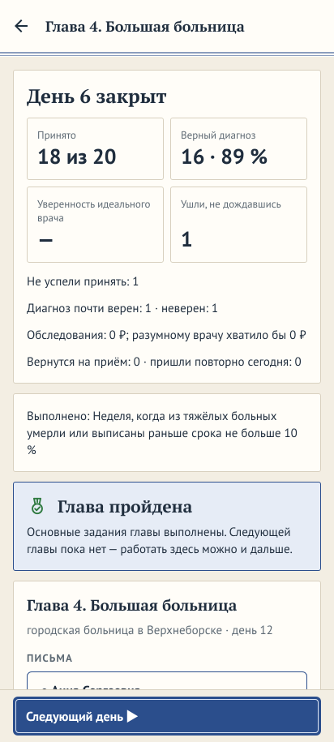

Первый день главы 1, 09:08 — трое с «нужно скоро» (Н2):

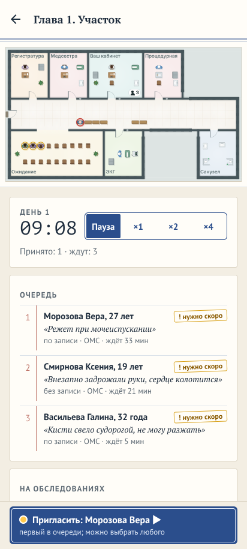

Ответ на общий вопрос — стена отрицаний; пузырь наезжает на чип вопроса (Н3, Ш4):

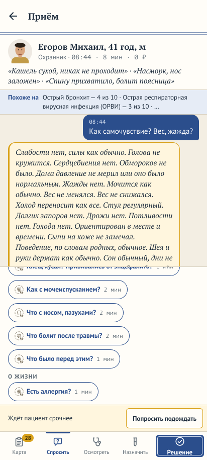

Вкладки сложности на 360 × 640 в тёмной теме (Н4):

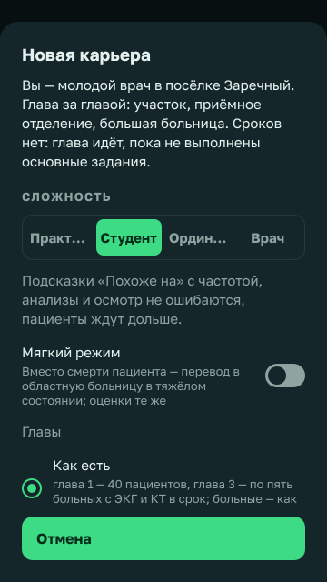

Меню на 412 × 915 — провал между бейджем и пунктами (Н8):

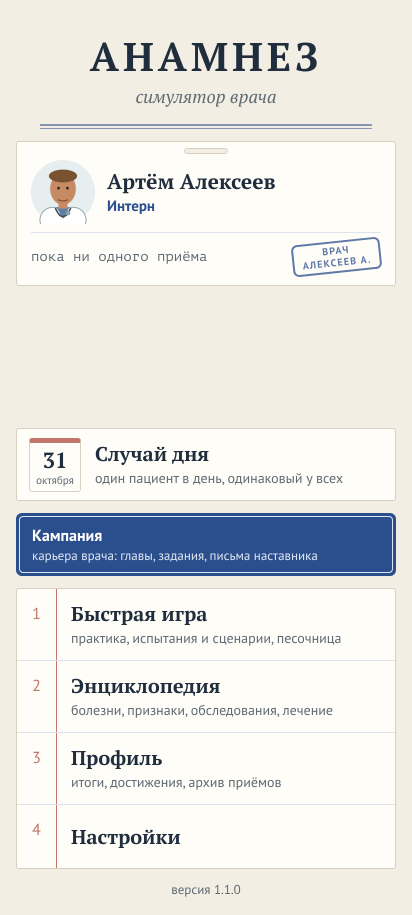

Анкета врача без обложки (Н7):

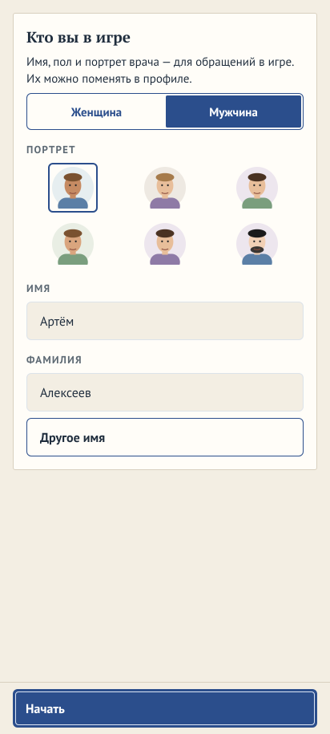

«Весь больной» у больного с кашлем (Н9):

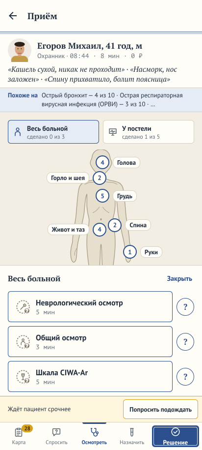

«Похоже на (подсказка уровня)» на доске гипотез (Н6):

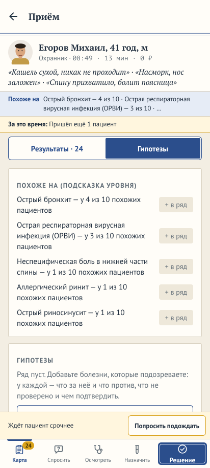

Лист назначений на «Студенте» — по алфавиту (Ш3):

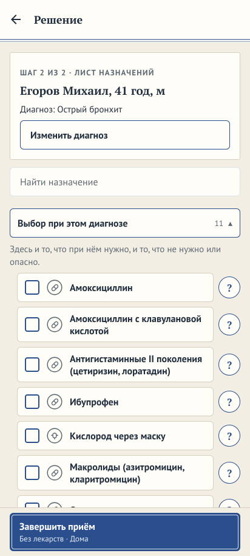

После частей 97 и 98 — ответ на общий вопрос (найденного нет, «нет» приглушены), вкладки сложности на 360 × 640 в
тёмной теме, анкета врача под обложкой:

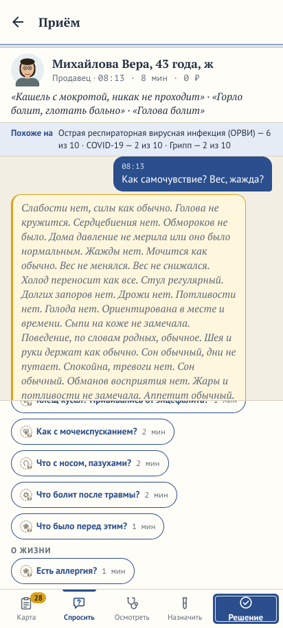

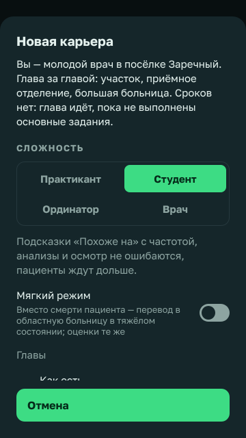

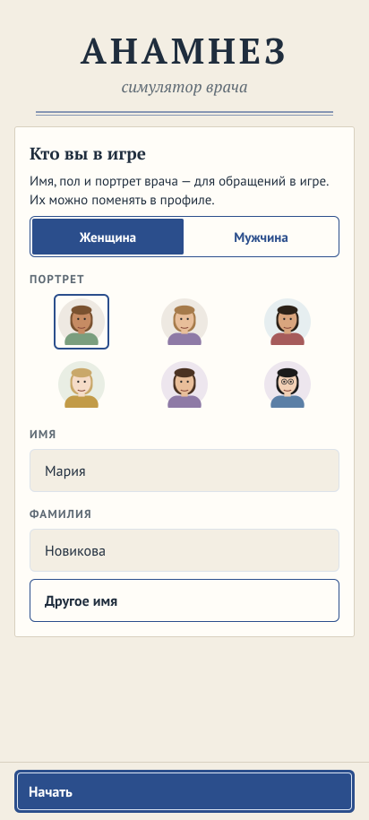

Часть 99 — вечер, когда карьера пройдена: карточка наверху итогов дня, письмо наставницы, карьеры в профиле:

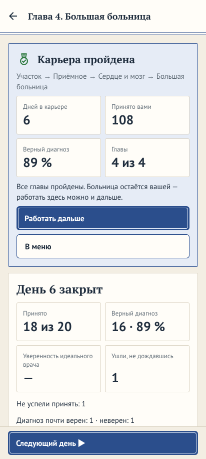

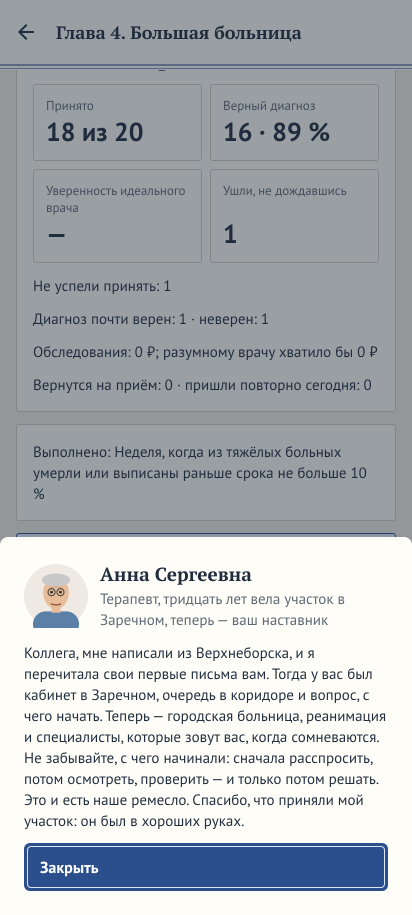

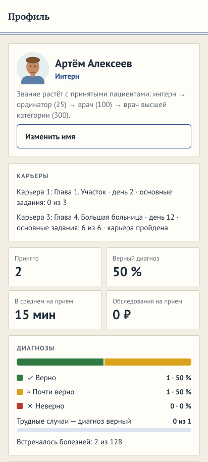

Часть 102 — меню 412 × 915 со сводкой карьеры вместо пустоты:

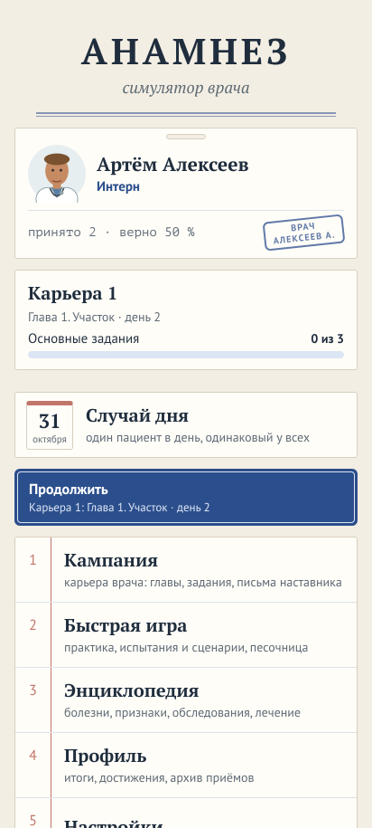

### Отчёт субагента (дословно; заголовки понижены, длинные строки перенесены)

#### «Анамнез» 1.1.0 — готова ли к первой публикации: отчёт критика-игрока

Дата проверки: 31.10.2026. Ветка `claude/upbeat-allen-4fgfwq`, код 1.1.0, база 83. Веб-сборка собрана заново
(`npm run export:web`), пройдена Playwright-скриптами в окнах 412 × 915 и 360 × 640, в светлой («Медкарта») и тёмной
(«Монитор») темах. Снимки — в `shots/` (имена говорящие), журналы — `tour*.out`, скрипты — `tour1.ts`…`tour5.ts`,
`lib.ts`. Ошибки страницы и консоли собирались на каждом экране: ошибок — 0; предупреждения — только программный WebGL
безголового Chromium и известные `SkPath … deprecated` на странице проверки снимков (см. спецификацию премиального вида,
п. 3).

##### 1. Вердикты

| Мерка | Вердикт | Почему |
|---|---|---|
| **Играбельная** | **не готово (близко)** | Первую смену новый игрок проходит без чужих подсказок: оговорка → анкета врача → меню → «Кампания» → письма и задания главы → «Открыть смену» → «Промотать до следующего» → «Пригласить» → четыре вкладки приёма → «Решение» в два шага → итог со штампом → «К очереди» → «Закрыть день» → итоги → «Следующий день». Подсказки наставника приходят по месту; тупиков, падений и ошибок консоли нет. Держат две вещи: темп первой смены не «ровный» — к 09:08 первого дня в очереди трое с меткой «нужно скоро», за день 18 пришедших, половина уходит, не дождавшись (Н2); и ответ на общий вопрос — «простыня» отрицаний на полэкрана, в которой новичку не найти главное (Н3). |
| **Завершённая** | **не готово** | У кампании нет финала: после главы 4 игрок видит ту же карточку «Глава пройдена», что после главы 1, со словами «Следующей главы **пока** нет — работать здесь можно и дальше» и кнопку «Следующий день» — без конца (`shots/51-campaign-end-full.png`; `completeLast` в `src/i18n/sections/campaign.ts`, `nextChapterOf` в `src/engine/campaign/campaign.ts`). Итога карьеры нет ни в кампании, ни в профиле (`src/app/profile/index.tsx` — только накопительная статистика). Заглушек и пустых экранов нет: все пункты меню работают, песочница честно закрыта до главы 2 с объяснением. |
| **С достойным дизайном** | **готово с оговорками** | Экраны выдержаны в одном виде внутри каждой темы; автопроверка «вылезло за окно» — 0 находок на всех экранах в 412 и 360 точках, в обеих темах. Оговорки: подписи вкладок сложности «Практикант»/«Ординатор» обрезаются в веб-сборке (на телефоне ужимает `adjustsFontSizeToFit` — проверить на устройстве, Н4); меню на высоком экране — с пустым провалом между бейджем врача и «Случаем дня» (Н8); анкета врача — единственный экран первого запуска без обложки (Н7). Плавность движения и звук из динамика в вебе проверить нельзя. |

**Итог:** публиковать эту версию рано. Держат публикацию два пункта — нет финала кампании и итога карьеры (Н1) и крутой
темп первой смены (Н2). Остальное — доводка на один-два релиза.

##### 2. Недочёты

Тяжесть: **держит публикацию** → **важно** → **шлифовка**. Размер: S (часы) / M (дни) / L (неделя и больше).

###### Держат публикацию

**Н1. У кампании нет финала, у карьеры — итога.** Где: `src/engine/campaign/campaign.ts` (`nextChapterOf` →
`undefined` для главы 4), `src/state/session.ts` (`buildCampaignView`: `after = completeLast`),
`src/i18n/sections/campaign.ts` (`completeLast`), `src/ui/campaign.tsx` (`chapter-done`), `src/app/profile/index.tsx`.
Снимки: `shots/51-campaign-end-full.png`, `shots/50-campaign-careers-ch4done.png`,
`shots/52-achievements-campaign-full.png`.
Почему важно: игрок, прошедший четыре главы (десятки часов), получает ту же карточку, что после главы 1, и слово «пока»
— игра сама говорит, что не доделана; в достижениях — медаль «Большая больница», и всё. Это прямое несоответствие мерке
«у кампании — финал, у карьеры — итог». Как исправить: (а) экран-эпилог после главы 4 — письмо наставника, цифры карьеры
(дни, приёмы, точность, построенное, спасённые), медаль «Карьера пройдена», кнопки «Работать дальше» / «В меню»;
(б) в профиле — карточка «Карьеры»: по каждой из трёх — глава, день, пройдена ли, итоговые цифры (данные есть в
`savedGames()`); (в) убрать «пока» из `completeLast`. Размер: **M**.

**Н2. Темп первой смены главы 1 не «ровный»: новичка сразу заваливает.** Где: генерация потока первого дня
(`src/engine/shift`), `content/campaign/chapters/district.yaml` (`tutorial` задаёт лишь трёх больных, остальные — общий
поток), метки срочности растут от ожидания. Снимки: `shots/15-p2-back.png` (09:08 — трое ждут, у всех «! нужно скоро»),
`shots/20-shift-queue-after-3.png` (09:23 — «‼ срочно» и два «нужно скоро»), `shots/13-p1-examine.png` (полоса «Ждёт
пациент срочнее — Попросить подождать» уже на первом приёме), `shots/21-shift-end-of-day.png` (14:02: принято 2, ждут 7,
ушли 9), `shots/22-day-summary.png`. Почему важно: за первый час тренировочной смены, пока наставник объясняет «сначала
расспрос», в очереди четверо с жёлто-красными метками; при 18 пришедших и приёме 10–15 игровых минут новичок примет
6–8, остальные уйдут — первый итог «Ушли, не дождавшись: 9» читается как провал, а не обучение. Как исправить: в
первые 1–2 дня главы 1 (`tutorialDay`) — поток вдвое меньше, без меток срочности у не-заданных больных, срочность не
растёт от ожидания; наставнику — подсказку про метки и «Попросить подождать» при первом их появлении; проверить
`difficulty-sim`. Размер: **M**.

###### Важно

**Н3. Ответ на общий вопрос — стена отрицаний.** Где: чат расспроса (`src/ui/case`), тексты ответов — база
`content/findings`. Снимок: `shots/12-p1-asked.png`. «Как самочувствие? Вес, жажда?» выдаёт 16 строк «Слабости нет.
Силы как обычно. Голова не кружится…» одной курсивной плашкой; то, что есть, тонет в том, чего нет. Это первое, что
видит новичок после подсказки «начните с расспроса». Исправить: положительные находки — отдельно сверху, отрицания —
свёрнуто строкой «Остальное без особенностей (14)» с раскрытием, либо чипами, как в «Результатах». Размер: **M**.

**Н4. Подписи вкладок сложности обрезаются.** Где: `src/ui/components.tsx:307` (`Tabs`, `numberOfLines={1}
adjustsFontSizeToFit minimumFontScale={0.7}`), `src/ui/difficulty.tsx`. Снимки: `shots/360x640-dark-career-sheet.png`,
`shots/412x915-dark-career-sheet.png`, `shots/412x915-dark-single.png`, `shots/04-campaign-new-sheet.png`
(автопроверка: «…Практикант», «…Ординатор»). В вебе — многоточие; на Android шрифт ужмётся до 70 % — четыре слова в
одной
полосе на 360 точках станут мелкими и разной величины. Исправить: на узких экранах — две строки по две вкладки или
список-радио, как у «Главы». Размер: **S**. Проверить на телефоне.

**Н5. В профиле не видно пути по карьерам.** Где: `src/app/profile/index.tsx`. Снимки: `shots/38-profile.png`,
`shots/39-achievements-full.png`. Профиль показывает практику, специальности, достижения, испытания — но не то, в какой
главе каждая карьера и что в ней сделано. Исправить: карточка «Карьеры» (см. Н1б). Размер: **S**.

**Н6. Жаргон разработчика в текстах для игрока.** Где: `src/i18n/sections/shift.ts:98` («отпущенных домой **модель**
ведёт неделю»), `src/i18n/sections/spikes.ts:111,124,131` («Похоже на (**подсказка уровня**)», «Опасные причины
(подсказка уровня)», «Правила решения (подсказка уровня)»), плитка итога дня «Уверенность идеального врача», строка
«ОМС: страховая оплатит приём по тяжести диагноза…» на вкладке «Результаты» (`src/i18n/sections/sandbox.ts:149`).
Снимки: `shots/19-p1-outcome.png`, `shots/16-p1-board.png`, `shots/22-day-summary.png`, `shots/16-p1-results.png`.
«Модель», «уровень» — слова из спецификаций, не из речи врача. Исправить: «отпущенных домой игра наблюдает неделю»,
просто «Похоже на», «Уверенность разумного врача» (так уже в разборе). Размер: **S**.

**Н7. Анкета врача — без обложки игры и с пустой нижней половиной.** Где: `src/ui/profile.tsx` (`DoctorForm bare`),
`src/app/index.tsx`. Снимок: `shots/02-first-doctor-form.png` (ср. `shots/01-first-disclaimer.png`). Оговорка — с
обложкой «АНАМНЕЗ», меню — с обложкой, а между ними голая карточка «Кто вы в игре». Исправить: тот же `Cover` сверху.
Размер: **S**.

**Н8. В меню на высоком экране — провал между бейджем и «Случаем дня».** Где: `src/ui/menu.tsx:198` (`spacer:
flexGrow: 1`). Снимки: `shots/03-menu-fresh.png` (≈280 px пустоты), `shots/360x640-dark-menu.png` (на 360 × 640 всё
плотно). Задумано «пункты под большим пальцем», но на 412 × 915 пустота читается как недогруженный экран. Исправить:
`maxHeight` у распорки или сводка карьеры в этом месте. Размер: **S**. Развилка — §4.

**Н9. В полке «Весь больной» новичку предлагают «Шкалу CIWA-Ar» наравне с общим осмотром.** Где:
`src/ui/case/places.ts`.
Снимки: `shots/13-p1-examine-place.png`, `shots/16-p1-results.png`. Для пациента с кашлем в первой смене три пункта:
«Неврологический осмотр», «Общий осмотр», «Шкала CIWA-Ar» (алкогольная абстиненция). Новичок нажмёт первый — получит
24 чипа неврологии и ничего о простуде. Исправить: «Общий осмотр» первым; шкалы — по показаниям или в отдельной полке.
Размер: **S**.

**Н10. Норма сформулирована через «больную сторону».** Где: база `content/findings` (невро-находки). Снимок:
`shots/16-p1-results.png` (нижний чип «Мимика на больной стороне есть, хоть и…»). У здорового стороны нет — сбивает.
Исправить: отдельный текст нормы «Мимика сохранена с обеих сторон». Размер: **S**.

###### Шлифовка

**Ш1. Заголовок главы дважды**: шапка «Глава 1. Участок» и первая строка карточки — `shots/05-chapter1-evening.png`
(`src/ui/campaign.tsx`). В карточке оставить место и день. S.

**Ш2. Итог дня: плитка «Уверенность идеального врача — » с прочерком** при отсутствии значения —
`shots/51-campaign-end-full.png` (искусственное сохранение, но плитка так и выглядит). Прятать плитку. S.

**Ш3. Лист назначений при «Студенте» — по алфавиту, антибиотики сверху** — `shots/18-p1-plan.png`: при остром бронхите
первыми «Амоксициллин», «Амоксициллин с клавулановой кислотой». Пояснение есть, но новичок тянется к первому. У
«Практиканта» это решено; для «Студента» — хотя бы немедикаментозное сверху. M, развилка — §4.

**Ш4. Чат расспроса: пузырь ответа наезжает на верхний чип вопросов при прокрутке** — `shots/12-p1-asked.png` («Клещ
кусал?..» под пузырём). Похоже на особенность прокрутки веба; проверить на телефоне. S.

**Ш5. Две темы — два разных мира.** «Медкарта» и «Монитор» различаются не цветами, а шрифтами, рамками, значками
(`shots/03-menu-fresh.png` и `shots/360x640-dark-menu.png`). По ADR 0017 так и задумано; «все экраны в одном виде»
выполняется внутри темы. Снимки в магазине и обложку делать в одной теме. Решение владельца.

**Ш6. Стройка на 412 × 915: план занимает треть, остальное серое поле** — `shots/06-chapter1-build.png`. Камера по
умолчанию могла бы подгонять план по ширине. S.

**Ш7. Лист «Какое помещение» показывает только «от … ₽»** — `shots/06-chapter1-build-rooms.png`; цену размера —
сразу при выборе. S.

**Ш8. «Что было дальше» у отпущенных домой — всегда одна фраза** — `shots/19-p1-outcome.png`; добавить «см. итоги дней
2–7». S.

**Ш9. Снимок страницы проверки «Снимки» (режим разработчика) в вебе не снялся за 30 с** — тяжёлые холсты; на
телефоне эта страница — только для разработчика. Проверить скорость `/spikes/imaging` на устройстве. S.

###### Что проверено и работает без замечаний

Первый запуск (оговорка, анкета с подсказанным именем и шестью портретами); меню; список карьер и лист новой карьеры
(сложность, мягкий режим, «Главы короче»); письма наставника с портретами; стройка (план, список помещений, отмена);
персонал (работающие, кандидаты с портретами); очередь и карта амбулатории (люди ходят, значки у дверей, касание — кто
это); пауза и скорости; «Промотать до следующего»; четыре вкладки приёма; фигура человека с точками осмотра и полками;
бланк направления по разделам с ценами и временем, «Будет в 09:10», «Отпустить / Подождать 3 мин»; «Похоже на» и доска
гипотез; «Решение» в два шага со справкой «?»; итог приёма со штампом, оплатой ОМС и оценками A–D; достижения с
медалями; итоги дня плитками; «Следующий день»; «Продолжить» в меню с главой и днём; быстрая игра (практика с четырьмя
сложностями и понятными подписями; «Смена» с выбором больницы — закрытые объяснены; испытания и сценарии — экран
сценария с целью и «Начать неделю», в карте приёма видна пометка условия); «Случай дня» (список дней); энциклопедия
(8 разделов, 1 140 статей, поиск); профиль; достижения; настройки (звук, музыка, вибрация, паузы, мягкий режим, умения,
свои больные, тема, размер текста, перенос, отчёт); «Об игре» (версия, «Что нового», оговорка, база 83 и 250 источников,
звук, лицензии, студия, почта, сайт, политика); режим разработчика (семь касаний версии → «Проверки на телефоне»:
движок, карта, карта пациента, снимки, сохранение, кости — все шесть открываются; выключатель в настройках).
360 × 640 в обеих темах: меню, лист карьеры, настройки, профиль, энциклопедия, «Об игре», очередь, приём (все вкладки),
решение, лист назначений, итог приёма, итоги дня — без обрезки и наездов (`shots/360x640-*.png`).

##### 3. Что уже хорошо — не сломать

- **Приём понятен с первого раза:** вкладки «Карта · Спросить · Осмотреть · Назначить · Решение» под пальцем, у каждого
  действия — минуты и цена, у каждого пункта — «?». Подсказки наставника приходят по месту и по одной («Сначала —
  расспрос», «Теперь — осмотр», «Решение — в два шага», «Сравните свой путь»), с кнопкой «Без подсказок».
- **Живая карта амбулатории** с людьми, дверями и значками «Ждут: N»; лента «Что происходит» дублирует словами.
- **Итог приёма** со штампом «Верно / Почти: та же тактика», «На самом деле», оплатой и шестью оценками — лучшая
  обратная связь в игре; «Первый пациент» и «Первая смена» — в нужный момент.
- **Честные тексты:** закрытые больницы и песочница говорят, какой главой открываются; «Это игра» — на первом экране, в
  «Об игре» и в энциклопедии; «база пока черновая» названо прямо.
- **Ноль ошибок консоли и страницы** во всех проходах; ноль переполнений на 360 и 412 точках в обеих темах.
- **Звук по коду** (`src/audio/sounds.ts`, `src/ui/case/sounds.ts`, `src/app/shift/index.tsx`): касания — вибрация;
  приход пациента, «срочный», «результаты готовы», тревога монитора — свои сигналы с вибрацией; приборы — манжета
  (давление), монитор (ЭКГ, прикроватные, УЗИ/МРТ), рентген (снимки, КТ), пробирки (анализы, экспресс-тесты); расспрос
  и осмотр руками тихие; фон амбулатории с редким телефоном — только на экране смены; музыка меню/смены с плавным
  переходом за 1 с; громкости разведены (сигналы 0,9 · приход 0,6 · приборы 0,5 · фон 0,25). Логика цельная.

##### 4. Развилки для владельца

1. **Финал кампании.** (а) Экран-эпилог после главы 4: письмо, цифры, медаль, «работать дальше» — ясная точка; главы
   5+ при появлении встанут перед эпилогом. (б) Без эпилога — карточка «Карьера пройдена» с цифрами и итог в профиле.
   **Рекомендация: (а)** — игра обещает «главы, задания, письма»; без последнего письма история не рассказана.
2. **Первая смена.** (а) Поток первого дня вдвое меньше и без срочных — спокойное обучение; (б) поток как есть, но
   срочность не растёт от ожидания, наставник объясняет метки и «Попросить подождать». **Рекомендация: (а) плюс
  подсказка
   из (б)** на 1–2 дня главы 1.
3. **Лист назначений «Студента».** Оставить алфавит (честно, как справочник) или группировать «немедикаментозное →
   симптоматическое → антибиотики» с подписью. **Рекомендация:** группировать — этому глава 1 и учит («три дня без
   лишнего антибиотика»).
4. **Провал в меню.** Оставить (под палец) или ограничить. **Рекомендация:** ограничить высоту и показать короткую
   сводку карьеры — экран перестанет выглядеть пустым, кнопки останутся внизу.

##### 5. Что проверить не удалось и почему

- **Звук из динамика и музыка:** в веб-сборке отключены кодом (`Platform.OS === 'web'`); описано по коду. Громкости,
  наложения сигналов, телефон регистратуры — только на телефоне.
- **Плавность движения** (`slide_from_right`, появление «Известно», люди на карте, «уменьшить движение»): безголовый
  Chromium с программным WebGL не показатель; счётчик кадров — `/spikes/map` в режиме разработчика.
- **Ужатие подписей вкладок** на Android (Н4) — в вебе `adjustsFontSizeToFit` не работает.
- **Главы 2–4 вживую** не проходились (долго); конец кампании показан на сохранении, собранном движком (`tour4.ts`);
  письма и задания главы 4 — из базы. Переходы между главами покрыты e2e-сценарием проекта (`tools/e2e/smoke.ts`), я
  его не перезапускал.
- **Полный `bun test` и `npm run e2e`** не запускались по условию.
- **Приём в «Случае дня»** не снят (селектор строки дня); список дней — `shots/36-daily.png`; приём там — тот же
  компонент, что в смене.
- **Стройка и персонал на 360 × 640 / в тёмной теме** не сняты: сохранение попало на открытый день 2. Остальные экраны
  360 × 640 в обеих темах — есть.

##### Приложение: как снято

`lib.ts` — сервер над `dist-web`, браузер, снимки, сбор ошибок, автопроверка «за окном / обрезано».
`tour1.ts` — первый запуск → кампания → глава 1 → стройка, персонал → смена: три приёма, конец дня, итоги, день 2,
меню. `tour2.ts` — все пункты меню, настройки, «Об игре», режим разработчика и его проверки, перенос. `tour3.ts` /
`tour5.ts` — 360 × 640 и тёмная тема: меню, лист карьеры, настройки, профиль, энциклопедия, приём, итоги дня.
`tour4.ts` — карьера с выполненной главой 4: конец кампании. Журналы — `tour*.out`, ошибки — `errors-*.txt`.
