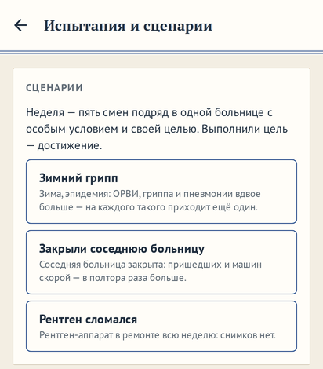
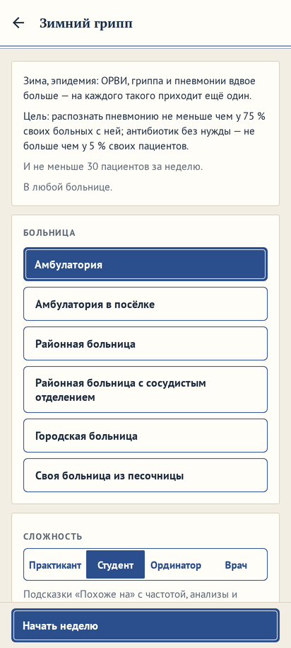
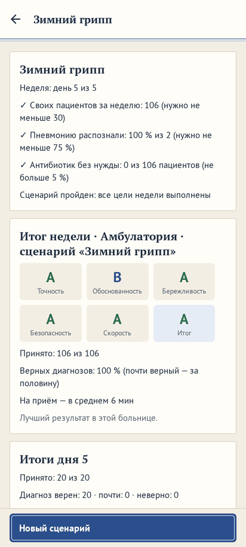
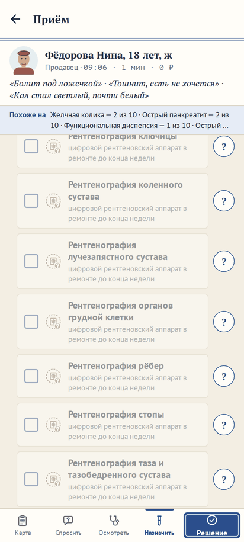

# Сценарии на неделю: «Зимний грипп», «Закрыли соседнюю больницу», «Рентген сломался»

**Версия:** 0.6.15 **Состояние:** сделано

## Зачем

Предложение владельца 24.10.2026: «Может надо добавлять сценарии типа эпидемии, несчастные случаи и стихийные бедствия,
закрытия соседних больниц и т п.» Вопрос 55 ([#168](https://github.com/Nefeste/anamnez/issues/168)) предложил четыре
варианта; ответ владельца: «вариант 2 до 1.0, 3 и 4 после 1.0» — три сценария в быстрой игре на готовом движке, рядом с
испытаниями вопроса 50 ([#163](https://github.com/Nefeste/anamnez/issues/163)), одним пунктом меню «Испытания и
сценарии». Это вторая половина части 91 дорожной карты; первая — испытания (0.6.14,
[`2026-10-challenges.md`](2026-10-challenges.md)).

Испытание — условие на один день. Сценарий — неделя: поток больных меняется, и цель — не одна смена, а пять подряд.

## Что увидит игрок

- **«Быстрая игра» → «Испытания и сценарии»** — сверху карточка «Сценарии»: три сценария, у каждого — что за неделя и
  лучший итог. Касание — экран сценария: условие, цель с порогами, сколько своих пациентов нужно, где можно; ниже —
  больница (только те, где сценарий имеет смысл) и сложность; «Начать неделю».
- **«Зимний грипп»** — зима, эпидемия: на каждого пришедшего сам с ОРВИ, гриппом или пневмонией приходит ещё один с одной
  из них. «Похоже на» знает об эпидемии: эти болезни вдвое вероятнее. Цель — распознать пневмонию и не давать антибиотик
  без нужды.
- **«Закрыли соседнюю больницу»** — пришедших сами и машин скорой в полтора раза больше. Цель — чтобы приёма дождались и
  никто не умер.
- **«Рентген сломался»** — рентген-аппарат в ремонте всю неделю: в журнале смены «Не работает: … — до конца недели», в
  карте пациента снимки серым — «… в ремонте до конца недели». Цель — итог недели не ниже «B».
- **Неделя** — пять смен подряд в одной больнице. Название в шапке — сценарий; в «Продолжить» — «Амбулатория · сценарий
  «Зимний грипп», день 2 из 5, 10:24». В итогах дня — «Неделя: день 2 из 5», цели с ✓ и ✗ по сыгранным сменам,
  итог «Смены» за них — «Итог за сыгранные смены» — и «Следующая смена»; после пятой — «Итог недели», пройден ли
  сценарий, лучший результат и «Новый сценарий».
- **Пройден** — все цели недели выполнены: достижение за сценарий, группа «Испытания и сценарии» в профиле.

## Правила

- **Неделя** — `SCENARIO_DAYS` = 5 смен: после пятой следующей нет. Свой слот сохранения: «Смена» и испытания неделю не
  перезаписывают, новый сценарий — перезаписывает.
- **Где.** Там же, где «Смена» (амбулатория практики, больницы открытых глав, своя), и где сценарий имеет смысл: «Закрыли
  соседнюю больницу» — со смотровой приёмного (туда везёт скорая), «Рентген сломался» — с рентген-кабинетом; не подходит —
  в списке серым с причиной.
- **«Зимний грипп».** Поток: из пришедших сами (по записи и без) у каждого с ОРВИ, гриппом или пневмонией — «двойник» без
  записи, болезнь — из этих трёх по их частотам для него, время прихода — как у пришедших без записи. Остальные — те же
  люди в то же время, что без сценария. Вывод — с множителем 2 у этих болезней: так в эпидемию и есть, а «Похоже на»
  остаётся честным — по шансам ровно вдвое, остальные между собой как были. С тем же множителем — разумный врач разбора,
  нанятые врачи и уверенность разбора при закрытии приёма: по ней — обоснованность диагноза.
- **«Закрыли соседнюю больницу».** Запись, пришедшие без записи и машины скорой — 150 % обычного.
- **«Рентген сломался».** Аппараты рентгена (`eq.xray_analog`, `eq.xray_digital`) — в поломке с первого утра каждого дня
  недели; другие поломки — как всегда, к завтра чинят.
- **Цели** — по своим приёмам недели; приёмы нанятых врачей не в счёт. У всех — не меньше `WEEK_SEEN` своих пациентов: по
  двум-трём о неделе не судят.
  - «Зимний грипп»: пневмонию распознали — диагноз «пневмония» у больного с ней (по правде, как в разборе) — не меньше
    `PNEUMONIA_CAUGHT` %; антибиотик без нужды (в разборе — «не показан» у антибиотика) — не больше чем у
    `NEEDLESS_ANTIBIOTIC` % своих пациентов.
  - «Закрыли соседнюю больницу»: не дождались приёма — ушли из очереди и не приняты к концу смены — не больше `QUEUE_LOST`
    % пришедших; умерли — не больше `DEATHS` % своих пациентов.
  - «Рентген сломался»: итог «Смены» за пять смен — не ниже «B».
- **Итог недели** — итог «Смены» по всем приёмам недели, пришедшие — за все смены. Лучший результат — свой у сценария в
  каждой больнице, после пятой смены.

## Замер: проходимо ли

`npm run district-sim -- --scenario flu|neighbor|xray --weeks 12`: разумный врач — тот же, что у нанятых врачей и в
`district-sim`, — неделю со сценарием и неделю без него на одних зёрнах, зима, 6–10 секунд на неделю.

- **«Зимний грипп»**, амбулатория практики: пришли за неделю 74 → 100, приняли сами 70 → 84; больных пневмонией за
  неделю 2,5 → 4,5, распознал 99 → 92 % (по неделям от 67 до 100 %); антибиотик без нужды — 0,4 из 84; итог недели — A.
  Цели выполнены в 11 неделях из 12: в одной из трёх пневмоний одна пропущена — 67 %.
- **«Закрыли соседнюю больницу»**, районная больница: пришли 92 → 140, приняли сами 84 → 110; не дождались 8 → 21 % (по
  неделям 17–25 %, без сценария 2–16 %); умерших — ни одного; итог — A. Порог очереди 30 % разумный выполняет всегда,
  игроку — запас; при 15 % не выполнил бы ни разу.
- **«Рентген сломался»**: в амбулатории практики — без разницы, пневмонию разумный находит без снимка (выслушивание, СРБ,
  сатурация); в районной больнице итог недели A — в 10 неделях из 12, B — в 2: переломы без снимка. Цель «не ниже B»
  выполнена всегда.

## Данные

- **Смена**: режим `scenario`, `meta.scenario?: 'flu' | 'neighbor' | 'xray'`; слот `scenario`. Старые сохранения — без
  него; `schemaVersion` прежний.
- **Вывод**: `prior` у контекста — список множителей (профиль специалиста и эпидемия); `contextOf` принимает один или
  список.
- **Запись приёма в профиле**: `scenario` — разбор из архива с тем же разумным врачом.
- **Достижения**: вид `scenario` (`scenario: flu`), группа «Испытания и сценарии»; закрытый пятый день сообщает пройденный
  сценарий. База 81.
- **Лучший результат**: ключ — больница и `:sc=<сценарий>`.

## Движок

- `src/engine/shift/scenarios.ts`: `SCENARIO_DAYS`, `FLU_IDS` и `FLU_X`, `NEIGHBOR_FLOW`, `scenarioPrior`, `scenarioFlow`,
  `scenarioAmbulance`, `scenarioFits`, `xrayBroken`.
- `newScenario` — «Смена» с режимом `scenario`; `planDay` — поток и «двойники»; `nextDay` — после пятой смены нет, рентген
  сломан; разбор и нанятые врачи — с множителем эпидемии.
- `src/state/scenario.ts`: `scenarioResult` — цели и итог недели.

## Неудачные случаи

- **Двойник по записи к специалисту** — приходит без записи, к любому врачу.
- **Пневмония у больного, принятого нанятым врачом**, — не в счёт цели: цель — ваши приёмы.
- **Неделя в своей больнице без рентгена** — «Рентген сломался» в ней не предложен.

## Проверки

- `scenarios.test.ts`: двойники — вдвое больше больных эпидемии, остальные те же, номера по времени прихода, всегда зима;
  поток и скорая в полтора раза; рентген сломан всю неделю, снимок не назначить; после пятой смены дня нет; где играть;
  вывод — по шансам вдвое; цели — по сыгранной неделе разными врачами; не пройдено, пока неделя не кончилась;
  достижение, лучший результат; неделя в игре — свой слот, «Продолжить», итог дня и недели.
- Сценарий в браузере: «Испытания и сценарии» — три сценария, «Закрыли соседнюю больницу» в амбулатории — серым с
  причиной; экран «Зимнего гриппа» с целью, «Начать неделю», в «Продолжить» — «день 1 из 5»; итог дня — «Неделя: день 1
  из 5», три цели, «Следующая смена» — вторая с 08:00.
- Отдельный прогон на веб-сборке: «Рентген сломался» в районной больнице — в журнале смены «… — до конца недели», в
  «Назначить» снимок серым с причиной; итог первой смены — «Итог за сыгранные смены»; после пятой — «Итог недели»,
  «Сценарий пройден», «Новый сценарий», следующей смены нет.

## Чего здесь нет

- События в кампании и песочнице (ДТП, вспышка, закрытие соседней больницы посреди главы) — после 1.0 (вариант 3).
- Массовые несчастные случаи с сортировкой многих пострадавших — после 1.0 (вариант 4).
- Сценарии вместе с испытаниями.

## Что изменилось по ходу работы

- **Пневмонию распознали — 75 %, а не 80.** При 4–5 больных пневмонией за неделю 80 % — это ни одного промаха: разумный
  врач не выполнил бы цель в каждой пятой неделе.
- **Очередь — 30 %, а не 15.** При полуторном потоке разумный врач в районной больнице теряет 17–25 % пришедших: 15 % не
  достижимы никем.
- **«Рентген сломался» в амбулатории** почти ничего не меняет — сценарий доступен и там, а на экране сценария сказано, где
  он заметнее: в районной больнице, с переломами.
- **Уверенность разбора — тоже с эпидемией.** Сначала множитель знали «Похоже на», разумный врач и нанятые врачи, а
  уверенность разбора при закрытии — нет: игрок видел «Грипп — 6 из 10», а обоснованность судилась по меньшему. Теперь у
  всех одна и та же; проверяет тест.
