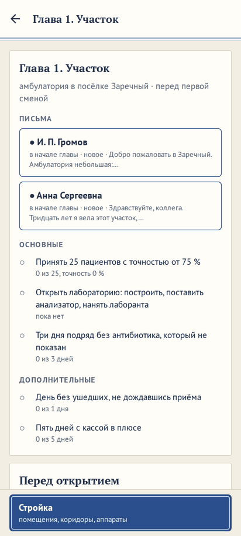

# Главы короче: настройка при начале кампании, интересный больной дня, пороги глав

**Версия:** 0.6.17 **Состояние:** сделано

## Зачем

Замечание владельца 24.10.2026: «Также поначалу в кампании все еще много простудных заболеваний, ну с этим можно
смириться, но путь до большой интересной больницы долгий, может отпугнуть новичков.» Вопрос 54
([#167](https://github.com/Nefeste/anamnez/issues/167)) предложил пять вариантов; ответ владельца: «делаем настройку
при старте кампании - главы короче или как есть. Если выбрали настройку, то реализуем в ней идеи 2 (интересный
больной) и 3 (главы короче). 4 и 5 пока отложим в список идей в roadmap, не делаем до отзывов.» Это часть 93
дорожной карты.

Что было: в кампании частоты болезней — всегда как в жизни (spec 2026-10-variety), в амбулатории ОРВИ — у каждого
пятого. Глава 1 — принять 40 пациентов; глава 3 — ЭКГ и КТ в срок по пяти больным, а такие больные приходят редко.
Разумный виртуальный врач проходил четыре главы за 64–91 смену (замер 0.5.12).

## Что увидит игрок

- **Новая карьера**: после сложности и мягкого режима — «Главы»: «Как есть» (как было и по умолчанию) или «Короче»,
  выбор из двух с подписями, как «Больные» в настройках. Выбирается один раз, при начале карьеры.
- **С «Короче»**:
  - глава 1 — «Принять 25 пациентов с точностью от 75 %» вместо 40;
  - глава 3 — «ЭКГ при боли в груди в первые 10 минут: три больных» и «КТ при подозрении на инсульт в первые 40
    минут: три больных» вместо пяти; остальные задания всех глав — как есть;
  - каждый день один-два из пришедших сами — с более редкой болезнью: не простуда и не боль в спине, а, например,
    ангина, впервые выявленный диабет, пневмония или радикулопатия, в больнице с хирургией — панкреатит или тромбофлебит.
- **Подсказки, вывод и разбор — по частотам жизни**, как с «Разнообразием»: игра учит настоящим частотам, «Короче»
  меняет только то, кто пришёл.
- **В списке карьер** у такой карьеры — «главы короче».

## Интересный больной дня

- **Кто**: один или два (поровну) из пришедших сами или записанных к вам — не вернувшиеся, не записанные к
  специалисту и не привезённые скорой. В день обучения главы — нет: у него свои заданные пациенты.
- **Болезнь** — из болезней отделений больницы с весом записи не больше 100 (`INTERESTING_WEIGHT`): частые болезни —
  с весом 300 и 1000 (ОРВИ, грипп, COVID-19, боль в спине, гастроэнтерит, синусит, бронхит, растяжение, рана кисти) —
  в 3–10 раз чаще. Жребий — со сглаженными весами «Разнообразия» (`variety`): человек — правдоподобный, болезнь — по его
  возрасту, полу, привычкам и хроническим болезням.
- **Замер** (3000 пришедших сами, времена года поровну): в амбулатории как в жизни частые — у 62 %, сглаженные без
  отбора — у 28 %, у интересного — ни у кого; болезней — 42: аллергический ринит 6 %, диабет 5 %, ангина 5 %,
  пневмония 5 %, радикулопатия 4 %, головная боль напряжения 4 %, ГЭРБ и стабильная стенокардия по 4 %. В районной
  больнице — 75 болезней: поверхностный тромбофлебит 5 %, панкреатит 5 %, аллергический ринит 4 %.
- **Для вас**: нанятые врачи интересного не берут, как заданного пациента первой смены главы, — иначе редкое увидел бы
  не игрок.
- **Остальные пришедшие** — те же, что с «Как есть», бит в бит: у интересного своя ветвь жребия дня.

## Пороги глав

- У задания главы — `short: { count, text }`: глава 1 «Принять N пациентов» — 25, глава 3 «ЭКГ в срок» и «КТ в срок» —
  по 3. Порог и текст — в главе (`content/campaign/chapters/`), как и прежние.
- Путь до городской больницы — по модели районной больницы, карьера разумного врача (замер ниже).

## Замер пути

`npm run district-sim -- --runs 0 --career-runs 4` — без настройки и с `--short`: карьера разумного врача, те же четыре
зерна, 150 дней.

| Глава | Как есть, смен | Короче, смен |
|---|---|---|
| 1 «Участок» | 3–4 | 3–4 |
| 2 «Приёмное» | 8–13 | 9–12 |
| 3 «Сердце и мозг» | 26–63 | 11–29 |
| 4 «Большая больница» | 7–23 | 7–15 |
| до городской больницы | 43–79 | 26–43 |
| вся карьера | 50–86 | 38–56 |

- **До городской больницы** — на 40 % короче, в среднем 36 смен вместо 62: глава 3 — вдвое, ЭКГ и КТ в срок нужны
  трём больным, а такие приходят редко.
- **Глава 1** у разумного врача не короче — её держат лаборатория и три дня без лишнего антибиотика: 40 пациентов он
  принимает за 3–4 смены. Новичку, который принимает меньше, 25 вместо 40 — не одна смена.
- **Глава 4** — заданий «Короче» у неё нет: в среднем те же 11 смен, разница по зёрнам — от дня, с которого она
  началась. Касса — ни разу не в минусе, не ниже 221 тыс. ₽, как и без настройки.

Месяц главы с начала (`--chapter … --no-career --runs 4`), разумный врач, четыре зерна:

- **Глава 4** — без настройки и с `--short` на одних зёрнах: основные задания с «Короче» выполнены на всех четырёх
  за 10–26 дней (без настройки — на трёх за 11–16, на одном «сепсис» за 30 дней не успел); прибыль — 3,54 млн ₽
  против 3,59 млн; «боксы окупаются своими больными» — на грани в обоих: 275 тыс. ₽ против 276 тыс. (без настройки —
  255 против 265, так и было: о числе зёрен — вопрос 27); «случаи с операцией окупают операционную» (для сведения) —
  676 тыс. против 705 тыс. (без настройки — 805 против 733).
- **Главы 2 и 3** с `--short`: глава 2 — основные задания за 9–11 дней, прибыль — 1,03 млн ₽; «операции в срок» — 89,1 %
  при пороге 90 %, на тех же зёрнах без настройки — 88,9 %: на четырёх зёрнах так и было. Глава 3 — все критерии
  выполнены, задания — за 8–22 дня, прибыль — 1,09 млн ₽.

## Данные

- **Смена**: `meta.shortChapters?: true` — карьера с «Главы короче»; нет поля — «Как есть», и все прежние карьеры.
  В `meta`, а не в ходе главы: ход главы при переходе в следующую начинается заново.
- **Задание главы**: `short?: { count, text }` — у заданий «принять N» (`seen`) и «срок» (`deadline`).
- **Сохранение**: поле необязательное, `schemaVersion` прежний. База — 82: в главах новые поля.

## Движок

- `newCampaign(db, { …, short })` — `meta.shortChapters`.
- `missionsOf(ch, short)` (`src/engine/campaign/campaign.ts`) — задания главы с порогами «Короче»; вечер главы
  (`campaignEvening`) и вид кампании берут их.
- План дня: в кампании с «Короче», кроме дня обучения, — один-два интересных: `generatePatient` с `variety` и `only` —
  болезни отделений больницы с весом записи не больше 100.

## Модель районной больницы

- `npm run district-sim -- --short`: карьера и месяцы глав с «Главы короче».

## Неудачные случаи

- **Карьера до 0.6.17** — «Как есть»: поля нет.
- **Среди болезней больницы с весом до 100 у этого человека ничего не бывает** — как пришёл бы сам, по частотам жизни
  (`only` у `generatePatient` так и работает).

## Проверки

- `short-chapters.test.ts`: пороги «Короче» у глав 1 и 3, остальные задания те же; вечер главы засчитывает задание по
  порогу «Короче»; интересных — один-два в день, болезнь — из редких, в день обучения — нет, остальные пришедшие — те
  же, что «Как есть»; нанятый терапевт интересного не берёт, остальных пришедших сами — берёт; переход в следующую
  главу — настройка та же.
- Сценарий в браузере: новая карьера с «Короче» — задание «Принять 25 пациентов».

## Чего здесь нет

- Идеи 4 и 5 вопроса 54 — окно в большую больницу и пролог в приёмном — в идеях дорожной карты, до отзывов игроков.
- Сменить настройку в начатой карьере: она — при начале.
