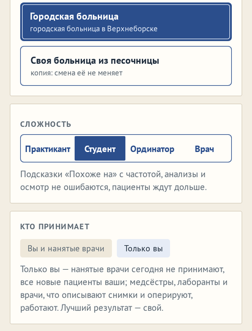

# Смена, где принимаете только вы

**Версия:** 0.6.1 **Состояние:** сделано, ждёт проверки на телефоне

## Зачем

Пункт 79 дорожной карты — ответ владельца на вопрос 16 ([#109](https://github.com/Nefeste/anamnez/issues/109),
16.10.2026): «хочу оба варианта — оставить как сейчас и отдельную кнопку когда принимает только игрок, это может быть
как режим, так и настройка». Как сейчас — «Смена» идёт в больнице как она есть: нанятые врачи принимают, оценка — по
вашим приёмам ([`2026-09-hired-doctors.md`](2026-09-hired-doctors.md)).

## Что увидит игрок

- В «Смене», под сложностью, — «Кто принимает»: «Вы и нанятые врачи» — как прежде — или «Только вы». Выбор — там, где
  работают нанятые врачи: в городской больнице главы 4 и в своей из песочницы, если в ней есть терапевт или
  специалист. В амбулатории, посёлке и районной больнице принимаете и так только вы — выбора нет.
- «Только вы» — нанятые врачи в этот день не принимают: к ним не записываются, новых они не берут, на карте их
  кабинеты пусты. Все пришедшие — ваши. Медсёстры, лаборанты, врачи, что описывают снимки, хирурги и реаниматологи
  работают, как прежде.
- В городской больнице с одним и тем же зерном без записи и со скорой приходят те же люди, а записанных — столько,
  сколько к вам одному: 12 вместо 59. Это день одного врача, а не пятерых.
- Итог — «Итог смены · Городская больница, принимаете один»; лучший результат такой смены — свой: всех новых вы
  принимали один, и сравнивать его с днём, когда работали нанятые врачи, нечестно. «Продолжить» в меню — так же.

## Как сделано

- **Движок** — поле дня `meta.solo` (`src/engine/shift/types.ts`): `newSingle` ставит его до того, как день разыгран;
  нанятых врачей, что принимают (`colleaguesOf`), тогда нет — нет и записи к ним, и тех, кого они берут; «ждёт вас»
  не нужно — оставлять некому. Без выбора — те же ветви и те же числа: поле не ставится, симуляторы его не задают.
- **«Смена»** (`src/app/single.tsx`) — «Кто принимает» двумя плашками; у больницы в списке — работают ли в ней
  нанятые врачи (`VenueView.doctors`, `src/state/session.ts`).
- **Карта** — в такой смене нанятых врачей на ней нет; кабинеты не помечены «Нет персонала»: врачи в штате, только
  не принимают.
- **Лучший результат** — под своим ключом больницы, `…:solo`, в том же профиле.

## Проверки

- `single.test.ts`: в городской больнице с выбором «Только вы» нанятые врачи никого не приняли и записалось меньше, а
  без записи и со скорой пришли те же люди; без выбора — как прежде; выбор — только у городской больницы из готовых;
  итог и «Продолжить» — «принимаете один», лучший — под своим ключом.
- Сценарий в браузере: «Кто принимает» — у городской больницы, у амбулатории практики — нет; «Только вы» — смена
  открылась, «Продолжить» — «Городская больница, принимаете один».
