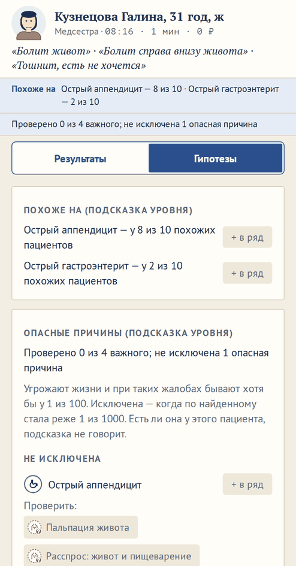

# Подсказка «Практиканту»: опасные причины жалобы

**Версия:** 0.6.13 **Состояние:** сделано

## Зачем

Предложение владельца 24.10.2026: «Может быть у пациента для простого уровня игры (практикант) сделать подсказки сколько
ннвыявленных симптомов осталось и сколько из них тревожных жизнеугрожающих, которые если долго не лечить, возникнут
осложнения.» Вопрос 57 ([#170](https://github.com/Nefeste/anamnez/issues/170)) предложил четыре варианта: счётчик по
правде, подсказку по базе, предупреждение без чисел, ничего. Счётчик по правде говорит, что искать больше нечего или что
опасное есть, ещё до того, как врач о нём подумал, и нарушает правило архитектуры «Правда недоступна интерфейсу». Ответ
владельца — вариант 2: «по базе, а не по больному» — «проверено 5 из 9 важного при этой жалобе; не исключены 2 опасные
причины»: опасные причины жалобы и то, чем их исключают; есть ли они у этого больного, не сказано. Подсказка учит
привычке исключать опасное.

## Что увидит игрок

- **Строка под «Похоже на»** — только на «Практиканте» и только у пациента с жалобами: «Проверено 4 из 11 важного; не
  исключены 2 опасные причины». Все исключены — «…; опасные причины исключены». Опасного при этих жалобах нет —
  «Опасных причин при этих жалобах почти не бывает: каждая — реже 1 из 100».
- **Касание строки** — доска гипотез, карточка «Опасные причины (подсказка уровня)»: что значит «опасная» и
  «исключена», та же строка, ниже — «Не исключены»: болезнь со значком, «+ в ряд» — в ряд гипотез, как из «Похоже на»,
  и «Проверить:» — обследования, касание — что это. Важное при ней проверено, а исключить не вышло — «Важное проверено —
  исключить по нему не удалось». Внизу — «Исключены: …».
- Есть ли опасная болезнь у пациента, подсказка не говорит: она меняется только от того, что врач спросил, осмотрел и
  назначил.

## Правила

- **Опасная причина** — болезнь больницы (отделения смены), которая угрожает жизни (`severity: critical`, в
  энциклопедии — «угрожает жизни»), с вероятностью хотя бы 1 из 100 (`DANGER_FLOOR`) — при одних жалобах, с полом,
  возрастом и сезоном, или по всему найденному. Вероятность — тот же вывод, что «Похоже на».
- **Исключена** — по всему найденному стала реже 1 из 1000 (`DANGER_GONE`).
- **Важное при опасной причине** — её красные флаги из базы, признаки, которые ищет обследование её подтверждения, и
  признаки, которые при ней бывают обычно — у трёх из четырёх и чаще, полоса базы «обычно», — кроме жалоб пациента и
  того, что в этой больнице нечем проверить. **Проверено** — спросили, осмотрели или назначили то, что признак
  проверяет; без повторов по всем опасным причинам.
- **Чем проверить** — на каждый непроверенный важный признак самое дешёвое подходящее пациенту обследование этой
  больницы; без повторов, от дешёвого к дорогому: расспрос и осмотр — раньше анализов и снимков.
- Не исключённые — первыми, внутри — по вероятности при жалобах.

## Замер: почему так

Разумный врач без ошибок обследований, как у «Практиканта»; 1000 пациентов амбулатории и 400 больницы главы 4, все
сезоны.

- **Первое правило** — опасная, если жалоба есть среди признаков болезни, угрожающей жизни, — вышло слишком широким:
  на 60 пациентах больницы главы 4 — в среднем 9 опасных причин, у одного 23, «важного» — 52.
- **Второе** — исключена, если найденное в 10 раз вероятнее без болезни, чем с ней (отношение правдоподобия её
  признаков), — «исключало» настоящую болезнь посреди обследования: у 2 из 33 пациентов амбулатории с болезнью,
  угрожающей жизни (тромбоэмболия лёгочной артерии с нетипичной картиной, сепсис без лихорадки на расспросе).
- **Итоговое** — по вероятности: в амбулатории опасные причины есть у 357 пациентов из 978 с жалобами, после разумного
  врача не исключены у 140; в больнице главы 4 — у 100 из 394 и у 31. Чаще всего не исключены сепсис, острый
  аппендицит и острый коронарный синдром — подсказка просит проверить их до конца. Настоящая болезнь, угрожающая жизни,
  при жалобах в списке у 31 из 33 в амбулатории и у 9 из 9 в больнице; из списка она не исключена ни на одном шаге —
  самая низкая её вероятность по ходу приёма — 1,7 из 100, в 16 раз выше порога. Не в списке — нетипичные:
  тромбоэмболия с одышкой и сухостью во рту (4 из 1000), декомпенсация сердечной недостаточности с одышкой, лихорадкой и
  ознобом (2 из 1000) — при них «Похоже на» видит пневмонию.
- **Важное** сначала было «бывает хотя бы у половины с болезнью»: при диабетическом кетоацидозе с сепсисом — 24
  признака, а у острого коронарного синдрома не попадали ни ЭКГ, ни тропонин: подъём ST и рост тропонина бывают не при
  каждом его виде. Красные флаги, подтверждение и «обычно» — в среднем 6 признаков на причину; у коронарного синдрома —
  давящая боль, подъём и депрессия ST на ЭКГ.
- **Цена**: вид приёма с подсказкой — 8–9 мс, как без неё: ещё один вывод — на одних жалобах.

## Данные

- `VisitView.danger?: DangerHint` — `causes` (`DangerView`: болезнь, `excluded`, `check` — обследования), `checked`,
  `important`; только у «Практиканта» и только при жалобах.
- Считает `dangerHint` в `src/state/caseView.ts` — по базе, жалобам и наблюдениям врача, правды не читает;
  `examsFor` — из `src/engine/med/differential.ts`, как «ищут:» у непроверенного в карточке гипотезы.
- Экран: строка — `PatientCard.tsx`, карточка — `src/ui/case/Dangers.tsx`.
- Движок, база (79) и сохранения не менялись.

## Неудачные случаи

- **Нетипичная картина**: опасная болезнь при жалобах реже 1 из 100 — в списке её нет, пока найденное не сделает её
  чаще (тромбоэмболия: D-димер — и 20 из 100). Так же и в «Похоже на».
- **Важное проверено, а не исключена**: сепсис при лихорадке и частом пульсе — подсказка так и говорит; решать врачу.
- **Исключена другим диагнозом**: в модели у пациента одна основная болезнь; найденное, которое хорошо объясняет
  другая, делает опасную реже 1 из 1000 и без её собственных признаков — так же думает «Похоже на».
- **Дорогое в «Проверить»**: КТ и УЗИ — когда ими подтверждают; они — после расспроса и осмотра.

## Проверки

- `trainee-hint.test.ts`, 7 тестов: подсказка — только у «Практиканта» и при жалобах; без правды — у пациента с другой
  болезнью, теми же жалобами и находками она та же; опасные — угрожают жизни и не реже 1 из 100, в амбулатории чаще их
  нет; проверено растёт с действиями врача и не больше важного; все болезни базы, угрожающие жизни, по три пациента:
  при жалобах в списке — больше 80 %, из списка не исключены ни на одном шаге разумного врача; к концу его приёма
  исключено больше половины опасного; формы слов строки.
- Сценарий в браузере: практика на «Практиканте» — при боли в пояснице «Опасных причин при этих жалобах почти не
  бывает»; при боли в животе — «Проверено N из M важного; не исключены…», касание — карточка с «Проверить:», «+ в ряд»
  — болезнь в ряду гипотез.

## Чего здесь нет

- **Счётчик по правде** (вариант 1) — ответ владельца: по базе, а не по больному.
- **Серьёзные, но не угрожающие жизни причины**: их показывает «Похоже на».
- **Подсказка на других уровнях** и в разборе после приёма.

## Что изменилось по ходу работы

- Правила «опасная» и «исключена» — по замеру выше: первое — слишком широкое, второе исключало настоящую болезнь.
- «Важное» — красные флаги, подтверждение и «обычно» вместо «хотя бы у половины».
