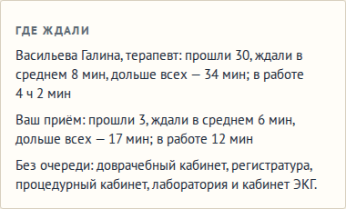

# Где ждали: узкие места больницы по числам дня, второй процедурный кабинет и партии в лаборатории

**Версия:** 0.6.19 **Состояние:** сделано

## Зачем

Предложение владельца 24.10.2026: «При проверках справляется ли больница с потоком - это может быть частью игры, когда
игрок решает нужно ли ему дополнительный лаборант для анализов крови (гистология, микробиология, гематология) или второй
рентген и тому подобное, пятый терапевт - в зависимости от того сколько очередей к кому.» Вопрос 60
([#175](https://github.com/Nefeste/anamnez/issues/175)), ответ владельца: «Да, вариант 2 делаем до 1.0 / 3 делаем
после 1.0». Вариант 2 — видно, где ждут, и каждое решение действует. Вариант 3 (медсёстры по приоритетам, резерв
помогает, таблица «Персонал») — в идеях дорожной карты после 1.0. Это часть 96 дорожной карты.

Что было до 0.6.19:

- Видна только очередь «сейчас»: на карте у помещения — «очередь N», у вашего кабинета — «Ждут: N». В итогах дня
  песочницы — одна цифра: «Ждали долго: в среднем N мин», она идёт в репутацию. Где именно ждали, не видно нигде.
- Второй рентген (как и второй кабинет КТ, ЭКГ, УЗИ) уже делил очередь: пациент идёт туда, где освободятся раньше;
  вторая регистратура и второй доврачебный кабинет — тоже (0.6.9).
- Второй процедурный кабинет не помогал: кровь брали в первом работающем.
- Лаборатория очереди не знала: сколько проб ни принесли, каждая готова через своё время, а вторая лаборатория не
  получала проб вовсе. Лаборант менял только скорость — навыком и чертой.

## Что увидит игрок

- **Итоги дня — «Где ждали»**, карточкой после «Скорой»: по месту — сколько прошли, сколько ждали в среднем и дольше
  всех, сколько место было в работе. Места — по убыванию среднего ожидания, первое — узкое место: «Рентген-кабинет:
  прошли 14, ждали в среднем 24 мин, дольше всех — 51 мин; в работе 3 ч 10 мин». Где в среднем ждали меньше 5 минут —
  одной строкой: «Без очереди: регистратура, доврачебный кабинет и кабинет ЭКГ.»
- **Касание помещения на карте** — то же за сегодня, к этой минуте, двумя строками — строка помещения под картой
  в одну строку экрана: «Сегодня: прошли 14, ждали в среднем 9 мин» и «Дольше всех — 22 мин, в работе 3 ч 10 мин». У
  лаборатории — пробы: «Сегодня: проб 31, …», а у пробы, которую лаборант ещё не поставил, — «ждёт постановки».
- **Второй процедурный кабинет делит очередь**, как второй рентген: кровь берут там, где забор начнётся раньше, с
  дорогой; его забор ещё идёт — новая пробирка туда же, одна вена. Лежащему в смотровой приёмного — как прежде.
- **У лаборатории — пропускная способность.** Лаборант ставит партию — пробы, что пришли вместе, — и пока он её ставит,
  следующая партия ждёт. Вторая лаборатория со своим лаборантом ставит свою партию одновременно: проба идёт туда, где
  лаборант освободится раньше.
- **Решения — те, что есть**: нанять, построить второй кабинет, поставить быстрого или опытного сотрудника. Итоги дня
  говорят, помогло ли.

## Места

| Место | Ждал — от | до | В работе |
|---|---|---|---|
| регистратура | дошёл до стойки | регистратор начал | оформление, 2 мин |
| доврачебный кабинет | дошёл до медсестры | медсестра начала | 3 мин |
| ваш приём | оформили; без очереди — с первой минуты у медсестры | вы позвали | ваши приёмы |
| кабинеты нанятых врачей | так же | он позвал | его приёмы |
| рентген, КТ, МРТ, УЗИ, ЭКГ, эндоскопия | дошёл до кабинета | процедура началась | процедуры |
| процедурный кабинет | дошёл | забор начался | заборы |
| лаборатория | проба дошла | лаборант начал ставить её партию | постановка партий |
| смотровая приёмного | машина приехала | положили на койку | — |

- **Строка на помещение**: у двух рентгенов — по строке, с номером по плану: «Процедурный кабинет 2». Кабинет нанятого
  врача — его имя и должность.
- **Считается, когда случилось**: снимок и забор — с минуты, как начались, а не как их назначили; регистратура и
  медсестра — когда оформили; врач — когда позвал; лаборатория — когда проба дошла. Поэтому «Сегодня» на карте — о том,
  что уже было, а к вечеру то же — в итогах дня.
- **Не считаем**: время анализа и описания снимка — работа аппарата и врача, а не очередь; операционную — у неё свои
  сроки и строка «Операции»; ожидание врача у привезённого скорой — его смотрят в смотровой, там его место — койка.
  Вернувшийся с результатами второй раз врача в счёт не ждёт.

## Лаборатория

- **Постановка партии** — 6 минут и по минуте на пробу (центрифуга, маркировка, загрузка анализаторов) — игровая оценка:
  рекомендаций о времени постановки нет; быстрый лаборант ставит быстрее, как и делает процедуру быстрый
  рентгенолаборант.
- **Постановка — часть времени анализа**: без очереди результат прежний. Ставит предыдущую партию — эта ждёт, и её
  результаты позже на столько же. Так не меняются сроки глав там, где очереди нет, а очередь видна и стоит времени.
- Партия — пробы, что дошли до лаборатории вместе: одна ходка медсестры (часть 89: пока к процедурной очередь, она копит
  пробы и несёт разом). Вы ждёте результата одной из них у себя — партия без очереди, как проба cito: обещанное время
  не сдвигается, а следующая партия ждёт и её.
- **Вторая лаборатория** — со своим лаборантом: проба идёт туда, где он освободится раньше; поровну — в первую. Два
  лаборанта в одной лаборатории — после 1.0, с распределением персонала (вариант 3): у помещения одно место на
  должность.

## Данные

- **Итоги дня**: `summary.waits: Record<номер помещения, { n, total, max, busy }>` — прошли, секунд ждали всего и дольше
  всех, секунд в работе.
- **Смена**: у стойки регистратуры и медсестры — `at` (дошёл); у пробы — `set` (лаборант начал ставить её партию);
  события `{ kind: 'lab'; room; at }` — пробы дошли до лаборатории — и `{ kind: 'served'; room; waited; busy }` —
  снимок или забор начался; `s.rooms[лаборатория]` — до какой минуты лаборант ставит партию.
- **База** — та же: новых записей нет; время постановки — в балансе больницы (`economy.yaml`, `lab: { setup: 6,
  perSample: 1 }`). Поля необязательные, `schemaVersion` прежний.

## Движок

- `collectRoom` для процедурной — та, где забор начнётся раньше (`drawStart` с дорогой), а его забор ещё идёт — та же.
- Лабораторий несколько — проба идёт в ту, где лаборант освободится раньше; поровну — в первую (`examSetup`).
- Проба дошла — событие `lab` (`labBatch`): партия — пробы этой лаборатории с той же минутой `lab`; постановка —
  `(setup + perSample × проб) × скорость лаборанта`; началась позже — результаты позже на столько же, нанятый врач их
  дождётся.
- Ожидание пишет `waitStat` в минуту, когда обслуживание началось: регистратура и медсестра — в событии `nurse`,
  кабинеты — событием `served` в минуту начала, врачи — при вызове, лаборатория — в событии `lab`, смотровая — когда
  положили.
- Прогноз результата (`readyIn`) знает очередь к лаборанту: проба дойдёт, пока он ставит прежние, — подождёт.

## Модели больниц

- Разумный врач — как прежде; модели печатают «Где ждали» по главам: места по среднему, дольше всех, сколько прошли и
  часов в работе в день; кабинеты врачей — по виду, ваш — отдельно.
- Пороги глав держим: постановка — часть времени анализа, сроки там, где нет очереди, прежние.

## Неудачные случаи

- **Лаборатории нет** — анализа нет, как прежде.
- **Сохранение 0.6.18** — у проб в пути нет события лаборатории: анализ по-старому; у оформленных — нет `at`: их
  ожидание у стойки не считается; итоги прошлых дней — без «Где ждали».

## Критерии приёмки

- Итоги дня: «Где ждали» — места по убыванию среднего ожидания, первая строка — узкое место; меньше 5 минут — «Без
  очереди». ✓ (`where-waited.test.ts`, сценарий в браузере)
- Второй процедурный: двое пришли на забор разом — второй идёт во второй кабинет; ожидание у обоих кабинетов меньше,
  чем у одного. ✓
- Лаборатория: лаборант ставит другую партию — эта ждёт, результат позже на столько же; без очереди — прежний; две
  лаборатории — первая занята, проба во вторую. ✓
- Разумный врач на 4 зёрнах глав 2–4 — пороги глав держатся, кроме прежнего «боксы окупаются» (вопрос 27); «Где
  ждали» в моделях — числа по главам. ✓ (см. «Замер»)
- Сценарий в браузере: итоги дня — «Где ждали»; касание регистратуры на карте — «Сегодня: …». ✓

## Замер

`npm run district-sim -- --runs 4 --career-runs 4`: разумный врач, четыре зерна, месяц каждой главы с начала, зима.

| Где ждали, мин: в среднем / дольше всех | Глава 2 | Глава 3 | Глава 4 |
|---|---|---|---|
| ваш приём | 20 / 137 | 23 / 156 | 21 / 216 |
| смотровая приёмного — койка | 2 / 203 | 1 / 107 | 17 / 430 |
| эндоскопия | — | — | 11 / 146 |
| кабинеты нанятых врачей | — | — | 10 / 127 |
| процедурный кабинет | 0,1 / 14 | 0,3 / 20 | 2,5 / 91 |
| лаборатория | 0,1 / 8 | 0,1 / 6 | 0,5 / 14 |

- **Узкое место — врачи**, а не аппараты: ваш приём (разумный врач принимает 13–15 человек в день и занят 6–7 часов)
  и в городской больнице — кабинеты нанятых врачей и смотровая приёмного: машина ждёт свободную койку в среднем
  17 минут, дольше всех — 7 часов, пока койки заняты привезёнными раньше. Регистратура, медсестра, рентген, УЗИ и ЭКГ —
  меньше двух минут в среднем.
- **Лаборатория — без очереди**: в городской больнице 43 пробы в день занимают лаборанта на 3 часа из смены, в
  районной — 11 проб, час. Второй лаборант при таком потоке не нужен; нужен — когда больница больше.
- **Пороги глав** выполнены, кроме того, что не выполнялся и раньше: «боксы окупаются своими больными» в главе 4 —
  267 813 ₽ против 267 900 ₽ (0.6.18 на тех же зёрнах — 246 913 против 263 500; о числе зёрен — вопрос 27). Сроки —
  100 %, 93,4 % и 90,8 % в главах 2–4 (0.6.18 — 100, 93,4 и 91,3): в главе 2 и 3 — то же до рубля, в главе 4 приёмы
  разошлись по времени — 295 сроков вместо 300. Умерших в смотровой нет; карьера — все главы на каждом зерне за 50–86
  смен, как в 0.6.18.
- **Быстродействие** (`--stall --runs 1 --days 3`): худшая команда — 158 мс, 99 % команд — 33 мс (0.6.18 — 161 и 32).

## Проверки

- `where-waited.test.ts`, 12 тестов: регистратура и медсестра — ждал от стойки до начала, в работе — оформление; ваш
  приём — от конца оформления до вызова, в работе — приёмы; рентген — с минуты, как снимок начался; второй процедурный —
  второй на забор идёт туда и ждёт меньше, а его забор ещё идёт — новая пробирка туда же; лаборант ставит партию — без
  очереди результат прежний, ставит другую — эта ждёт и результат позже на столько же, ждёте результата у себя — без
  очереди; две лаборатории — первая занята, проба во вторую; сохранение 0.6.18 — по-старому; итоги дня — по убыванию
  среднего, «Без очереди», на карте — «Сегодня»; занятость — часами и минутами.
- Сценарий в браузере — 438 из 438, ошибок в консоли нет: итоги дня со скорой — карточка «Где ждали»; в песочнице
  касание регистратуры — «Сегодня: прошли …, ждали в среднем …» и строкой ниже «Дольше всех — …». Кадры выше —
  отдельным прогоном на той же веб-сборке: четверо разом на забор в песочнице и конец дня с нанятым терапевтом.
- По ходу работы кадр нашёл, что строка «Сегодня» длиннее строки экрана и обрезалась многоточием, — теперь она в две
  строки; в итогах дня «4 ч 2 мин» больше не разрывается между часами и минутами.

## Чего здесь нет

- **Вариант 3 вопроса 60** — медсёстры по приоритетам, резерв помогает, лежачих везёт медсестра, таблица «Персонал» —
  после 1.0.
- **Гистология и микробиология** — их результаты через дни, в смену не помещаются.
- **Пятый терапевт** — уже можно: кабинет, место в ординаторской, зарплата; «Где ждали» покажет, нужен ли.
