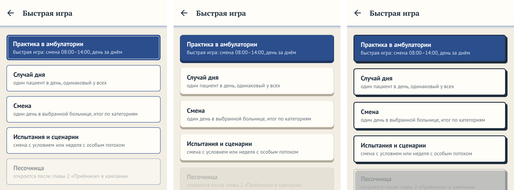
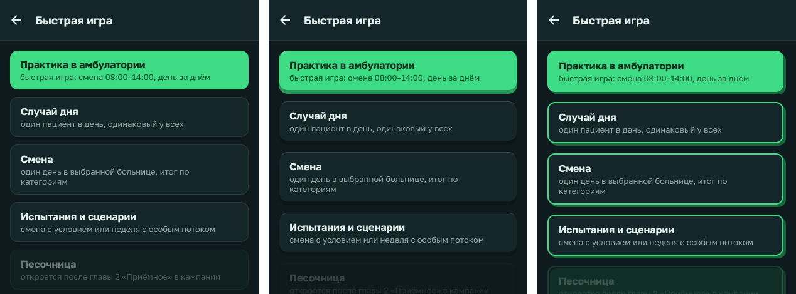
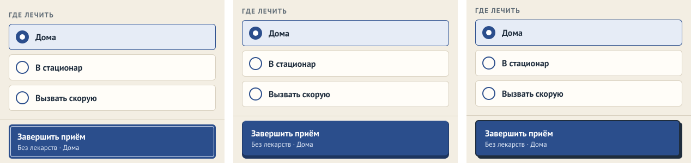
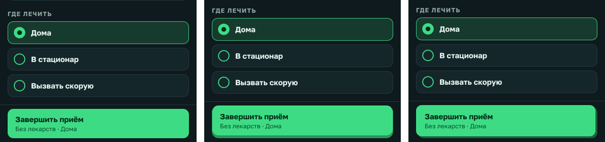
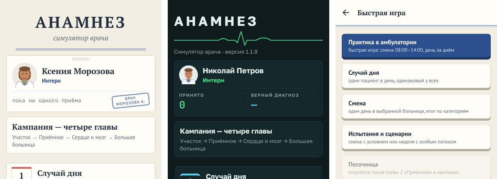
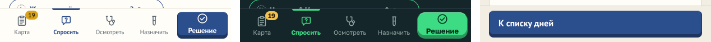

# Вид кнопок: клавиша или контур

**Версия:** 1.1.10 **Состояние:** сделано в коде; вопрос 74 ([#218](https://github.com/Nefeste/anamnez/issues/218)) —
вариант 1, клавиша; нажатие — проверить на телефоне

## Зачем

Владелец 01.11.2026: «Дизайн кнопок можно поглядеть здесь и улучшить, чтобы кнопки выглядели с дизайном», —
и ссылка на страницу «Design Encyclopedia 2026»
([andrewchatgptkz-ops.github.io](https://andrewchatgptkz-ops.github.io/gemini-argon-design-demos/2026.html)).
Сейчас кнопка — плоская плашка: главная — цветом темы, остальные — рамкой; нажатие только чуть гасит её
(`opacity: 0.8`). На телефоне такая кнопка не отвечает пальцу, а рядом с карточками того же вида она сливается с
ними. Часть 106 «Пути к публикации» (мерка «с достойным дизайном»).

## Что на образце

Страница — шесть стилей веба 2026 года, у каждого — «когда стоит» и «когда не стоит»:

| Стиль | Для «Анамнеза» | Почему |
|---|---|---|
| Бенто-сетка | нет | это раскладка плитками, а не вид кнопки; плитки у нас уже есть — итоги дня, оценки случая |
| Необрутализм | вариант Б, смягчённый | чёткий контур и жёсткая тень без размытия; сам образец пишет «не стоит» для медицины — кислотные цвета; у нас — цвета темы |
| «Жидкое стекло» | нет | размытие фона — тяжело для телефона и для чтения поверх карты больницы |
| Тактильный скевоморфизм | вариант А | «интерфейс, который хочется нажать пальцем»: клавиша прибора, вдавливается; близко к приборам и монитору в игре |
| Кинетика и ремесло | нет | крупная анимированная типографика — для витрин, не для кнопок под пальцем |
| Ретро-терминал | нет | у «Монитора» уже свой вид экрана прибора; зелёный ЭЛТ-шум спорит с ним |

Код страницы не переносится: оба варианта — свои, на стилях React Native, без новых пакетов и без теней платформы
(их в интерфейсе игры нет нигде).

## Варианты

Кадры — веб-сборка 1.1.8 с макетом кнопки, 412 × 915: слева — сейчас, в середине — А, справа — Б.

**А. Клавиша.** Под кнопкой — полоска на тон темнее, «губа» в 5 точек; сверху — светлая кромка. Нажатие вдавливает
клавишу: она опускается на 4 точки, губа почти исчезает. Главная кнопка — цветом темы, остальные — цветом листа.

**Б. Контур и жёсткая тень.** Рамка в 2 точки цветом чернил («Медкарта») или темы («Монитор»), сдвинутая вниз-вправо
тень без размытия. Нажатие сдвигает кнопку на тень.

Нажатие на кадрах не видно; в макете оно сделано так, как описано выше.

**Рекомендация — А.** Клавиша отвечает пальцу (вдавливается), не спорит со штампами и рамками «Медкарты» и
продолжает приборы и монитор игры. Б — заметнее, но жёсткая тень рядом с карточками превращает каждый экран в
плакат, а в «Мониторе» зелёные рамки светятся сильнее, чем данные. Вопрос 74,
[#218](https://github.com/Nefeste/anamnez/issues/218).

## Что увидит игрок

По ответу — один вид во всех кнопках-действиях: главная и обычная кнопка (`Button`), «Решение» в нижних вкладках карты
пациента, выбор из нескольких (`Choice` — «Где лечить», уровень сложности), пункты меню «Монитора». Не меняются:
строки журнала в меню «Медкарты» (это журнал, а не кнопки), вкладки-переключатели, чипы вопросов, «?» справки.
Недоступная кнопка — приглушённая, как сейчас.

## Критерии приёмки

- Обе темы, 360 и 412 точек: ничего не обрезано и не наезжает; кнопка не ниже 48 dp.
- Нажатие видно (вдавливание или сдвиг) и не сдвигает соседей: место под губой или тенью занято всегда.
- Проверки сценария в браузере по `testID` не меняются; снимки магазина пересняты.
- Без новых пакетов и без теней платформы.

## Чего здесь нет

- Новых шрифтов и цветов тем (ADR [0017](../adr/0017-own-look.md)) — меняется только форма кнопки.
- Анимаций сверх нажатия.

## Что изменилось по ходу работы

- **Ответ владельца на вопрос 74** (01.11.2026, [#218](https://github.com/Nefeste/anamnez/issues/218)) — вариант 1,
  клавиша. Делается частью 106, по разделу «Что увидит игрок».
- **1.1.10** (01.11.2026). Компонент `Key` в `src/ui/components.tsx`: `Pressable` — губа (`keyLip`, `keyLipPlain` в
  палитре обеих тем), внутри — лицо кнопки со светлой кромкой (`keyLight`, `keyLightPlain`); нажатие меняет только
  поля губы (5 точек снизу → 4 сверху и 1 снизу), поэтому высота клавиши постоянна. Клавишей — `Button` (главная и
  обычная), «Решение» в `CardTabs`, пункты меню «Монитора» и «Случай дня» в нём (`MenuList`, `DailyCard`).
- **Не клавишей, хотя в «Что увидит игрок» были.** «Где лечить» — строки листа назначений (`CheckRow`), как и всё
  лечение в нём: клавишами длинный список стал бы шумным. Уровень сложности — вкладки (`Tabs`), а вкладки не меняются.
  Выбор «Больные» в настройках (`Choice`) — тоже строки.
- **Оттиск штампа у главной кнопки «Медкарты» снят** — как на кадрах макета, по которым владелец выбирал: клавиша с
  кромкой и штамп внутри вместе спорили. Обычные кнопки «Медкарты» — с рамкой цвета края листа, а не чернил, как в
  макете.
- **Сценарий в браузере** читал цвет листа у кнопки «Об игре» по её внешнему блоку — теперь это губа; проверки темы
  берут цвет лица клавиши (первый вложенный блок). Снимки магазина 01–07 и обложка пересняты — на них клавиши.

После 1.1.10 — меню «Медкарты» и «Монитора», «Быстрая игра»; внизу — «Решение» в обеих темах и «К списку дней»:

