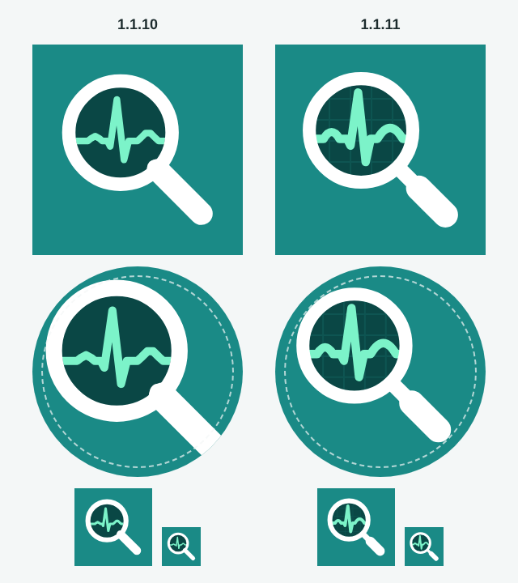

# Вопросы и ответы для карточки, новая иконка

**Версия:** 1.1.11 **Состояние:** сделано; иконку в карточке RuStore меняет владелец вместе со сборкой 1.1.11

## Зачем

Владелец 01.11.2026, пока 1.1.10 на модерации RuStore: «Не хватает раздела FAQ 10 вопросов (до 120 символов вопрос, до
500 символов ответ). Качество иконки посредственное, можно улучшить?» Часть 107 «Пути к публикации».

## Вопросы и ответы

Десять вопросов — то, что игрок спросит до установки: цена, интернет, медицина ли это, возраст, нужно ли образование,
уровни сложности, «Случай дня», своя больница, кампания и куда писать. Ответы — только то, что в игре есть сейчас, и
те же слова, что в описании и настройках; правило «Случая дня» не раскрывается.

- **Карточка** — [`store/listing.ru.md`](../../store/listing.ru.md), раздел «Вопросы и ответы»: вопрос — заголовком,
  ответ — блоком кода, чтобы копировать как есть.
- **Сайт** — раздел «Вопросы» на странице игры: те же вопросы по-русски
  ([`page.ru.md`](../../store/site/page.ru.md)) и по-английски ([`page.en.md`](../../store/site/page.en.md)). В
  английском названия кнопок игры не цитируются: игра пока только на русском.
- **Проверка** — `tools/test/store.test.ts`: вопросов десять, вопрос до 120 символов, ответ до 500, вопросы сайта
  совпадают с карточкой.

## Иконка

Знак прежний — лупа с лентой ЭКГ в линзе на бирюзовом фоне (брендбук студии, ADR [0017](../adr/0017-own-look.md)):
узнаваемость не теряется, рисунок плоский, без градиентов и бликов. Что было не так у 1.1.10:

- **Стык ручки.** Ручка из двух линий с круглыми концами — на стыке с кольцом наплыв, «шишка».
- **Зубцы ЭКГ.** P и T — трапеции из прямых, лента похожа на ступеньки.
- **Адаптивная иконка Android** — знак шире безопасной зоны: край знака на 0,39 стороны слоя от центра, а видно круг
  0,33 (безопасный — 0,31). На круглых значках лаунчеров конец ручки срезался, кольцо касалось края; так же — на
  экране запуска Android 12+, где значок в круге.

Что стало в 1.1.11 (`tools/store/art.ts`):

- ручка — узкая шейка и «пилюля» со скруглёнными концами, без наплыва; длина ручки — чуть больше радиуса линзы;
- P и T — плавные дуги, QRS — острый; линия толще, читается на 48 точках;
- в линзе — сетка монитора на тон светлее стекла (в монохромном слое её нет);
- слои адаптивной иконки: знак вписан по описанному кругу — край на 0,30 стороны (замер по пикселям
  `assets/adaptive-icon.png` и монохромного слоя), внутри безопасной зоны;
- иконка магазина: знак занимает 0,74 стороны, как раньше, но рамка теперь по самому рисунку — он чуть крупнее.

Слева — 1.1.10, справа — 1.1.11: иконка 512 (здесь 260), адаптивная в круглой маске (пунктир — безопасная зона), 96 и
48 точек:

Перерисованы кодом: `assets/icon.png`, слои адаптивной иконки, `favicon.png`, `store/icon/icon-512.png`; со знаком
на графике — `store/graphics/feature-1024x500.png` и `cover-1920x1080.png`.

## Что делает владелец

- **Иконка в карточке RuStore** — `store/icon/icon-512.png`, вместе со сборкой 1.1.11, чтобы значок в магазине и на
  телефоне совпадал; до неё в карточке — прежняя.
- **Вопросы и ответы** — из `store/listing.ru.md`, если в карточке или на странице студии есть такое поле.

## Критерии приёмки

- Десять вопросов: вопрос ≤ 120 символов, ответ ≤ 500; на сайте — те же; тест магазина зелёный.
- Иконка плоская, без градиентов и бликов, без красного креста; читается на 48 точках.
- Слои адаптивной иконки — знак внутри круга радиусом 0,306 стороны.

## Чего здесь нет

- Нового знака или цветов: меняется рисунок, а не бренд.
- Снимков экрана: в игре меняется только иконка.
