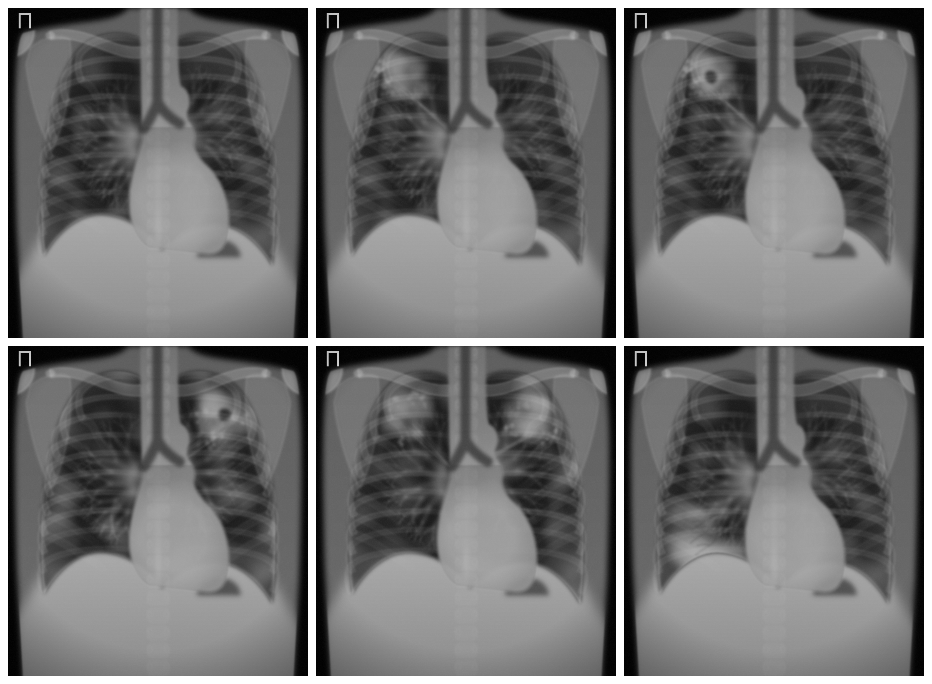
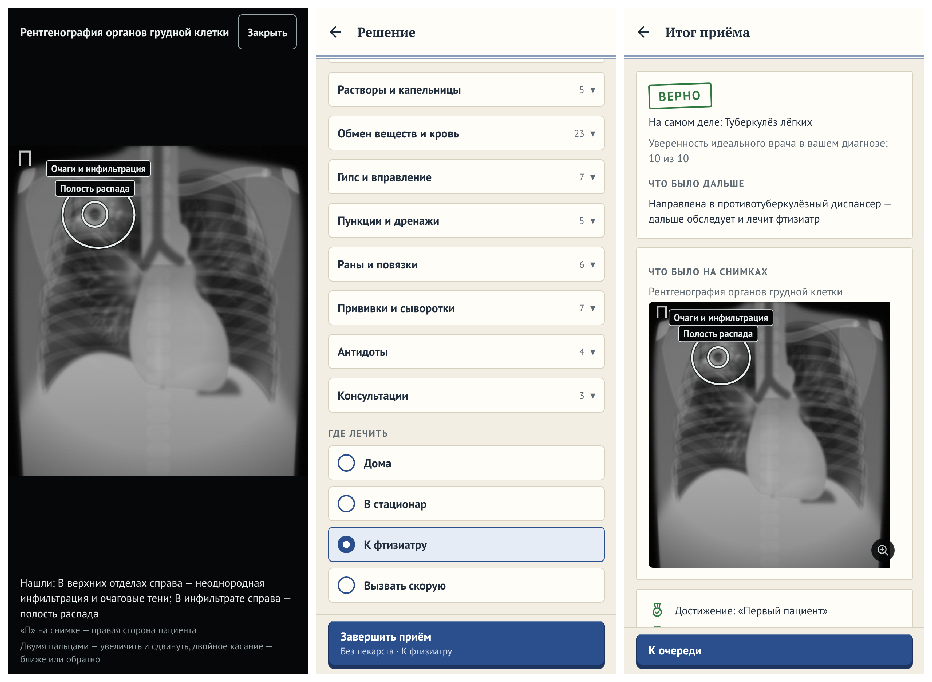

# Туберкулёз лёгких — болезнью для приёма

**Версия:** 1.1.14 **Состояние:** сделано; источник сверен с рубрикатором по карточке от владельца — вопрос 78
([#234](https://github.com/Nefeste/anamnez/issues/234))

## Зачем

Вопрос 77 ([#231](https://github.com/Nefeste/anamnez/issues/231)) по образцу снимка с признаками туберкулёза, который
владелец прислал 20.11.2026 (спецификация [`2026-11-xray`](2026-11-xray.md)). Ответ владельца 20.11.2026 — «вариант 1»:
туберкулёз лёгких — болезнью для приёма, верное решение — направить к фтизиатру, новое место лечения рядом с
«Перевести»; лечит противотуберкулёзный диспансер, схем лечения в игре нет. Часть 110 «Пути к публикации».

## Что увидит игрок

- **Больной.** Впервые выявленный инфильтративный туберкулёз лёгких у взрослого: кашель неделями, слабость, небольшая
  температура к вечеру, ночная потливость, похудание, иногда кровохарканье. Лёгкие часто «молчат»: хрипов мало или
  нет. Реже пневмонии; чаще у мужчин, у тех, кто жил рядом с больным туберкулёзом, и у злоупотребляющих алкоголем.
- **Расспрос.** «Как началась болезнь» отвечает, кашляет ли человек дольше трёх недель; общий расспрос — о ночном
  поте; «Контакты и поездки» — был ли рядом больной туберкулёзом. Кашель дольше трёх недель теперь бывает и при ХОБЛ,
  рефлюксе с кашлем и у курильщиков: такой кашель — повод подумать о туберкулёзе, а не диагноз.
- **Снимок груди.** В верхнем отделе лёгкого под ключицей — неоднородное затенение, вокруг — мелкие плотные очаги
  кучками, к корню — тонкие тяжи; при распаде в затенении — полость с неровной стенкой и воздухом внутри. Сторона — из
  строки находки: справа, слева или с обеих сторон. На «Практиканте» и «Студенте» в снимке крупно обведены «Очаги и
  инфильтрация» и «Полость распада», на «Ординаторе» и «Враче» — задача «Найдите на снимке» (spec
  [`2026-11-xray-marks`](2026-11-xray-marks.md)).

  

- **Мокрота на кислотоустойчивые микобактерии** — новый анализ: мазок под микроскопом, результат в ту же смену. Находит
  не больше половины больных, при распаде — чаще; «не нашли» туберкулёз не исключает.
- **Решение.** На экране решения у любого врача — и в кабинете, и в больнице — новое место **«К фтизиатру»**. Исход —
  «Направлен в противотуберкулёзный диспансер — дальше обследует и лечит фтизиатр». Оставить дома — «меньше нужного» и
  «лечения нет»; положить в общую палату — «больше нужного» и «соседи — контактные»; антибиотики и гормоны — «не
  нужно».
- **Энциклопедия** — статья «Туберкулёз лёгких»: где лечить — «к фтизиатру, в противотуберкулёзный диспансер»;
  «Заразна: передаётся по воздуху»; статьи новых признаков и анализа.

Кадры сценария в браузере, 412 точек: снимок крупно у «Студента», решение «К фтизиатру» и разбор.

## Как сделано

- **База** (`content/`): болезнь `cond.pulmonary_tb` (терапия, A15, лёгкие, `isolation: airborne`, параметры —
  сторона и распад); признаки `sym.cough_3w`, `sym.night_sweats`, `hx.tb_contact`, `lab.afb_sputum`, `img.cxr_tb`,
  `img.cxr_cavity`; фактор риска `risk.tb_contact`; анализ `exam.sputum_afb`. Новые признаки — в расспросах и снимке
  груди. Кашель дольше трёх недель добавлен ХОБЛ, рефлюксу с кашлем и курению. База 88.
- **Место** `phthisiatry` (`Setting`, схема базы): закрывает только себя; в порядке серьёзности — между «дома» и
  стационаром: кому нужен стационар, тому мало; есть всегда (`choiceFor`, варианты смены, «Разобрать случай»,
  «Случай дня»). Направленного лечат не у нас: «лечения нет» не ставится. Правило базы «заразной болезни нужен бокс»
  принимает и «К фтизиатру»: туберкулёз изолирует диспансер.
- **Разумный врач** направляет к фтизиатру только по снимку груди: до решения — рентген, как до операции —
  подтверждающее обследование (`confirmBeforeInvasive`).
- **Рисунок** — `src/render/xray/chest.ts`, шаг «5г», своё зерно (`xray-tb`): рисунок остальных находок при туберкулёзе
  не меняется. Геометрия — `tbCenter` и `tbCavity` в `chestGeometry.ts`, одна для рисунка и разметки (`marks.ts`).
  Полость без описанных теней (рентгенолог их не увидел) рисуется вместе с тенями: полости в пустом лёгком не бывает.

## Источники и доли

- Клинические рекомендации «Туберкулез у взрослых», ID 16_4, год утверждения 2025, пересмотр не позднее 2027,
  размещены 16.01.2026, применяются; разработчики — Российское общество фтизиатров и «Ассоциация фтизиатров», одобрены
  Научно-практическим советом Минздрава России: разделы 1.3 (заболеваемость 26,9 на 100 000 в 2024 году), 1.5
  (инфильтративный туберкулёз, возможна деструкция; фазы — инфильтрации, распада, обсеменения), 1.6 (интоксикация,
  ночные поты, кашель, кровохарканье, постепенное начало, контакт с больными), 2 (диагноз подтверждает комиссия врачей
  противотуберкулёзной медицинской организации), 2.2 (скудность физикальных проявлений), 2.3 (УУР B, УДД 1: микроскопия
  — не менее двух образцов, находит не больше 50 % впервые выявленных), 2.4 (УУР B, УДД 1: рентгенография лёгких в двух
  проекциях и/или КТ), 6 (при бактериовыделении и осложнениях, в том числе кровохарканье, — госпитализация в
  круглосуточный стационар). Текст прочитан 20.11.2026 по копии документа.
- Приказ Минздрава России от 15.11.2012 № 932н «Об утверждении Порядка оказания медицинской помощи больным
  туберкулезом», зарегистрирован в Минюсте России 07.03.2013 № 27557: пункт 9 — рентген груди, общий анализ крови и
  мокрота на КУМ при подозрении; пункт 11 — кого обследовать: кашель больше 3 недель, кровохарканье, интоксикация 2
  недели и больше; пункт 12 — направить в противотуберкулёзный диспансер в 3-дневный срок при очагах, инфильтрации,
  полостях на снимке и КУМ в мокроте.
- Игровые оценки, подписанные в записях: доли признаков и параметров, множители факторов риска, точность расспросов и
  чтения снимка, сроки и цена анализа, верхние отделы как место теней.

**Вопрос 78 ([#234](https://github.com/Nefeste/anamnez/issues/234)) — сверка с рубрикатором.** Рекомендации Минздрава
база ссылает на карточку рубрикатора `cr.minzdrav.gov.ru/view-cr/<код_версия>` с датой публикации и отметкой о сверке
(`sources.test.ts`). 20.11.2026 рубрикатор из среды разработки был недоступен — соединение сбрасывалось, через сервис
загрузки страниц — ошибка 503; на зеркалах — только «ID: 16», без версии, а текст, который удалось прочитать, был
версии 2024 года (16_3). Владелец в тот же день прислал карточку из рубрикатора: ID 16_4, год утверждения 2025,
размещены 16.01.2026, применяются. Текст 16_4 прочитан по копии и сверен со всем, на что ссылаются записи: отличий от
16_3 три — заболеваемость (26,9 на 100 000 в 2024 году вместо 31,1 в 2022), микроскопия — «не менее двух образцов»,
УУР B вместо C, рентгенография — «в двух проекциях и/или КТ», УУР B. Игру они не меняют. Ссылки — на карточку 16_4.

## Чего здесь нет

- Схем химиотерапии, доз и препаратов: лечит фтизиатр (ADR 0012 устава).
- ПЦР и посева мокроты, пробы с аллергеном туберкулёзным рекомбинантным и КТ груди: их делает диспансер; в игре они
  результата за смену не дают. Можно добавить отдельной частью, если понадобятся для «Найдите на снимке» на КТ.
- Флюорографии на профилактическом осмотре и внелёгочного туберкулёза — вариант 2 вопроса 77 не выбран.
- Глав и сценариев «Смены» про туберкулёз: болезнь приходит на приём сама, по доле в отделении терапии.
