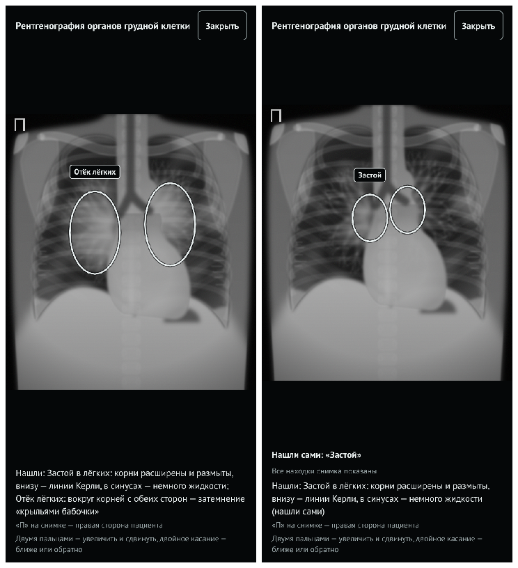

# Разметка находок на снимке и «Найдите на снимке»

**Версия:** 1.1.13 **Состояние:** сделано; на телефоне проверить касание места находки

## Зачем

Вопрос 76 ([#230](https://github.com/Nefeste/anamnez/issues/230)) по образцу, который владелец прислал 20.11.2026
(спецификация [`2026-11-xray`](2026-11-xray.md)): на образце находки обведены контурами с подписями. Ответ владельца
20.11.2026 — «вариант 1 и задачу 3»: разметка подсказкой на лёгких уровнях и в разборе, и задача «Найдите на снимке».
Часть 109 «Пути к публикации».

## Что увидит игрок

- **«Практикант» и «Студент».** В снимке крупно находки рентгенолога обведены и подписаны: «Инфильтрат», «Воздух»,
  «Жидкость», «Перелом ребра», «Широкое средостение», «Большое сердце», «Застой», «Отёк лёгких», «Свободный газ»,
  «Петли с уровнями», «Перелом». Подписи следуют за увеличением и сдвигом, сами не растут.
- **«Ординатор» и «Врач».** Контуров сразу нет; внизу — «Найдите на снимке». Игра спрашивает: «Где „Инфильтрат“?
  Коснитесь этого места». Попали — «Нашли сами», строка снимка в карте отмечается «нашли сами»; не попали или нажали
  «Показать» — без штрафа, контур виден. Попытка — одна на находку; показанное остаётся обведённым.
- **Разбор** — на любом уровне: карточка «Что было на снимках», контуры прямо на снимке; касание — снимок крупно.
- **Профиль.** Попадания копят новую специальность «Лучевая диагностика» — по одной за находку; пороги те же, что у
  отделений: 10, 40, 100, 250. Со второго уровня — умение «Чтение снимков»: свой снимок и срез игрок смотрит сам —
  результат без ожидания описания рентгенолога. Это умение из геймдизайна, §12: «Чтение снимков (лучевая 2): снимок
  виден до описания, можно решить самому».

Кадры сценария в браузере, 412 точек: слева — «Студент», отёк лёгких обведён сразу; справа — «Врач» после задачи:
застой показан самим, строка — «нашли сами».

Разметка есть у обзорного снимка груди, снимка живота и снимков костей. У КТ, МРТ и УЗИ — нет: их срезы рисуются
другой геометрией, разметка для них — отдельной работой, если понадобится. Эмфизема не обводится: она по всему
лёгкому. Выпот в колене пока не обводится: его тень на боковой проекции рисуется своей фигурой, её перенос — потом.

## Как сделано

- **Геометрия** — `src/render/xray/marks.ts`, без Skia: контуры в долях кадра из той же геометрии и того же зерна, что
  рисунок. Инфильтрат — овал вокруг облака (`infiltrateCenter` в `chestGeometry.ts` — одна для рисунка и разметки),
  воздух — плевральная полость стороны, жидкость — от её верхней границы до купола, переломы рёбер — места переломов,
  застой — корни, отёк — «крылья бабочки», живот — серп газа и середина живота, кости — овал вокруг линии перелома на
  каждой проекции. Попадание (`hits`) — внутри контура или в 3,5 % ширины кадра от края: палец толще линии.
- **Карта пациента** (`caseView.ts`): у группы результатов — `marks`: находка базы, подпись, контур; только у
  показанных строк. У вида — `marks: 'show' | 'find'`: «Практикант», «Студент», разбор и приём нанятого врача — `show`,
  «Ординатор» и «Врач» — `find`; `looked` — попытки; строка с попаданием — `self`, в карте — «· нашли сами».
- **Смена** — команда `look` (`engine.ts`): находка и попал ли; одна попытка на находку, только показанной находки
  пришедшего снимка, только своего приёма; времени не тратит. Попытки — в пациенте смены (`looked`), в сохранении.
  У «Случая дня», «Разобрать случай» и прототипа задачи нет: контуры видны сразу, как у «Студента».
- **Профиль** (`recordCases`): попадания закрытого приёма — опыт `dept.radiology`. Умение — запись базы
  `content/career/skills/radiology_reading.yaml`, эффект `imageReport`: у снимков и срезов игрока (обследования
  `imaging`) время описания — ноль (`reportMinutes`); у нанятых врачей и «Виртуального врача» — как в базе.
- **Просмотр** (`ImageViewer.tsx`): контуры — путями Skia внутри преобразования увеличения, с тёмной каймой под светлой
  линией; подписи — над контуром, следуют за увеличением; одно касание в задаче ждёт, не двойное ли оно.

## Проверки

- `xray-marks.test.ts`: контуры на своей стороне и вокруг места рисунка; попадание и промах; в карте — только у
  показанных строк; уровни и разбор; попытка одна и только своя; опыт лучевой диагностики и «Чтение снимков» — снимок
  без описания, анализ — как в базе, срок готовности снимка короче ровно на описание.
- Сценарий в браузере: отёк лёгких у «Студента» — обведён сразу; тот же больной у «Врача» — «Найдите на снимке»,
  касание места — «Нашли сами», строка карты отмечена; в разборе — «Что было на снимках».

## Чего здесь нет

- Штрафа за промах: задача учит, а не наказывает.
- Подсказки, где искать: игра называет находку, место показывает игрок.
- Разметки КТ, МРТ и УЗИ, эмфиземы и выпота в колене — выше, почему.
