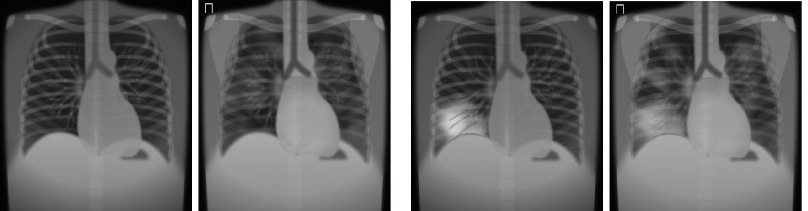
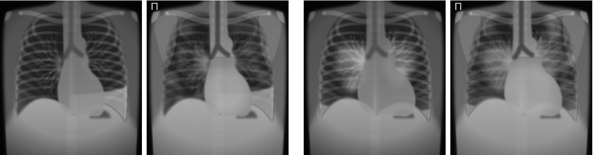
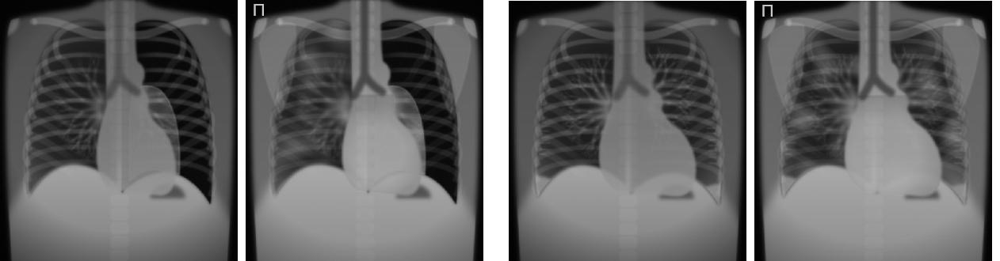
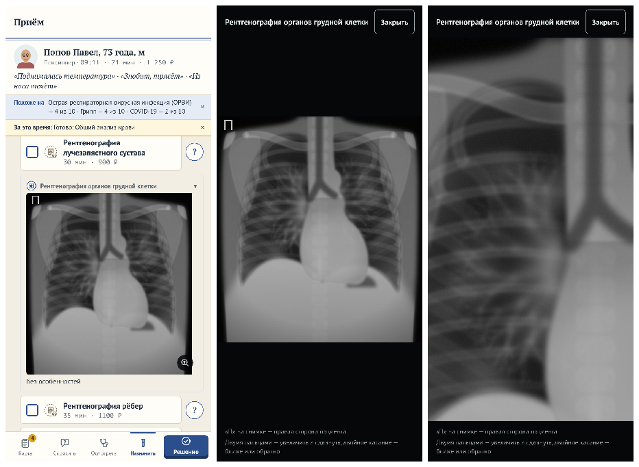
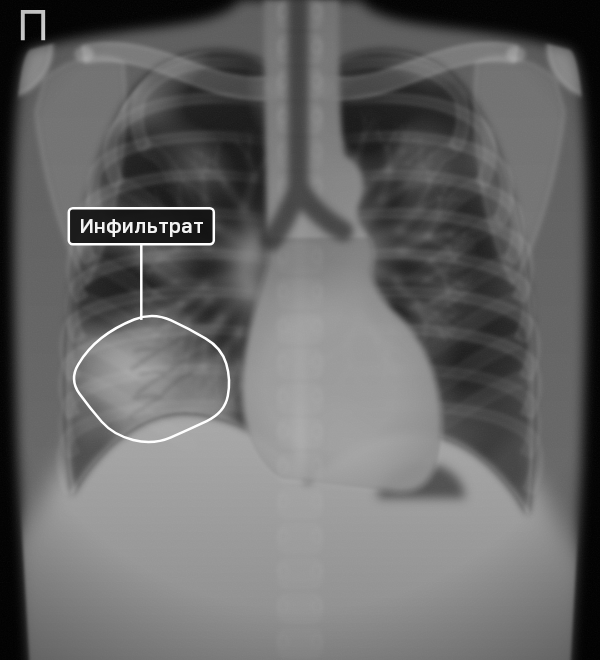

# Рентген груди: ближе к плёнке, снимок крупно

**Версия:** 1.1.12 **Состояние:** сделано — рисунок снимка груди и просмотр крупно; разметка находок и туберкулёз —
вопросы 76 и 77

## Зачем

Владелец 20.11.2026 прислал снимок экрана программы, которая ищет на рентгенограммах признаки туберкулёза: «посмотри
пример рентгена с признаками туберкулеза. Подумай как можно улучшить наши картинки сгенерированного рентгена, а также
интерфейс вокруг». Снимок образца в репозиторий не кладётся: это рентгенограмма настоящего человека и чужая программа.
Ниже — словами, что на нём есть.

## Что на образце

**Снимок** — прямая проекция груди взрослого: плотные белые ключицы, лопатки, головки плечевых костей; рёбра видны
отчётливо, задние ярче передних; тёмные лёгочные поля с мягким сосудистым рисунком, гуще у корней; белая тень сердца с
чёткими краями; трахея — тёмный столб воздуха над позвоночником; купола диафрагмы — светлые дуги. В углу — свинцовая
буква стороны. Признаки туберкулёза — неоднородные затенения в верхних отделах обоих лёгких и очаг в левом лёгком ниже
корня.

**Вокруг снимка** — просмотрщик: чёрное поле во весь экран, миниатюры снимков исследования слева, панель внизу —
контраст, увеличение, сдвиг, поворот, переключатель «контуры — тепловая карта». Находки обведены контурами с подписями на
выносных линиях. Справа — заключение: впечатление, находки, оценка уверенности.

## Что не так у нашего снимка (1.1.11)

| Что | На плёнке | У нас было |
|---|---|---|
| плотности | сердце и живот — одинаково белые, лёгкие тёмные | сердце — почти как мягкие ткани, живот — самое белое на снимке: снимок «молочный» |
| лёгочная ткань | неровная, с мягким сосудистым рисунком | пустая чёрная, сосуды — тонкими светлыми «волосками» |
| рёбра | заметны, но не спорят с лёгкими | ровной лесенкой одной яркости |
| трахея | тёмный столб воздуха | светлее позвонков: позвонки ложились поверх |
| кости пояса | ключицы плотные, видны лопатки и головки плечевых | ключицы тонкие, лопаток нет |
| инфильтрат, отёк | серое затенение плотности мягких тканей, сквозь него не видно сосудов | светящееся пятно светлее кости |
| сторона | свинцовая буква | нет — только подпись на странице «Проверок» |
| просмотр | во весь экран, с увеличением | только в строке карты шириной экрана, без увеличения |

## Что сделано в 1.1.12

**Рисунок** (`src/render/xray/chest.ts`) — та же геометрия и те же находки, другие плотности:

- сердце и средостение плотнее, к краям тень тоньше; живот под куполами — не ярче сердца;
- лёгочная ткань — плавная неравномерность плотности, сосуды мягче, заметнее и тают к периферии, корни плотнее. Мелкий
  шум пробовали: здоровые лёгкие с ним читались как мелкоочаговое поражение, а в игре о диагностике норма должна
  выглядеть нормой;
- тело рёбер прозрачнее, остался корковый край; ключицы толще и плотнее; лопатки — внутренним краем по верхним наружным
  отделам лёгких; головки плечевых костей — с корковым краем;
- позвонки — с корнями дужек, за сердцем и под куполом бледнее; трахея — тёмный столб поверх позвоночника;
- инфильтрат и отёк — серое затенение обычным наложением, а не светом: облако не светлее мягких тканей, внутри у
  инфильтрата — тонкие ветвящиеся бронхограммы;
- метка стороны — буква «П» над правым плечом пациента (на снимке — слева): правое лёгкое видно сразу;
- затемнение краёв слабее.

Проверки рисунка (`tools/test/imaging.test.ts`: где светлее и где темнее при каждой находке, то же зерно — те же байты)
не менялись и проходят.

Кадры — страница «Проверок» веб-сборки, 412 точек; в каждой паре слева 1.1.11, справа 1.1.12. Норма и инфильтрат справа
внизу:

Жидкость слева внизу и отёк лёгких:

Большой пневмоторакс слева и застой с большим сердцем:

**Снимок крупно** (`src/ui/case/ImageViewer.tsx`). В углу снимка в карте пациента — лупа; касание открывает снимок на
весь экран, на чёрном фоне: двумя пальцами — увеличить до 5 раз и сдвинуть, двойное касание — приблизить в 2,5 раза к
этому месту или вернуть. Снимок перерисовывается по ширине экрана и увеличивается преобразованием холста — линии
остаются чёткими. Внизу — что нашли, у рентгена груди — что «П» значит правую сторону. «Закрыть» и «назад» Android
возвращают в карту. Так открываются все снимки и срезы — рентген, КТ, МРТ, УЗИ, ЭГДС; ЭКГ — нет: лента и так во всю
ширину, а подписи отведений — текстом поверх. Цвета негатоскопа — в палитре (`film`, `onFilm`, `onFilmMuted`),
одинаковые в обеих темах, как сами снимки.

Кадры сценария в браузере: снимок в карте с лупой в углу, снимок крупно, двойное касание — ближе:

Снимок магазина `02-xray.png` и обложка `cover-1920x1080.png` (на ней тот же экран) пересняты: на них новый рентген.
Остальные снимки магазина не менялись.

## Что дальше — вопросы владельцу

- **Вопрос 76 — разметка находок на снимке** (контуры с подписями, как на образце): на каких уровнях сложности и где —
  подсказкой, в разборе или задачей «найди на снимке». Макет — наш снимок с инфильтратом справа:

  

- **Вопрос 77 — туберкулёз лёгких в базе.** Сейчас его в игре нет: снимок с очагами и полостью нечему показывать.

Без вопроса, в очередь графики: тени молочных желёз у женщин (рисовальщик пола пациента не знает), инверсия и контраст в
просмотре крупно, сравнение со снимком прошлого приёма.

## Критерии приёмки

- Проверки рисунка груди проходят без правки порогов; то же зерно — те же байты.
- На странице «Проверок» и в карте пациента: сердце плотнее лёгких, трахея тёмная, «П» — слева вверху; инфильтрат —
  серое затенение, не свечение.
- Снимок крупно открывается касанием и закрывается «Закрыть»; двойное касание приближает; ничего не обрезано на 360 и
  412 точках; кнопка «Закрыть» — не ниже 48 dp.
- Цвета — только из палитры; контраст надписей на чёрном — не меньше 4,5 к 1 (`theme.test.ts`).

## Чего здесь нет

- Новых находок и болезней — только вид тех, что есть.
- Генераторов изображений: всё рисует код (ADR 0013, ADR 0012 устава).
- Вида чужой программы: подписи, контуры и панели образца не переносятся.
